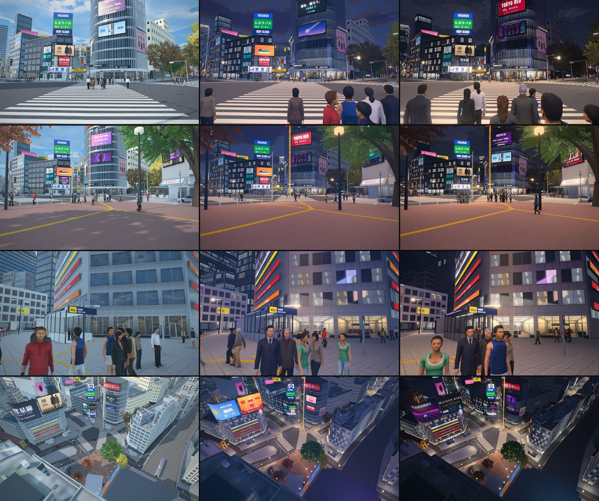
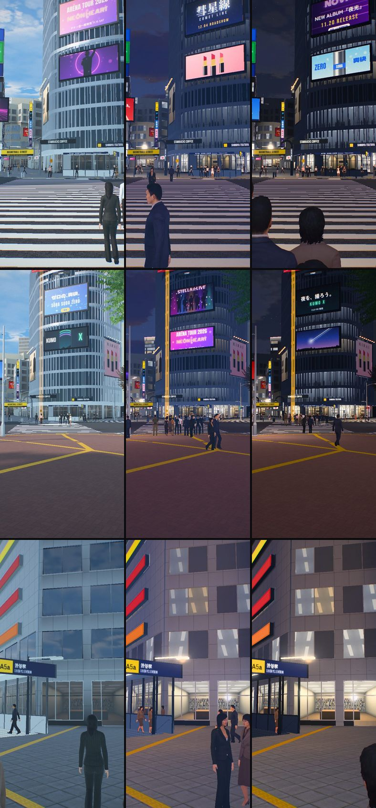

# Hero levels: a street modelled finely

> **Scope, November 2026.** The project is now one story on one map: Blue Hour, at the Shibuya Scramble
> ([STORY.md](STORY.md)). This page was written while the project built many maps, a globe and a model viewer.
> Where it names another city, the title screen, the viewer or the reef sites, it describes work kept at the tag
> `archive/world-2026-11`; the shared code it explains is the code Shibuya runs.

Asked for in November 2026 for Tokyo's live maps: one small level per map, a street or a crossing some
200-300 m across, that reads at eye level as a photograph or a current game does, while the rest of
the map stays as it is around it. Shinjuku's is Kabukicho Ichibangai (`cities/shinjuku/hero.py`);
Shibuya's scramble is built by its own session on the same kit; Marunouchi-Ginza's (Tokyo Station) is drawn as
landmark meshes, below. Sydney's is Circular Quay West, where its game starts (`cities/sydney/hero.py`), and
Queenstown's the Skyline deck on Bob's Peak (`cities/queenstown/hero.py`): stone, timber and a water's edge
rather than a street of signs. Kyoto's two (Yasaka-dori, the Omotesando of Fushimi Inari) are on the kit with
Japanese traditional pieces, below.
Three more stand by a map's spawn: Kamakura's is the hill road above the Kamakurakokomae crossing
(`cities/kamakura/hero.py`), Tetsugaku's the head of the Philosopher's Path (`cities/tetsugaku/hero.py`),
and Kyoto's the station's north forecourt under Kyoto Tower (`cities/kyoto/hero.py`).

| What | Where |
|---|---|
| The loader, in every map's game | `web/game/hero.js` (`OEHero`), started by `web/game/game.js` from `game.hero` |
| The kit: geometry by material, the atlas, the bake, Blender and the export | `blender/hero_kit.py` |
| Parts: paving laid on the game's ground, a wall's frame with openings, windows, lamp posts, benches, bollards | `blender/hero_parts.py` |
| The measured things under a level: OpenStreetMap's map of its rectangle, in local metres | `python pipeline/hero_osm.py --city <id> --box x0 y0 x1 y1` -> `cities/<id>/hero_osm.json` |
| The ground a level is laid on: the game's own walking surface, sampled | `node tools/ground_probe.js <id> x0 y0 x1 y1 > cities/<id>/hero_ground.json` |
| Parts for a level in the open: ground draped on the terrain, retaining walls, hedges and shrubs, utility poles and wires, signs | `blender/hero_open.py` |
| The build | `python blender/build_hero.py --city <id>` (needs `pip install bpy==5.2.3` and Node) |
| A map's level | `cities/<id>/hero.py` (`build(kit)` returns geometry, atlas, materials and its centre) |
| Its place in the game | `cities/<id>/city.json` `game.hero` (copied into `game.json` by `pipeline/game_text.py`) |
| Its stills | `tools/views/<id>-hero.json`, taken with `tools/scramble_shot.js` (which waits for a hero level to load) |
| Its check | `tools/game_check.js`: walked up to, it loads and shows and hides what it replaces; left, it is let go |

## How it works

**Drawn over the city, not instead of it.** A hero level's fronts stand a few centimetres in front of the
city's own walls (the shop fronts 0.5 m, the floors above 0.22 m), and its paving 4 cm over the ground,
so the city's buildings, ground, collision and surface model need no change, and the level can come and
go. Its glass and its recesses lie between its face and the city's wall. What the city draws that the
level draws again finely (Kabukicho's tenant stacks and fascias on Ichibangai) is built into landmark
meshes of their own (`kbhero_*`, `cities/shinjuku/kabukicho.py` `in_hero`) and hidden while the level is
shown (`game.hero[].hide`).

**Streamed.** It is fetched when the camera comes within 260 m of its edge, shown within 420 m, and let go
(geometry and textures freed) past 520 m. On the low tier (phones) every texture is halved before it is
sent to the GPU, a quarter of the memory, and on a phone's lean sub-tier no side is over 1024; it is resized by
`createImageBitmap`, not through a full-size canvas. Its shaders are compiled and its textures sent in idle time
before it is first shown (`world.js` `upload`, `compile`), so it does not stall a frame. The low tier draws it without
normal and roughness maps; the paving's roughness came in glTF's one metallic-roughness picture (its metalness 0 in
it) with the factors beside it at glTF's default of 1, so without the picture the asphalt, the crossings' paint, the
pavers and the setts were a rough metal on every phone, lit by the sky's reflection and by no lamp, until November
2026: `hero.js` now sets what the picture said (no metal, a paving's roughness) as it lets it go.

**What cannot be seen costs nothing** (issue 358, from first principles). A level is paid for in four
currencies: bytes fetched, memory held, triangles drawn and pixels shaded. Each is spent only where the eye is:

| Cost | What decides it | How the level spends it |
|---|---|---|
| Fetched and held at all | how far the level is | nothing within 260 m: nothing fetched; past 520 m: everything freed |
| The finest geometry (glazing bars, a railing's rails, bench arms, joints) | whether it covers a pixel | a second model, `<id>_fine.glb` (`Geo.fine`, plain materials only, so no texture is held twice): fetched only when the camera is inside the level, each 22 m square of it drawn only within `fine_m` (70 m) of the camera, and never fetched on the low tier |
| Triangles and draws behind you | the view | the level is cut into squares (`meta["cell"]`, one mesh per material and square), so three.js's frustum test leaves out what is off screen; at Sydney's start about half the level |
| Texture memory | the screen's pixels, not the texture's | a material carries only the maps that show (`maps`: `"c"`, `"cn"`, `"cnr"`): bark, grass and distant render have no roughness map; on the low tier no normal or roughness maps at all and every colour map halved, on a phone's lean sub-tier no side over 1024 |
| Light after dark | nothing per frame | baked into the vertices, below: no light is evaluated at run time |

Measured on Sydney's level (`tools/mem_check.js`, the phone tier): the GPU peak went from 531 MB without the
level to 546 MB with it (budget 700), and the heap from 465 MB to 470 MB (budget 880); the fine model is never
fetched there.

**Light baked into the vertices.** After dark a street like Ichibangai is lit by its signs and shop
fronts, not by its lamps. Each lit face (a sign's panel, a fascia, a shop's glass, a vending machine,
a lantern) is a set of small area lights a metre apart, in the mean colour of what is drawn on it; every
vertex of the level sums them (the cosine at the light and at the vertex over the square of the
distance, `hero_kit.bake`), and the corners' occlusion from the walls is added, into its `_BAKE`
attribute. `hero.js` adds that light in the surface's own colour after dark (`uNight`) and lets the
occlusion take the sky's light by day. The city's street lights (`world.js` `streetLit`) still reach it,
at the share `game.hero[].street` gives (Kabukicho 0.35), since its own lamps are baked. No lightmap
texture, no second UV set, and nothing for a phone to compute.

**Materials by name** (Blender's, kept in the glTF): `win*` windows (the rooms' light is turned up with the
night; a `tint` darkens the glass by day), `glow*` lit signs (their emissive at
`game.hero[].glow`: by day and by night), `tube*` neon tubes (which stutter now and then), `win*`
windows (dark glass by day, rooms lit after dark), `ground*` what you walk on (wet in the rain; on the high
tier it takes the wet street's reflection, `mirror.js`). A material's tint (the building's colour over a
shared texture) travels in its glTF extras.

**Textures.** CC0 PBR sets from ambientCG at 1K (colour, normal, and roughness packed into glTF's
metallic-roughness image), as WebP inside the model: `PavingStones136` (Ichibangai is paved: OpenStreetMap
`surface=paving_stones`, and the ward's plans keep both streets paved), `Tiles036` (the small square
facing tiles of Japan's mixed-use buildings), `Plaster001`, `Concrete034`, `Tiles138`; and for stone, timber and a water's edge `Bricks066` (smooth coursed ashlar),
`Bricks083` (squared rubble), `PavingStones125A` (sawn granite planks), `PavingStones131` (setts), `Grass004`,
`Planks040` (grooved deck boards), `Granite005A`, `Travertine009` (sawn bedded stone), `Rock051` (schist) and
`Bark014`. A grey texture is brought to a stone's colour by a tint computed from its mean
(`hero_kit.tint_to(key, sRGB)`), so one ashlar serves Sydney's sandstone and a bluestone alike. Everything
drawn (sign panels with the tenants' names, shop interiors, rooms behind the windows, vending machine
fronts, menu boards, air conditioners, manhole covers, grates) is one atlas, drawn in Python with the
project's open fonts (`pipeline/adkit.py`).

## The Scramble (Shibuya)

The Shibuya map's game opens on Hachiko Square at the junction's south-east corner, looking across the
diagonal to QFRONT. The level (`cities/shibuya/hero.py`, `hero/scramble.glb`) is the hundred metres round the
junction, and its first part is what fills most of the frame from eye level: the ground.

- **The carriageways**: one asphalt surface on the game's own road bands, a 50 cm concrete gutter along every
  kerb, flush granite kerbs, manholes and gully grates. The asphalt is ambientCG's `Asphalt031` with its
  aggregate a little clearer (`asphalt_texture`). Clean and of one tone: no patches, stains or wear ("The bar"
  in AGENTS.md: the ground is never aged).
- **The paint**: the five crosswalks at the places measured off GSI's aerial photograph
  (`scramble.CROSSWALKS`), stop lines, the diamonds before them and centre lines, in an even off-white
  thermoplastic with the grain of its glass beads (`paint_texture`).
- **The pavements**: grey blocks (`PavingStones136`), and Hachiko Square in the red-brown block the 2024
  photographs show, drawn here (`cities/shibuya/scramble_tex.py` `plaza`, below); the yellow tactile blocks
  with their bars and domes in relief (JIS T 9251's pattern, `tactile_texture`), laid as Japan lays them
  (`scramble.tactile_layout`, below); a cast-iron grate round each mapped tree.
- **On the kerbs**: white guard pipes between the crosswalks, and steel lamp posts whose light is baked.
- **The fronts** (`Level.fronts`, `front`): each wall a player can see from the junction's roads and pavements
  (eye points on a 7 m grid within 70 m, no building between), of the buildings the landmarks do not draw whole
  (QFRONT, 109, MAGNET, Seibu and the station keep their own). A skin 10 cm in front of the city's plain wall:
  a glazed street floor between piers on a dark stone foot, onto a lit shop drawn as its light (shelves, a
  cafe's counter, a clothes rail); above it, storey by storey, facing tile or panel with windows set back in
  their reveals, aluminium frames, sills, and a coping on the parapet; behind each pane a room, lit or dark
  after nightfall. Where a landmark's print or screen hangs on the wall the skin is cut away behind it
  (`behind`), so no picture is covered. One grammar; the buildings that face the junction take their wall and
  their windows from `FRONTS` (below), the rest one of three quiet facings.
- **Light from the sky** (`hero_kit.sky_occlusion`, meta `sky_rays`): each vertex keeps the share of the sky it
  sees, baked, so a reveal, a canopy's underside and the foot of a wall are darker than the open ground.

It hides the landmark meshes it draws again (`p5_plaza`, the junction's flat asphalt, paint, tactile strips and
guard pipes); the entrances, the tracks, Hachiko and the signs stay the landmarks'.
153,000 triangles, 8.1 MB; nothing is built under a building, in a stair well, on a wall no player sees or past
100 m. Its fine model (`scramble_fine.glb`: the shop doors' stiles, rails and pull handles, the lamp posts'
bands; 14,000 triangles, 0.5 MB) is fetched on the high and medium tiers once the camera is in the level, drawn
within 60 m, and never fetched on a phone.

**QFRONT against its photograph.** The landmark drew the building as navy glass under a white grid with a plain
band for a street floor. From the 2025 photograph of it across the crosswalk: the outer skin is now glass that
mirrors the sky over a dark pane (`x_qf_glass`), each floor's edge a silver band 0.8 m deep behind the fins
(`scramble.qfront`), and the level draws the street floor (`Level.qfront_base`): the shopfront line a metre
behind the face, glazed from a stone foot to the canopy's soffit onto lit shops, with the building's round
columns in silver cladding standing free in front.

**Glass that read as milk.** Two causes, both found with the still tool's ray probe
(`PROBE=fx,fy tools/scramble_shot.js`: what stands along the ray through a point of the frame). The subway
entrance's panes had a pale colour of their own, and four of them one behind another whitened everything seen
through them: clear glass has almost no colour of its own, only what it mirrors (`x_glass` is now near black at
16%). And glass at street level mirrored the game's environment, which is the sky alone, where a photograph
shows the shaded fronts across the street: a hero material's `sky` (hero_kit; `envMapIntensity` in `hero.js`)
is the share of the sky it mirrors, 0.15 for shop glass. By day a shop's own light is `glow[0]` 0.24: a room
seen from a sunlit street is darker than the street.

**Daylight.** The Japanese maps take the `shinkai` look by default (docs/LOOK.md), whose shade is a strong blue;
on a level held to a photograph it turned every white wall and the paving blue. Shibuya names its own in
`game.look`: the `film` preset, a near-neutral shade `[0.88, 0.91, 0.95]` with more bounce from the ground, and
a day grade without the extra saturation.

**People at the lens.** With the camera low at a kerb the near crowd showed as flat dolls a few metres away:
the modelled people were chosen by distance from the player, not from the camera, and those behind it took the
places. `web/game/people.js` now picks them by distance from the camera, those in view first.

Photographs looked at (Wikimedia Commons; none is reproduced, no texture is taken from one): the empty
junction, 2025-01 (ウィ貴公子, CC BY-SA 4.0), QFRONT from the crosswalk, 2025-02 (GoToVan, CC BY 2.0), Hachiko
Square, 2020-04 (Asanagi, CC0); links in docs/cities/shibuya.md.

### The second pass (issue 461): what the stills showed, and what was done

Stills from the six eye-level views, a car's and the helicopter's (`tools/views/shibuya-hero.json`), by day, at
dusk and at night, were put beside the 2024-25 photographs (docs/cities/shibuya.md, section 6b). Four things
broke the picture, in the order of the pixels they covered:

| What the still showed | Why | Now |
|---|---|---|
| Hachiko Square in a jumble of pink, brown and grey patches | the scanned set (`PavingStones128`) is slabs a metre long in four tones; tinted, it stayed a patchwork | `scramble_tex.plaza`: concrete blocks 200 x 100 mm in a herringbone, 1.6 m to the repeat (1.6 mm a texel), red-brown, each block within five percent of the next, a 3 mm sanded joint and a chamfered arris in the normal map. Every change of tone is a block or a joint |
| White boxes with black holes for windows round the junction | white tile at sRGB 214 beside a street of greys; glass at 4% reflectance mirrors nothing | no front is white (tile 192 and a warm 190/180/164, panels 158 to 176, charcoal 62); `win_glass` mirrors three quarters of the sky's picture in a grey-blue, so an upper window by day is a pane of sky and cloud |
| Mottled grey walls (MAGNET, the blocks south of the square) | a scanned concrete (`Concrete034`) over a whole front reads as blotches | `scramble_tex.panel`: cladding panels 1.2 m square with an open joint, flat and even; the building's colour is its tint (`wall_clad`, `wall_grey`, `wall_char`) |
| Shops and lit rooms as flat cartoons a few metres from the eye | drawn as coloured rectangles, 400 x 220 px | each is a box room ray-cast offline from where a walker stands (`scramble_tex.shop`, `room`): a ceiling with its light panels, walls lit by them by the cosine and the square of the distance, corners darker where surfaces meet, and the trade standing in it (gondolas and shelves of goods, a bookshop's spines and table, a cafe's counter, menu board and back bar, a rail of garments on a plinth). An upstairs room is seen from 9 m below: its ceiling and the head of its back wall. The atlas is the same 2048 x 1024; it was half empty |

**The fronts that face the junction** (`hero.py` `FRONTS`, by OpenStreetMap id): the block on Center Gai's corner
in charcoal cladding with ribbons of glass (in the photographs it is a dark ground for its screens and tenant
signs); 渋谷駅前ビル on Dogenzaka's corner and MAGNET in pale metal panels with ribbon windows; the blocks south of
the square in grey precast; Jingu-dori's east side in tile. QFRONT, SHIBUYA109, Seibu and the station keep the
faces the landmarks give them (`scramble.py`, `streets.py`), each already drawn from its photograph.

**A way in to every shop.** Every second bay of a street floor is a pair of glass doors under the transom: the
stone foot stops either side, the glass runs down to a steel threshold; the leaves' stiles and rails and the
pull handles are in the fine model.

**From the air and from a car.** `heli` (95 m up, over the square) and `over` (150 m, straight down) show no
aerial photograph inside the level: carriageway, paint, kerbs and paving are the level's own to its rim. The
dashes along the kerbs from that height are the white guard pipes and their shadows.

Day, dusk and night on the high tier at 1440 x 900 (the spawn, the square, a front close up, the helicopter),
and on the low tier at 390 x 844:




Checked on a phone (`tools/mem_check.js shibuya`, an iPhone emulated on the low tier, two runs each on the same
machine): the GPU peak was 242 and 241 MB before and is 241 and 242 MB after, of the 300 MB budget. The atlas is
the size it was, the drawn paving replaces a scanned set of the same size, and the fine model is never fetched
there.

Where it still falls short of the bar, as the stills show: a front's grammar is still one (piers, ribbons or
punched windows, a parapet), varied by material, not each building's own face modelled from its photograph; the
junction's signals are the game's live heads on plain poles, not Tokyo's masts with their arms and name plates;
glass mirrors the sky or nothing, never the street across the way; the trees are the map's shared ones; the
kerbs are flush, since the game's ground is one surface; the lamp posts' design and places are from photographs,
not a survey; the shops are plausible trades, not the real tenants; and it has been seen on a software renderer
only.

**Signs that stood in the air.** A sign tower placed from a photograph by a roof height the city's solids do
not have (a penthouse narrower than the sign, a roof 6 m lower) stood with its legs in the air. The towers now
seat themselves on a roof that takes their whole footprint (`scramble.seat`); a bent roof screen stands on the
roof under its own foot line, not the building's highest (`pipeline/screens.py`); a wall print hangs by the
height of the wall behind it (`city.wall_top`). `tools/float_check.py <city>` lists landmark pieces that touch
neither the ground, a solid nor a held piece, and `tools/check.sh` runs it for the live cities.

**Pictures with something in front of them.** The same rule, things as they stand in the world, for what a
sign is for: being seen. `tools/sign_clear.py <city>` casts rays out of every picture face (a sign, a screen,
a print) and lists those another landmark covers. Shibuya had 86: QFRONT's fins and transoms ran across Q'S EYE,
the crown's advert and the canopy's names (they now stop at each picture's edge, `scramble.qfront` `openings`);
three generators each hung a sign at the same street front without knowing of the others (the generic shop
signs and the crossing's tenant stacks now leave a front that `streets.py` dresses, and one another's sites:
`city.dressed_fronts`, `wall_sites`); MAGNET's banner began under its fascia's top; a hoarding ran behind the
police box. Also in `tools/check.sh`. And a sign's lower line was cut off because `pipeline/meshkit.py` kept two
decimal places of an atlas coordinate (20 to 40 pixels of a 2048 x 4096 atlas): it keeps five.

**One plan for what is drawn and what is solid** (the owner's review, November 2026: a wall no one could see
in the middle of the east crosswalk, guard pipes across the crosswalks' ends with the crowd walking through
them, feet in the paving). Each had the same cause: two generations of the junction side by side. The landmarks
drew the ground and the guard pipes first; the level drew them again from its own kerb line and hid the
landmarks' meshes, which went on being solid and being stood on where they had been.

- The junction's plan is one object, `scramble.Plan` (carriageways, pavements, kerb, stair wells), and the guard
  pipes one function, `scramble.guard_runs`: the landmarks make them solid, the level draws the same runs finely.
- Where they stand follows the rule the road authority's fences follow (防護柵の設置基準, 横断防止柵: a fence where
  crossing is to be stopped, open at every crossing): none within a crosswalk's band carried 4 m past its ends,
  none within 2.5 m of any mapped footway that leaves the pavement for the carriageway, none round a stair
  well or against a building, and no run of fewer than three posts. The lamp posts keep off the footways too,
  and are solid (`game.hero[].posts`).
- Paint lies on the asphalt only (`Level.paint`): a stop line measured to a straight kerb ran on over a kerb
  that bulges, onto the square's paving.
- Whoever stands in a level stands on its paving: `game.hero[].lift` (metres over the game's ground;
  `web/game/nav.js` `lift`), and the ground meshes a level hides are not stood on while it is shown (`navcells.js`
  `unwalkedOf`): at the spawn the hidden tactile strip had the player 20 cm up, and elsewhere the crowd's soles were
  5 cm under the paving drawn. Where the level is not shown, what it hides is drawn, and stood on: the hidden meshes'
  paving is kept apart (`navcells.js` `pavingHid`) and `lift` reads it there, between its half-metre cells. On a phone
  the level comes some seconds after the game opens (the opening skipped and the story taken up again at once:
  November 2026, the owner's iPhone, six seconds from the load to the first beat), and all that time the one you
  play and the crowd round her stood 6 to 19 cm deep in the city's own Hachiko Square, its setts and its tactile
  strips over their shoes. `tools/feet_check.js` measures every sole against the ground drawn under it, at the
  story's first walk; `HERO=off` holds the level back to measure the city's own (at a desktop's size: a phone lets
  go of the city's buffers once they are on the GPU).
- **The tactile blocks** (`scramble.tactile_layout`, the level's and the city's alike). OpenStreetMap's
  `tactile_paving=yes` says which footways have them, not where the blocks lie: a mapped footway is the walkers'
  line, across Hachiko Square on the diagonal and round a kerb's curve point by point, and laid along it the
  blocks were a tangle of yellow arcs across the square and onto the carriageway (the owner's iPhone, November
  2026). Blocks are 30 cm squares in straight rows (MLIT's 道路の移動等円滑化整備ガイドライン and the municipal
  guides after it): each mapped line is pulled straight to within 2 m of its points, the points of different lines
  within a metre of each other are one node, and a warning block (domes) lies at each bend of 25 degrees or more
  and at each branch; where a line comes to one of the five crosswalks it is cut back 4 m from the kerb and comes
  in along the kerb to the crosswalk's middle, then square across to a row of warning blocks along the kerb, six
  wide and two deep, 30 cm back from its edge (the guideline: the row parallel to the road); every line of a corner
  shares that way in. A line's end at a kerb that is not a crosswalk's has a row four wide. The city's own copy,
  drawn until the level comes, is laid the same and flush on what it lies on (the ground, or Hachiko Square's
  setts, 6 mm over them): it was 12 cm over the ground.
- And on the ground it draws, where its builder laid its own levels: the level's drawn ground (its `ground*`
  materials) is sampled every metre in the game (`tools/hero_ground_probe.js <city> 1 export
  cities/<id>/hero_floor.json`) and walked as one smooth patch (`pipeline/hero_floor.py`, game.json `patches` with
  `smooth` and `hero`). Before, Shibuya's road by the station was drawn 0.36 m over the floor walked and Sydney's
  paving by the quay 0.41 m (rms 2.3 and 3.9 cm, 106 and 132 points of a metre's grid off by over 15 cm); now both
  are within a centimetre (0.5 cm rms, none over 15 cm). Run the probe again after a level is rebuilt.
- A level that drapes its ground on the game's terrain is rebuilt when that ground is graded again
  (`pipeline/street_ground.py`, issues 510 and 522). The Scramble's entry says `"graded": true`: the streets inside it
  are graded with the rest of the map (its road along the JR embankment north of the station was draped on the
  smeared survey and tilted up to 51 % towards the embankment; the embankment's own top held the road's edge nodes at
  the smeared height, and the street now takes those back), then `python blender/build_hero.py --city shibuya`,
  the floor's export above, `python pipeline/hero_floor.py --city shibuya` and `python pipeline/pack.py`. The
  landmarks' paving in the level (Hachiko Square's setts, its planters, the crossing's own asphalt shown until the
  level loads) keeps the ground under it. `python pipeline/street_ground.py --city shibuya --check` measures the
  drawn floor's cross-fall along the level's roads (0 of 850 m over 6 % now, 50 over 15 % before) and
  `tools/check.sh` fails if it comes back. A level without the flag (Sydney's quay) keeps the ground it was built on.
- `tools/unseen_walls.js <city>` audits a level against the picture (a wall with nothing drawn at it, a footway
  with something solid on it, the floor's height over the ground drawn), and `tools/game_check.js` fails a level
  with a wall on one of the crowd's lines or a floor off its lift. Sydney's level had no unseen wall and no
  barred footway; its floor was 4.5 cm under its paving (now `lift` 0.045; at the quay's edge, where the paving
  climbs to the coping, it is still up to 14 cm under). Tokyo's stands on its paving; seven single points of its
  crowd's lines meet a wall, and Shibuya's meet one where two footways go down a subway stair (issue 496).

### The trees, the camera in them and the crowd in a close frame (issue 19)

Seen in the stills of episode one: the cherries in Hachiko Square's planters carried their leaves down to
1.3 m, and the chase camera behind the player ended inside them (frame 3's first line was said through a
screen of leaves); a street ginkgo by the station hung its to 0.9 m. A square's and a street's trees in Tokyo
are pruned clear of the people under them (Japan's road rules keep 2.5 m over a footway, 4.5 m over a road):

- `cherry_plaza` (`blender/build_trees.py`): the Somei-yoshino as a square prunes it, a clean trunk to 4 m and
  the crown held high, its lowest leaves at 4.4 m at its own size; the two planters by Hachiko plant it
  (`cities/shibuya/city.json` `trees.areas`). The cherries of the Meguro's banks keep their low boughs.
- The street species (plane, elm, zelkova, ginkgo) are pruned in the build (`prune`): no spray hangs below
  3.2 m, their lowest leaves 3.3 to 4 m up at their own size.
- `trees.json` gives every species where its lowest leaves hang and how far its crown reaches (`clear_m`,
  `crown_r`, measured from the built cards), `web/trees.js` `crowns()` each tree's as drawn, and the game keeps
  them on its posts. On foot the chase camera's way to the head stops where it goes into the dense middle of a
  crown and comes closer or lower, as for a wall; the conversation's camera (`web/game/talkcam.js`) counts a
  crown, a trunk and a lamp post as in the way.
- The crowd's skinned people are chosen by distance as the lens sees it (`web/game/people.js`): through the
  finder's long lens a walker 50 m off is as big as one 25 m off in the chase view, so is a person and not a
  far figure, and half as many more are people while the lens is long.
- The way's band on the ground is hidden while the story's camera is raised and from the print: from the eye
  along the ground it stood in frame 2's finder as an amber shaft in front of the tram.

`tools/hero_trees.js` lists the trees round the Scramble with where their leaves begin and exits 1 on one lower
than 2.5 m within 60 m.

## Miyamasu (Shibuya): frame 5's place (issue 33)

The story's fifth frame is taken at the foot of Shibuya Scramble Square's north face, where Miyamasu Bridge (宮益橋)
carried the old road over the Shibuya River, looking 21 degrees west of north up the line the water ran
(`task.stand` [521.9, -1074.1], the river's `relic` at [519.4, -1067.7]). It lies 150 m from the Scramble, outside
that level, and its print showed what the city draws where no level is: the Ginza line's station over the east exit
as a flat slab 2.8 m over the pavement (the "pale lavender wall" of the issue), the piers under it as pale-blue
boxes, and a bare floor. It is the second level on the Scramble's kit (`cities/shibuya/hero_miyamasu.py`, a
subclass of `hero.py`'s `Level`; `python blender/build_hero.py --city shibuya --level miyamasu`).

**The place, from the research** (November 2026; sources below). The Ginza line's Shibuya station was moved about
130 m east in January 2020 onto a column-free box with an M-shaped arched roof over Meiji-dori and the east exit's
bus terminal, on fewer, heavier piers (7 reduced to 3 over the road). The east exit's 2F decks to Hikarie and
Scramble Square meet it 6 to 7 m over the street. Under it: the bus terminal's islands and lanes in the deck's shade,
grey interlocking blocks, granite kerbs, neutral-white LED light. Looking up the street from the bridge's site:
the station box overhead, then the plaza, then the mid-rise fronts of Miyamasuzaka-shita and Meiji-dori in tile and
panel. Miyamasu Bridge itself (in the ward's 1959 photograph, looking downstream from above it) was a low flat
concrete slab with a light rail; the river's walls there were cast concrete panels with pilasters (1929-31), not
the coursed stone the relic draws (docs/PAST.md keeps that liberty).

**What was built**, all of it what the frame's camera sees:

- **The underside where the record put it wrong.** OpenStreetMap maps the station from its first storey
  (`building:min_level=1`), which a storey of 3.9 m set 2.8 m over the pavement at the frame's standpoint.
  `pipeline/stations.py` `UNDERSIDE` sets it at 7.0 m over its base, the decks' level (an estimate from the
  photographs; no published clearance was found). The city's piers lengthen with it, and stand 18 m apart instead
  of the grid's 9 (`SPACING`: the deck stands on fewer, heavier piers than the one it replaced, seven over the road
  became three), which also took the pier that stood dead in the middle of the frame's view up the river.
- **The deck seen from the street** (`underside`): a steel soffit painted a pale warm grey, cross girders every
  3 m (a web and a bottom flange, 0.72 m deep), a linear 4000 K light in every second bay (a lit face the bake takes
  as a light: 0.12 m wide at 30, about half a street lamp's light on the ground below), and the edge box girders
  clad in white panels 1.8 m wide from 1.15 m under the deck to 1.4 m over it.
- **The piers** (`piers`): each pier the city stands the deck on (buildings.json `piers`) as a round steel column
  0.68 m in radius (over the city's 0.9 m square one, which stays the solid one walks round), on a granite collar
  0.36 m high, flaring at its head to a bearing plate under the girders, with a shadow gap at each 3 m can.
- **The ground of the east exit**: the Scramble's carriageway, gutter, kerb, blocks, tactile lines and guard pipes,
  on the same plan (`scramble.Plan`, with `standing`: the ground under the deck is drawn, since the deck does not
  stand on it), and its lamp posts on the kerbs out from under the deck.
- **The fronts** up the street and round the plaza in the Scramble's grammar (41 walls), except buildings the
  Scramble's level dresses itself (`skip_front`), so no wall is drawn twice; the two discs do not overlap.
- **The street's signs** (`signs`, issue 57), on the faces the frame looks at (`SIGNED`): tall tenant signs standing
  0.9 m out from an end of a face, from over the shops' band to up to 16 m above it, a tenant to each panel set
  vertically and read from up and down the street (Shibuya's 袖看板, the tenants of city.py's stacks round the
  crossing); lit boxes on the band over the shops; and Toei Plaza's name, 渋谷東映プラザ, in lit letters on a dark band
  high on its face (the building's own name in an open font, not its logo; the trades are typical and the tenants
  invented). Toei Plaza carries three tall signs, three boxes and its name, FPG links SHIBUYA (closing the view) one
  tall sign, its neighbour one of each. Their faces are on the atlas's last shelf, after the shops, so a phone holds no
  bigger an atlas at frame 5. The west side's fronts up the street (渋谷パークサイド共同ビル and the towers beyond it) are
  dressed by the Scramble's level, and their signs are that level's to hang.

Its stills: `tools/views/shibuya-miyamasu.json` (the frame's view, the talk shot, up and back along the deck, from
the air) with `tools/scramble_shot.js`; its beat is frame 5 of `tools/story_play.js` (`FROM=4 UPTO=5`).

48,000 triangles, 4.0 MB; its fine model (the fronts' window frames and mullions, half of what was built: 4.5 cm of
aluminium is under a pixel past 50 m) 49,000 triangles, 1.7 MB, drawn within 110 m of the camera and never fetched on
a phone. It is **fetched only near it** (`game.hero[].load_m` 60, `drop_m` 85, `show_m` 300; hero.js): from frame
4's roof and frame 5, never at the Scramble's spawn 90 m from its edge, and let go again before frame 6.

**On a phone at frame 5** both levels are held, the Scramble's 70 m off. `tools/mem_check.js` now takes `AT=x,y` (the
player put there before the heaviest hour). With the level as first built the GPU peak was 277 MB of the 270 budget
(275 settled at the frame). Two things brought it under: the window frames went to the fine model, and **a texture
two levels both carry is held once** (hero.js `share`: the shared surfaces by their picture's name, counted per
level and freed with the last; on a phone nine colour maps, about 12 MB). Now 263 MB settled at the frame, 265 at
the peak (the rain at ten at night), against 255 at the spawn before.

Photographs looked at (Wikimedia Commons; none is reproduced, no texture is taken from one): View from
Miyamasuzaka-Shita Crossroads (north), 2015-09 (そらみみ, CC BY-SA 4.0); 宮益坂下交差点, 2025-01-22 and 2026-02-19 19:04
(ウィ貴公子, CC BY-SA 4.0); Miyamasuzaka District before redevelopment, 2023-02 (Sakura Torch, CC BY-SA 4.0);
Pedestrian bridge construction in Shibuya, 2018-12 (Syced, CC0). Facts: trafficnews.jp/post/92628 (the station's
move), Tokyo Metro news 2019-10-28 (the M-shaped arch frame), ja.wikipedia 宮益坂地区再開発, Shibuya Ward's history
panels (上流から宮益橋を見る, 1959, all rights reserved: looked at, not used), Tokyo Metropolitan University's paper on
the river's improvement works (akira.fpark.tmu.ac.jp, 263.pdf).

Where it still falls short: the station's walls above the girders are the city's panel style, not its white box
and glass; the bus terminal's islands, shelters and signs are not modelled (the game's ground has no islands there);
the piers stand on the city's grid at 18 m, placed by rule, not where the real deck's three stand; and it has been seen on a
software renderer only.

## Only what the first frame sees (issue 358)

The levels by a map's spawn (Kamakura's first) apply issue 358's rule to detail: memory and shading go to
what the player can see, and the rest of the map pays nothing.

- **The level is the spawn's view, not a radius.** It is drawn from where the game opens: the road ahead, the
  walls and banks that face it, what stands in front of the horizon. Nothing behind the camera, behind a
  wall's face or past the first bend is modelled. Nissaka is 34,000 triangles and a 3.9 MB file.
- **Fine textures only there.** Seven 1K PBR sets and one 1K atlas exist only while the level is loaded
  (about 120 MB of GPU memory on a desktop with their mipmaps); on the low tier their normal and roughness
  maps are dropped and the colour halved (about 11 MB), and all of it is freed 520 m away (`hero.js`).
- **Light is distilled offline.** The street lights' pools on the road are in the vertices (`hero_kit.bake`):
  no light is added to the frame for them.
- **One surface, not layers.** The asphalt of the hill road and the lanes that meet it is one mesh on a 1 m
  grid cut to the roads' outline (`hero_open.Parts.cover`), so the terrain cannot show through it and no
  pixel of road is shaded twice; markings and patches are the only overdraw.
  It is draped on the ground the game draws (`hero_open.Ground`: game.json's 5 m terrain on each cell's two
  triangles, as `web/game/nav.js` reads it), not on the viewer's 10 m grid, which lies up to 0.3 m off it on
  this slope: enough for the hill to come through the road at the start. `tools/top_probe.js <city>
  "x,y;x,y"` names what lies on top at a point of the running game.
- **Measured.** `tools/mem_check.js kamakura` (an iPhone emulated, low tier) peaks at 379 MB of GPU memory
  with the level loaded, under the 700 MB budget.

## Research: how the games build a street like this, and what runs in a browser

Learned from, never copied (no look, asset or layout of theirs is used):

| Work | What it does at street level | Adopted here |
|---|---|---|
| *Like a Dragon* / *Yakuza*, Kamurocho (Ryu Ga Gotoku Studio; Dragon Engine) | Kabukicho itself, reduced to a few blocks; reusable pieces built round the multi-tenant *zakkyo* building, one tenant a floor; an engine made "for a nighttime mecca", its lighting set per time of day after measuring Kabukicho's lamps ([80.lv](https://80.lv/articles/like-a-dragon-devs-on-the-effective-reuse-of-kamuroch-map-assets), [Automaton](https://automaton-media.com/en/news/like-a-dragon-graphics-switch-to-the-dragon-engine-was-a-big-part-of-the-series-graphical-evolution-devs-say/)) | A front made of the same few parts (shop front, floors, stack) varied per building; a small, dense level rather than a large thin one; light set by the hour |
| *Ghostwire: Tokyo* (Tango Gameworks, UE 4.27) | City blocks as level units with merged materials and batch-built LODs; landmarks by hand; rain's wetness as global material parameters; ray-traced reflections, with screen-space ones smearing on wet streets ([4Gamer, CEDEC 2022](https://www.4gamer.net/games/514/G051472/20220607065/), [Unreal Engine](https://www.unrealengine.com/developer-interviews/ghostwire-taps-into-the-charm-of-tokyo-to-deliver-a-compelling-experience)) | One model per level, merged by material (40 draw calls for the street); wetness from the weather's global state (`weather.js`); planar rather than screen-space reflection for a flat street (`mirror.js`) |
| *Cyberpunk 2077* (CD Projekt Red) | Buildings and adverts placed by hand; decals over low texture density; props of known size to set the scale; colours grouped so the eye can rest ([80.lv](https://80.lv/articles/interview-how-cyberpunk-2077-s-night-city-was-built-almost-entirely-by-hand/)) | Stains, manholes and grates as decals over the paving; vending machines, crates, bicycles and cones at their real sizes; the signs' colours by trade, not at random |
| *Marvel's Spider-Man* and *Spider-Man 2* (Insomniac) | Buildings from shared kits; windows widely thought to be interior-mapped in the first, real interiors ray-traced in the second ([GDC](https://gdcvault.com/play/1026495), [Game Developer](https://gamedeveloper.com/programming/interior-mapping-rendering-real-rooms-without-geometry)) | Windows show rooms (a drawn room per window from a set of 16, lit or dark); parallax interior mapping is now shared in `web/interior.js` |
| UE5 *City Sample* (Epic) | Shape-grammar buildings from modular kits (corner, wall, entrance modules), street decals and props as meshes, light from sun, sky and emissive surfaces ([Epic](https://dev.epicgames.com/documentation/unreal-engine/city-sample-project-unreal-engine-demonstration)) | The front as a grammar (street floor, floors, parapet, stack); emissive surfaces as the night's light, baked |

In a browser (three.js r186, `WebGLRenderer`):

| Technique | Licence | Here |
|---|---|---|
| Baked light: three.js `lightMap`, or bakers such as pmndrs/react-three-lightmap | MIT | Baked offline into vertex attributes instead: no second UV set or texture, and smooth for light that changes over metres |
| CC0 PBR textures: ambientCG, Poly Haven | CC0 1.0 | Adopted (ambientCG, 1K, WebP) |
| `KTX2Loader` with Basis Universal (GPU-compressed textures) | MIT, Apache-2.0 | Not yet: the transcoder and an encoder are not in the repository; halving on the low tier stands in. The first thing to add for phones' memory |
| Interior mapping (van Dongen 2008; mohsenheydari/three-interior-mapping, three-fenestra) | technique free; MIT | Built, shared: `web/interior.js` (the Marunouchi section below) |
| `DecalGeometry` | MIT | Not needed: the level's decals lie on its own flat paving |
| `Reflector`-style planar reflection | MIT | Already the game's (`mirror.js`); the level's paving takes it |
| `SSRPass`, SSR/SSGI nodes | MIT | Not adopted: desktop-only, or WebGPU-only |
| `UnrealBloomPass` | MIT | The game's own bloom: the lit signs bloom at night |
| `LightProbe` | MIT | Not needed: the bake carries the street's own light |

## A landmark modelled finely: what it takes from the shared code

A landmark built as the map's landmark meshes (`pipeline/landmarks.py`) rather than as a streamed street on
the kit above takes the shared PBR surfaces (`web/pbr.js`) and rooms behind its glass (`web/interior.js`),
which the kit's `win*` materials can take too.

### What AAA cities do, and what was taken

None of the studios below published assets that can be used. What was taken from them is the way
they build a city, not how their cities look.

- **Like a Dragon / Yakuza (Kamurocho).** One small district built at very high density, every
  frontage its own. Taken: the level's scope. One room is finished to the bar; the rest of the
  map is left as the open-data model.
- **Marvel's Spider-Man 2 (Insomniac).** Modular building kits, and fake interiors behind windows
  drawn with cubemaps.
  - Taken: the facade as a kit. One bay, opening and storey grammar is applied to the measured
    outline, so the station follows OpenStreetMap/PLATEAU's footprint instead of a hand layout.
  - Interior mapping is already in `web/buildings.js` for the generic buildings. The station's
    windows are real openings: a 0.45 m deep reveal, a sash and glass, with a share lit after dark,
    and behind the glass a room drawn by interior mapping (`web/interior.js`, below).
- **UE5 City Sample (The Matrix Awakens).** Rule-built buildings from kits, with detail by LOD.
  Taken: detail by tier. The finest meshes (sashes, reveals, kerbs) carry `detail` and are not
  drawn on the low tier.
- **Cyberpunk 2077, Ghostwire: Tokyo.** Layered materials, grime at the foot of walls, wet streets
  that reflect. Taken:
  - weathering at the foot of each wall in the PBR shader (`grime_m`);
  - the wet-street mirror already in `web/mirror.js`, which the plaza's paving takes because it
    is `street_lit` paving.
- **GTA V.** Hand-made LOD chains, decals and props. Taken: street furniture as instanced props,
  one draw call per part (`landmarks.json` `props`).

In the browser:

- **PBR textures.** three.js `MeshStandardMaterial` with colour, normal and roughness maps from
  Poly Haven (CC0; ambientCG is also CC0 and is the next source), shipped as WebP.
- **KTX2/Basis.** Not adopted yet: there is no encoder in the pipeline. WebP keeps the downloads
  small (1.8 MB for every set at both sizes). The GPU cost is bounded by size per tier: 512 px and
  no roughness map on phones. KTX2 would cut that GPU memory by about 4–8×; it is the next step if
  phones need it.
- **SSR, GTAO, light probes.** The game already has contact shadows (`web/game/ao.js`), the wet
  mirror and an environment from its sky. Nothing new was added.

### The shared PBR surfaces (`web/pbr.js`)

A landmark material names a set, and the textures are repeated every `tile_m` metres of the
mesh's texture coordinates:

```json
"pbr": {"set": "brick", "tile_m": [1.4, 1.4], "vary": 0.2, "grime_m": 1.6, "grime_z": 3.2, "normal": 1}
```

- **Sets.** `web/assets/pbr/`, fetched and sized by `python pipeline/fetch_pbr.py`. Sources and
  licence are in `web/assets/pbr/LICENSE-PolyHaven.txt`.

  | Set | Poly Haven texture |
  |---|---|
  | `brick` | `red_brick` |
  | `granite_paving` | `granite_tile` |
  | `slate` | `roof_slates_03` |
  | `stucco` | `plastered_wall_04` |
  | `concrete_pavers` | `concrete_pavers_02` |

  To add a set, add it to `SETS` and run the script.
- **Colour and roughness.** The maps are divided by their set's mean (`sets.json`), so a material
  still averages to its own `color` and `roughness`. A city tunes a surface by its colour, and the
  mesh reads the same before its maps arrive.
- **Breaking the repeat.**
  - `vary` adds a slow variation of tone, taken from the world position.
  - `grime_m` darkens and roughens the foot of a wall, `grime_m` metres up from `grime_z`.
- **By tier.** High and medium load 1024 px colour, normal and roughness maps. The low tier loads
  512 px colour and normal maps only. Meshes marked `detail` (`meshkit.Mesh.detail`) are not drawn
  on the low tier.

### Rooms behind the glass (`web/interior.js`)

A landmark material with `"interior": {"room_m": [w, h, d], "win_m": [w, h]}` draws a box room behind
its glass: a ray from the eye through the pane meets the back wall, the floor, the ceiling or a side
wall. The glass's texture coordinates are metres from the opening's left jamb and sill. By day the room
is dim; after dark it takes the material's floodlit glow as its lamps, brightest under the ceiling's
light. Each room's walls are a shade of their own, some with a cabinet or a picture. Where a window
is a pixel or two the room fades to its mean colour.

### Floodlighting from below (`web/world.js` `floodFrom`)

`"flood": [from_m, to_m, roof, top, cone_m]` lights a material from the foot of its walls. The fifth
value, `cone_m`, stands a fitting every `cone_m` metres along the wall's foot, and each throws a cone
of light up the wall: bright over the fitting, widening and evening out as it rises. This is the
scalloped light a floodlit facade shows in night photographs. The station's brick and stone take one
at every 3.6 m bay.

While this was built, the floodlit copy of every landmark material was found to have lost its
shader: its `onBeforeCompile` had ended up inside a comment. So since 8 November, every city's
floodlit landmarks had lost their pattern and their fall-off after dark. It is code again.
