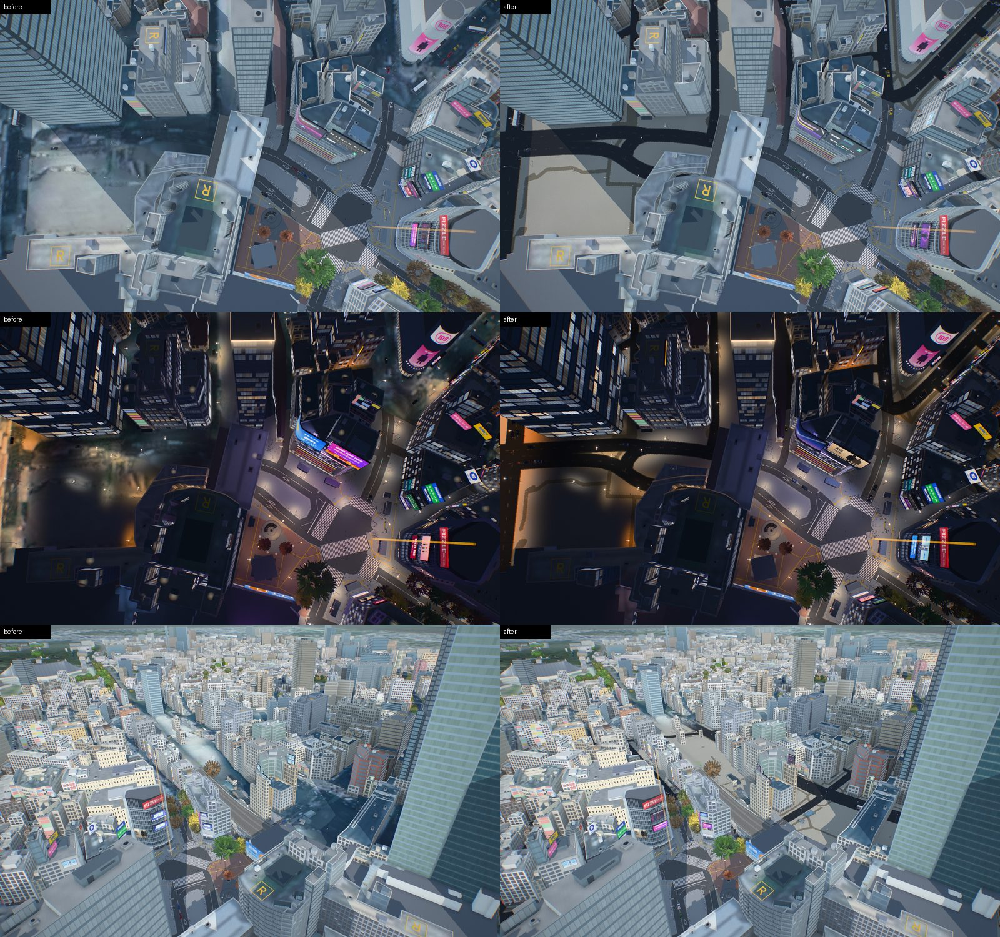
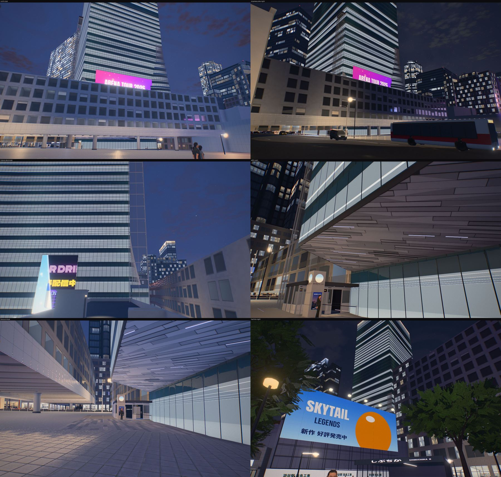
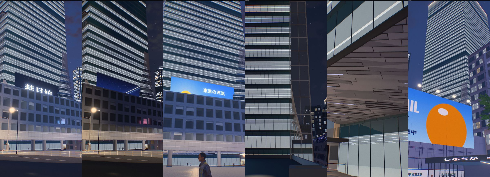

# Hero levels: a street modelled finely

> **Scope, November 2026.** The project is now one story on one map: Blue Hour, at the Shibuya Scramble
> ([STORY.md](STORY.md)). This page was written while the project built many maps, a globe and a model viewer.
> Where it names another city, the title screen, the viewer or the reef sites, it describes work kept at the tag
> `archive/world-2026-11`; the shared code it explains is the code Shibuya runs.

Asked for in November 2026 for Tokyo's live maps: one small level per map, a street or a crossing some
200-300 m across, that reads at eye level as a photograph or a current game does, while the rest of
the map stays as it is around it. Shinjuku's is Kabukicho Ichibangai (`cities/shinjuku/hero.py`);
Shibuya's scramble is built by its own session on the same kit; Marunouchi-Ginza's (Tokyo Station) is drawn as
landmark meshes, below. Sydney's is Circular Quay West, where its game starts (`cities/sydney/hero.py`), and
Queenstown's the Skyline deck on Bob's Peak (`cities/queenstown/hero.py`): stone, timber and a water's edge
rather than a street of signs. Kyoto's two (Yasaka-dori, the Omotesando of Fushimi Inari) are on the kit with
Japanese traditional pieces, below.
Three more stand by a map's spawn: Kamakura's is the hill road above the Kamakurakokomae crossing
(`cities/kamakura/hero.py`), Tetsugaku's the head of the Philosopher's Path (`cities/tetsugaku/hero.py`),
and Kyoto's the station's north forecourt under Kyoto Tower (`cities/kyoto/hero.py`).

| What | Where |
|---|---|
| The loader, in every map's game | `web/game/hero.js` (`OEHero`), started by `web/game/game.js` from `game.hero` |
| The kit: geometry by material, the atlas, the bake, Blender and the export | `blender/hero_kit.py` |
| Parts: paving laid on the game's ground, a wall's frame with openings, windows, lamp posts, benches, bollards | `blender/hero_parts.py` |
| The measured things under a level: OpenStreetMap's map of its rectangle, in local metres | `python pipeline/hero_osm.py --city <id> --box x0 y0 x1 y1` -> `cities/<id>/hero_osm.json` |
| The ground a level is laid on: the game's own walking surface, sampled | `node tools/ground_probe.js <id> x0 y0 x1 y1 > cities/<id>/hero_ground.json` |
| Parts for a level in the open: ground draped on the terrain, retaining walls, hedges and shrubs, utility poles and wires, signs | `blender/hero_open.py` |
| The build | `python blender/build_hero.py --city <id>` (needs `pip install bpy==5.2.3` and Node) |
| A map's level | `cities/<id>/hero.py` (`build(kit)` returns geometry, atlas, materials and its centre) |
| Its place in the game | `cities/<id>/city.json` `game.hero` (copied into `game.json` by `pipeline/game_text.py`) |
| Its stills | `tools/views/<id>-hero.json`, taken with `tools/scramble_shot.js` (which waits for a hero level to load) |
| Its check | `tools/game_check.js`: walked up to, it loads and shows and hides what it replaces; left, it is let go |
| A hall in a lift's lobby, stood on where its own floor is level (`floor`), solid where it is glass (`posts`, `belts`) | `cities/shibuya/hero_skylobby.py`; below, "SKY's street entrance" |
| A level over the street, fetched by its height off the camera as well (`zr`) | `cities/shibuya/hero_skyroof.py`; below, "SKY STAGE" |

## How it works

**Drawn over the city, not instead of it.** A hero level's fronts stand a few centimetres in front of the
city's own walls (the shop fronts 0.5 m, the floors above 0.22 m), and its paving 4 cm over the ground,
so the city's buildings, ground, collision and surface model need no change, and the level can come and
go. Its glass and its recesses lie between its face and the city's wall. What the city draws that the
level draws again finely (Kabukicho's tenant stacks and fascias on Ichibangai) is built into landmark
meshes of their own (`kbhero_*`, `cities/shinjuku/kabukicho.py` `in_hero`) and hidden while the level is
shown (`game.hero[].hide`).

**Its surroundings drawn from the street data, not the photograph** (issue 87). Past a level's circle the city's ground
was the 1 m aerial photograph, and from the air (the story's flight, the helicopter, any camera past 140 m, where the
drawn streets had faded out) its blur, the towers' shadows baked into it and the buses on the west exit's terminal read
as wet blotches beside the level's crisp paving. Now, out to 320 m past each level's circle (fading over its last
110 m), the ground shader in `game.js` takes no colour from the photograph at any height: asphalt, kerbs and footways
are the drawn streets (`streetTexture`), between them is paving in the footways' tone, the drawing's edges are taken
back to a pixel where it is magnified, and no grain is laid over it (`ZONE`, `zn`). The drawn streets of a tile under a
zone stay on in the helicopter. Roofs and piers in the zone take none of the photograph either (`buildings.js`
`photoZone`, `world.js` piers). It holds with any photograph the map is given. Its views: `tools/views/aerial-ground-87.json`.



**Streamed.** It is fetched when the camera comes within 260 m of its edge, shown within 420 m, and let go
(geometry and textures freed) past 520 m. On the low tier (phones) every texture is halved before it is
sent to the GPU, a quarter of the memory, and on a phone's lean sub-tier no side is over 1024; it is resized by
`createImageBitmap`, not through a full-size canvas. Its shaders are compiled and its textures sent in idle time
before it is first shown (`world.js` `upload`, `compile`), so it does not stall a frame. The low tier draws it without
normal and roughness maps; the paving's roughness came in glTF's one metallic-roughness picture (its metalness 0 in
it) with the factors beside it at glTF's default of 1, so without the picture the asphalt, the crossings' paint, the
pavers and the setts were a rough metal on every phone, lit by the sky's reflection and by no lamp, until November
2026: `hero.js` now sets what the picture said (no metal, a paving's roughness) as it lets it go.

**What cannot be seen costs nothing** (issue 358, from first principles). A level is paid for in four
currencies: bytes fetched, memory held, triangles drawn and pixels shaded. Each is spent only where the eye is:

| Cost | What decides it | How the level spends it |
|---|---|---|
| Fetched and held at all | how far the level is | nothing within 260 m: nothing fetched; past 520 m: everything freed |
| The finest geometry (glazing bars, a railing's rails, bench arms, joints) | whether it covers a pixel | a second model, `<id>_fine.glb` (`Geo.fine`, plain materials only, so no texture is held twice): fetched only when the camera is inside the level, each 22 m square of it drawn only within `fine_m` (70 m) of the camera, and never fetched on the low tier |
| Triangles and draws behind you | the view | the level is cut into squares (`meta["cell"]`, one mesh per material and square), so three.js's frustum test leaves out what is off screen; at Sydney's start about half the level |
| Texture memory | the screen's pixels, not the texture's | a material carries only the maps that show (`maps`: `"c"`, `"cn"`, `"cnr"`): bark, grass and distant render have no roughness map; on the low tier no normal or roughness maps at all and every colour map halved, on a phone's lean sub-tier no side over 1024 |
| Light after dark | nothing per frame | baked into the vertices, below: no light is evaluated at run time |

Measured on Sydney's level (`tools/mem_check.js`, the phone tier): the GPU peak went from 531 MB without the
level to 546 MB with it (budget 700), and the heap from 465 MB to 470 MB (budget 880); the fine model is never
fetched there.

**Light baked into the vertices.** After dark a street like Ichibangai is lit by its signs and shop
fronts, not by its lamps. Each lit face (a sign's panel, a fascia, a shop's glass, a vending machine,
a lantern) is a set of small area lights a metre apart, in the mean colour of what is drawn on it; every
vertex of the level sums them (the cosine at the light and at the vertex over the square of the
distance, `hero_kit.bake`), and the corners' occlusion from the walls is added, into its `_BAKE`
attribute. `hero.js` adds that light in the surface's own colour after dark (`uNight`) and lets the
occlusion take the sky's light by day. The city's street lights (`world.js` `streetLit`) still reach it,
at the share `game.hero[].street` gives (Kabukicho 0.35), since its own lamps are baked. No lightmap
texture, no second UV set, and nothing for a phone to compute.

**Materials by name** (Blender's, kept in the glTF): `win*` windows (the rooms' light is turned up with the
night; a `tint` darkens the glass by day), `glow*` lit signs (their emissive at
`game.hero[].glow`: by day and by night), `tube*` neon tubes (which stutter now and then), `win*`
windows (dark glass by day, rooms lit after dark), `ground*` what you walk on (wet in the rain; on the high
tier it takes the wet street's reflection, `mirror.js`). A material's tint (the building's colour over a
shared texture) travels in its glTF extras.

**Textures.** CC0 PBR sets from ambientCG at 1K (colour, normal, and roughness packed into glTF's
metallic-roughness image), as WebP inside the model: `PavingStones136` (Ichibangai is paved: OpenStreetMap
`surface=paving_stones`, and the ward's plans keep both streets paved), `Tiles036` (the small square
facing tiles of Japan's mixed-use buildings), `Plaster001`, `Concrete034`, `Tiles138`; and for stone, timber and a water's edge `Bricks066` (smooth coursed ashlar),
`Bricks083` (squared rubble), `PavingStones125A` (sawn granite planks), `PavingStones131` (setts), `Grass004`,
`Planks040` (grooved deck boards), `Granite005A`, `Travertine009` (sawn bedded stone), `Rock051` (schist) and
`Bark014`. A grey texture is brought to a stone's colour by a tint computed from its mean
(`hero_kit.tint_to(key, sRGB)`), so one ashlar serves Sydney's sandstone and a bluestone alike. Everything
drawn (sign panels with the tenants' names, shop interiors, rooms behind the windows, vending machine
fronts, menu boards, air conditioners, manhole covers, grates) is one atlas, drawn in Python with the
project's open fonts (`pipeline/adkit.py`).

## The Scramble (Shibuya)

The Shibuya map's game opens on Hachiko Square at the junction's south-east corner, looking across the
diagonal to QFRONT. The level (`cities/shibuya/hero.py`, `hero/scramble.glb`) is the hundred metres round the
junction, and its first part is what fills most of the frame from eye level: the ground.

- **The carriageways**: one asphalt surface on the game's own road bands, a 50 cm concrete gutter along every
  kerb, flush granite kerbs, manholes and gully grates. The asphalt is ambientCG's `Asphalt031` with its
  aggregate a little clearer (`asphalt_texture`). Clean and of one tone: no patches, stains or wear ("The bar"
  in AGENTS.md: the ground is never aged).
- **The paint**: the five crosswalks at the places measured off GSI's aerial photograph
  (`scramble.CROSSWALKS`), stop lines, the diamonds before them and centre lines, in an even off-white
  thermoplastic with the grain of its glass beads (`paint_texture`).
- **The pavements**: grey blocks (`PavingStones136`), and Hachiko Square in the red-brown block the 2024
  photographs show, drawn here (`cities/shibuya/scramble_tex.py` `plaza`, below); the yellow tactile blocks
  with their bars and domes in relief (JIS T 9251's pattern, `tactile_texture`), laid as Japan lays them
  (`scramble.tactile_layout`, below); a cast-iron grate round each mapped tree.
- **The stone blossoms in Hachiko Square** (`cities/shibuya/city.py` `blossom`, the landmark's): four five-petalled
  cherry blossoms of pale stone set flush in the red-brown blocks, each outlined by a band of dark grey stone, as a
  photograph of 23 March 2025 shows them in the foreground (Wikimedia Commons, *Demolition of Tokyu Toyoko (Hachiko
  square) 2025-03-23*, Asanagi, CC0 1.0: at least three near the seats and the tactile line, about 1.2 to 1.6 m
  across, the joints between their petals faint). Until November 2026 each was one flat fan of one pale tone 1.7 m
  across, the brightest thing in frame 2's photograph, and read as a sticker on the ground (issue 101). Now each is
  1.5 m across and is cut stone: five petals, each a piece, a mortar joint of 12 mm between one and the next, a small
  dark stone at the heart and a 50 mm band of dark grey granite (`hk_rim`) round the outline; the petals'
  stone is a tone darker (`hk_inlay` `#a59e92`), so that on the low tier, which draws no grain and adds the screens'
  pooled light to the albedo, it stays stone beside the blocks. They are flush, as the real ones are: an inlay shows no
  thickness, and what says stone is the joints and the band. Not known: the stone, and whether the inlays survived
  the square's repaving of summer 2025 (the blocks were reported changed by 27 August; nothing was said of them).
- **On the kerbs**: white guard pipes between the crosswalks, and steel lamp posts whose light is baked.
- **The fronts** (`Level.fronts`, `front`): each wall a player can see from the junction's roads and pavements
  (eye points on a 7 m grid within 70 m, no building between), of the buildings the landmarks do not draw whole
  (QFRONT, 109, MAGNET, Seibu and the station keep their own). A skin 10 cm in front of the city's plain wall:
  a glazed street floor between piers on a dark stone foot, onto a lit shop drawn as its light (shelves, a
  cafe's counter, a clothes rail); above it, storey by storey, facing tile or panel with windows set back in
  their reveals, aluminium frames, sills, and a coping on the parapet; behind each pane a room, lit or dark
  after nightfall. Where a landmark's print or screen hangs on the wall the skin is cut away behind it
  (`behind`), so no picture is covered. One grammar; the buildings that face the junction take their wall and
  their windows from `FRONTS` (below), the rest one of three quiet facings.
- **Light from the sky** (`hero_kit.sky_occlusion`, meta `sky_rays`): each vertex keeps the share of the sky it
  sees, baked, so a reveal, a canopy's underside and the foot of a wall are darker than the open ground.

It hides the landmark meshes it draws again (`p5_plaza`, the junction's flat asphalt, paint, tactile strips and
guard pipes); the entrances, the tracks, Hachiko and the signs stay the landmarks'.
153,000 triangles, 8.1 MB; nothing is built under a building, in a stair well, on a wall no player sees or past
100 m. Its fine model (`scramble_fine.glb`: the shop doors' stiles, rails and pull handles, the lamp posts'
bands; 14,000 triangles, 0.5 MB) is fetched on the high and medium tiers once the camera is in the level, drawn
within 60 m, and never fetched on a phone.

**QFRONT against its photograph.** The landmark drew the building as navy glass under a white grid with a plain
band for a street floor. From the 2025 photograph of it across the crosswalk: the outer skin is now glass that
mirrors the sky over a dark pane (`x_qf_glass`), each floor's edge a silver band 0.8 m deep behind the fins
(`scramble.qfront`), and the level draws the street floor (`Level.qfront_base`): the shopfront line a metre
behind the face, glazed from a stone foot to the canopy's soffit onto lit shops, with the building's round
columns in silver cladding standing free in front.

**Glass that read as milk.** Two causes, both found with the still tool's ray probe
(`PROBE=fx,fy tools/scramble_shot.js`: what stands along the ray through a point of the frame). The subway
entrance's panes had a pale colour of their own, and four of them one behind another whitened everything seen
through them: clear glass has almost no colour of its own, only what it mirrors (`x_glass` is now near black at
16%). And glass at street level mirrored the game's environment, which is the sky alone, where a photograph
shows the shaded fronts across the street: a hero material's `sky` (hero_kit; `envMapIntensity` in `hero.js`)
is the share of the sky it mirrors, 0.15 for shop glass. By day a shop's own light is `glow[0]` 0.24: a room
seen from a sunlit street is darker than the street.

**Daylight.** The Japanese maps take the `shinkai` look by default (docs/LOOK.md), whose shade is a strong blue;
on a level held to a photograph it turned every white wall and the paving blue. Shibuya names its own in
`game.look`: the `film` preset, a near-neutral shade `[0.88, 0.91, 0.95]` with more bounce from the ground, and
a day grade without the extra saturation.

**People at the lens.** With the camera low at a kerb the near crowd showed as flat dolls a few metres away:
the modelled people were chosen by distance from the player, not from the camera, and those behind it took the
places. `web/game/people.js` now picks them by distance from the camera, those in view first.

Photographs looked at (Wikimedia Commons; none is reproduced, no texture is taken from one): the empty
junction, 2025-01 (ウィ貴公子, CC BY-SA 4.0), QFRONT from the crosswalk, 2025-02 (GoToVan, CC BY 2.0), Hachiko
Square, 2020-04 (Asanagi, CC0); links in docs/cities/shibuya.md.

### The second pass (issue 461): what the stills showed, and what was done

Stills from the six eye-level views, a car's and the helicopter's (`tools/views/shibuya-hero.json`), by day, at
dusk and at night, were put beside the 2024-25 photographs (docs/cities/shibuya.md, section 6b). Four things
broke the picture, in the order of the pixels they covered:

| What the still showed | Why | Now |
|---|---|---|
| Hachiko Square in a jumble of pink, brown and grey patches | the scanned set (`PavingStones128`) is slabs a metre long in four tones; tinted, it stayed a patchwork | `scramble_tex.plaza`: concrete blocks 200 x 100 mm in a herringbone, 1.6 m to the repeat (1.6 mm a texel), red-brown, each block within five percent of the next, a 3 mm sanded joint and a chamfered arris in the normal map. Every change of tone is a block or a joint |
| White boxes with black holes for windows round the junction | white tile at sRGB 214 beside a street of greys; glass at 4% reflectance mirrors nothing | no front is white (tile 192 and a warm 190/180/164, panels 158 to 176, charcoal 62); `win_glass` mirrors three quarters of the sky's picture in a grey-blue, so an upper window by day is a pane of sky and cloud |
| Mottled grey walls (MAGNET, the blocks south of the square) | a scanned concrete (`Concrete034`) over a whole front reads as blotches | `scramble_tex.panel`: cladding panels 1.2 m square with an open joint, flat and even; the building's colour is its tint (`wall_clad`, `wall_grey`, `wall_char`) |
| Shops and lit rooms as flat cartoons a few metres from the eye | drawn as coloured rectangles, 400 x 220 px | each is a box room ray-cast offline from where a walker stands (`scramble_tex.shop`, `room`): a ceiling with its light panels, walls lit by them by the cosine and the square of the distance, corners darker where surfaces meet, and the trade standing in it (gondolas and shelves of goods, a bookshop's spines and table, a cafe's counter, menu board and back bar, a rail of garments on a plinth). An upstairs room is seen from 9 m below: its ceiling and the head of its back wall. The atlas is the same 2048 x 1024; it was half empty |

**The fronts that face the junction** (`hero.py` `FRONTS`, by OpenStreetMap id): the block on Center Gai's corner
in charcoal cladding with ribbons of glass (in the photographs it is a dark ground for its screens and tenant
signs); 渋谷駅前ビル on Dogenzaka's corner and MAGNET in pale metal panels with ribbon windows; the blocks south of
the square in grey precast; Jingu-dori's east side in tile. QFRONT, SHIBUYA109, Seibu and the station keep the
faces the landmarks give them (`scramble.py`, `streets.py`), each already drawn from its photograph.

**A way in to every shop.** Every second bay of a street floor is a pair of glass doors under the transom: the
stone foot stops either side, the glass runs down to a steel threshold; the leaves' stiles and rails and the
pull handles are in the fine model.

**From the air and from a car.** `heli` (95 m up, over the square) and `over` (150 m, straight down) show no
aerial photograph inside the level: carriageway, paint, kerbs and paving are the level's own to its rim. The
dashes along the kerbs from that height are the white guard pipes and their shadows.

Day, dusk and night on the high tier at 1440 x 900 (the spawn, the square, a front close up, the helicopter),
and on the low tier at 390 x 844:


Checked on a phone (`tools/mem_check.js shibuya`, an iPhone emulated on the low tier, two runs each on the same
machine): the GPU peak was 242 and 241 MB before and is 241 and 242 MB after, of the 300 MB budget. The atlas is
the size it was, the drawn paving replaces a scanned set of the same size, and the fine model is never fetched
there.

Where it still falls short of the bar, as the stills show: a front's grammar is still one (piers, ribbons or
punched windows, a parapet), varied by material, not each building's own face modelled from its photograph; the
junction's signals are the game's live heads on plain poles, not Tokyo's masts with their arms and name plates;
glass mirrors the sky or nothing, never the street across the way; the trees are the map's shared ones; the
kerbs are flush, since the game's ground is one surface; the lamp posts' design and places are from photographs,
not a survey; the shops are plausible trades, not the real tenants; and it has been seen on a software renderer
only.

**Signs that stood in the air.** A sign tower placed from a photograph by a roof height the city's solids do
not have (a penthouse narrower than the sign, a roof 6 m lower) stood with its legs in the air. The towers now
seat themselves on a roof that takes their whole footprint (`scramble.seat`); a bent roof screen stands on the
roof under its own foot line, not the building's highest (`pipeline/screens.py`); a wall print hangs by the
height of the wall behind it (`city.wall_top`). `tools/float_check.py <city>` lists landmark pieces that touch
neither the ground, a solid nor a held piece, and `tools/check.sh` runs it for the live cities.

**Pictures with something in front of them.** The same rule, things as they stand in the world, for what a
sign is for: being seen. `tools/sign_clear.py <city>` casts rays out of every picture face (a sign, a screen,
a print) and lists those another landmark covers. Shibuya had 86: QFRONT's fins and transoms ran across Q'S EYE,
the crown's advert and the canopy's names (they now stop at each picture's edge, `scramble.qfront` `openings`);
three generators each hung a sign at the same street front without knowing of the others (the generic shop
signs and the crossing's tenant stacks now leave a front that `streets.py` dresses, and one another's sites:
`city.dressed_fronts`, `wall_sites`); MAGNET's banner began under its fascia's top; a hoarding ran behind the
police box. Also in `tools/check.sh`. And a sign's lower line was cut off because `pipeline/meshkit.py` kept two
decimal places of an atlas coordinate (20 to 40 pixels of a 2048 x 4096 atlas): it keeps five.

**One plan for what is drawn and what is solid** (the owner's review, November 2026: a wall no one could see
in the middle of the east crosswalk, guard pipes across the crosswalks' ends with the crowd walking through
them, feet in the paving). Each had the same cause: two generations of the junction side by side. The landmarks
drew the ground and the guard pipes first; the level drew them again from its own kerb line and hid the
landmarks' meshes, which went on being solid and being stood on where they had been.

- The junction's plan is one object, `scramble.Plan` (carriageways, pavements, kerb, stair wells), and the guard
  pipes one function, `scramble.guard_runs`: the landmarks make them solid, the level draws the same runs finely.
- Where they stand follows the rule the road authority's fences follow (防護柵の設置基準, 横断防止柵: a fence where
  crossing is to be stopped, open at every crossing): none within a crosswalk's band carried 4 m past its ends,
  none within 2.5 m of any mapped footway that leaves the pavement for the carriageway, none round a stair
  well or against a building, and no run of fewer than three posts. The lamp posts keep off the footways too,
  and are solid (`game.hero[].posts`).
- Paint lies on the asphalt only (`Level.paint`): a stop line measured to a straight kerb ran on over a kerb
  that bulges, onto the square's paving.
- Whoever stands in a level stands on its paving: `game.hero[].lift` (metres over the game's ground;
  `web/game/nav.js` `lift`), and the ground meshes a level hides are not stood on while it is shown (`navcells.js`
  `unwalkedOf`): at the spawn the hidden tactile strip had the player 20 cm up, and elsewhere the crowd's soles were
  5 cm under the paving drawn. Where the level is not shown, what it hides is drawn, and stood on: the hidden meshes'
  paving is kept apart (`navcells.js` `pavingHid`) and `lift` reads it there, between its half-metre cells. On a phone
  the level comes some seconds after the game opens (the opening skipped and the story taken up again at once:
  November 2026, the owner's iPhone, six seconds from the load to the first beat), and all that time the one you
  play and the crowd round her stood 6 to 19 cm deep in the city's own Hachiko Square, its setts and its tactile
  strips over their shoes. `tools/feet_check.js` measures every sole against the ground drawn under it, at the
  story's first walk; `HERO=off` holds the level back to measure the city's own (at a desktop's size: a phone lets
  go of the city's buffers once they are on the GPU).
- **The tactile blocks** (`scramble.tactile_layout`, the level's and the city's alike). OpenStreetMap's
  `tactile_paving=yes` says which footways have them, not where the blocks lie: a mapped footway is the walkers'
  line, across Hachiko Square on the diagonal and round a kerb's curve point by point, and laid along it the
  blocks were a tangle of yellow arcs across the square and onto the carriageway (the owner's iPhone, November
  2026). Blocks are 30 cm squares in straight rows (MLIT's 道路の移動等円滑化整備ガイドライン and the municipal
  guides after it): each mapped line is pulled straight to within 2 m of its points, the points of different lines
  within a metre of each other are one node, and a warning block (domes) lies at each bend of 25 degrees or more
  and at each branch; where a line comes to one of the five crosswalks it is cut back 4 m from the kerb and comes
  in along the kerb to the crosswalk's middle, then square across to a row of warning blocks along the kerb, six
  wide and two deep, 30 cm back from its edge (the guideline: the row parallel to the road); every line of a corner
  shares that way in. A line's end at a kerb that is not a crosswalk's has a row four wide. The city's own copy,
  drawn until the level comes, is laid the same and flush on what it lies on (the ground, or Hachiko Square's
  setts, 6 mm over them): it was 12 cm over the ground.
- And on the ground it draws, where its builder laid its own levels: the level's drawn ground (its `ground*`
  materials) is sampled every metre in the game (`tools/hero_ground_probe.js <city> 1 export
  cities/<id>/hero_floor.json`) and walked as one smooth patch (`pipeline/hero_floor.py`, game.json `patches` with
  `smooth` and `hero`). Before, Shibuya's road by the station was drawn 0.36 m over the floor walked and Sydney's
  paving by the quay 0.41 m (rms 2.3 and 3.9 cm, 106 and 132 points of a metre's grid off by over 15 cm); now both
  are within a centimetre (0.5 cm rms, none over 15 cm). Run the probe again after a level is rebuilt.
- A level that drapes its ground on the game's terrain is rebuilt when that ground is graded again
  (`pipeline/street_ground.py`, issues 510 and 522). The Scramble's entry says `"graded": true`: the streets inside it
  are graded with the rest of the map (its road along the JR embankment north of the station was draped on the
  smeared survey and tilted up to 51 % towards the embankment; the embankment's own top held the road's edge nodes at
  the smeared height, and the street now takes those back), then `python blender/build_hero.py --city shibuya`,
  the floor's export above, `python pipeline/hero_floor.py --city shibuya` and `python pipeline/pack.py`. The
  landmarks' paving in the level (Hachiko Square's setts, its planters, the crossing's own asphalt shown until the
  level loads) keeps the ground under it. `python pipeline/street_ground.py --city shibuya --check` measures the
  drawn floor's cross-fall along the level's roads (0 of 850 m over 6 % now, 50 over 15 % before) and
  `tools/check.sh` fails if it comes back. A level without the flag (Sydney's quay) keeps the ground it was built on.
- `tools/unseen_walls.js <city>` audits a level against the picture (a wall with nothing drawn at it, a footway
  with something solid on it, the floor's height over the ground drawn), and `tools/game_check.js` fails a level
  with a wall on one of the crowd's lines or a floor off its lift. Sydney's level had no unseen wall and no
  barred footway; its floor was 4.5 cm under its paving (now `lift` 0.045; at the quay's edge, where the paving
  climbs to the coping, it is still up to 14 cm under). Tokyo's stands on its paving; seven single points of its
  crowd's lines meet a wall, and Shibuya's meet one where two footways go down a subway stair (issue 496).

### The trees, the camera in them and the crowd in a close frame (issue 19)

Seen in the stills of episode one: the cherries in Hachiko Square's planters carried their leaves down to
1.3 m, and the chase camera behind the player ended inside them (frame 3's first line was said through a
screen of leaves); a street ginkgo by the station hung its to 0.9 m. A square's and a street's trees in Tokyo
are pruned clear of the people under them (Japan's road rules keep 2.5 m over a footway, 4.5 m over a road):

- `cherry_plaza` (`blender/build_trees.py`): the Somei-yoshino as a square prunes it, a clean trunk to 4 m and
  the crown held high, its lowest leaves at 4.4 m at its own size; the two planters by Hachiko plant it
  (`cities/shibuya/city.json` `trees.areas`). The cherries of the Meguro's banks keep their low boughs.
- The street species (plane, elm, zelkova, ginkgo) are pruned in the build (`prune`): no spray hangs below
  3.2 m, their lowest leaves 3.3 to 4 m up at their own size.
- `trees.json` gives every species where its lowest leaves hang and how far its crown reaches (`clear_m`,
  `crown_r`, measured from the built cards), `web/trees.js` `crowns()` each tree's as drawn, and the game keeps
  them on its posts. On foot the chase camera's way to the head stops where it goes into the dense middle of a
  crown and comes closer or lower, as for a wall; the conversation's camera (`web/game/talkcam.js`) counts a
  crown, a trunk and a lamp post as in the way.
- The crowd's skinned people are chosen by distance as the lens sees it (`web/game/people.js`): through the
  finder's long lens a walker 50 m off is as big as one 25 m off in the chase view, so is a person and not a
  far figure, and half as many more are people while the lens is long.
- The way's band on the ground is hidden while the story's camera is raised and from the print: from the eye
  along the ground it stood in frame 2's finder as an amber shaft in front of the tram.

`tools/hero_trees.js` lists the trees round the Scramble with where their leaves begin and exits 1 on one lower
than 2.5 m within 60 m.

### The trees up close (November 2026)

The owner's still by the koban at Hachiko: a street tree next to the player was a smooth dark cone a metre and a half
through, with no bark, and a pillar where a zelkova stood beside the camera. Three things were wrong, and each is a
thing a real tree's make explains:

- **Its girth.** `r0` in `blender/build_trees.py` now means what a street-tree survey measures: the trunk's radius at
  breast height. A Tokyo street zelkova or ginkgo of 15 to 20 m stands on a trunk 40 to 60 cm through, a camphor's
  near a metre; before, the trunk tapered linearly from 1.35 `r0` at its foot and a zelkova was 1.4 m through at
  eye height. Below breast height it flares into its roots (`trunk_rad`: half as wide again at the ground, gone in
  half a metre), and above it tapers to the crown. Every model, near and far, has it, and the game's posts
  (`trees.json` `trunk_r`) follow.
- **Its bark.** Every trunk, limb and twig carries a bark uv in metres (`branch`: round the ring a whole number of
  repeats nearest its girth, no seam; along it the same metres), and wears a CC0 scan from ambientCG with its normal
  map (`BARKS`: Bark004, an old zelkova's grey scales over warmer under-bark; Bark001, the ginkgo's and the pine's
  corky ridges; Bark009, the plane's shed patches; Bark012, the camphor's long fissures; Bark003, the smooth bark of
  the evergreen oaks, the maple and the cherries, whose lenticel bands `trees.js` draws over it; Bark015, the sugi's
  strips). One scan stands for each kind of bark: the page tints it to the species' own colour (`bark_map.tint`), so
  the bark's mean is the colour the trees had, and only its relief and its grain are new. A thin branch's bark is
  finer than a trunk's, as a young branch's is.
- **Its making near the camera.** Within 42 m (24 m on the light tier) each tree is its hero model (`<species>_LODH`,
  `trees_hero.glb`, 8 to 16 thousand triangles where the near model has two): grown from the same seed through the
  same steps as the near model, so its limbs, twigs and crown are where the near model's are and the switch shows no
  jump, but finer. A trunk of twenty sides on four to six root spurs that fade over its first half metre (`BUTTRESS`:
  a zelkova and a camphor stand on spurs, a ginkgo and a cherry flare round), a slight oval and a slow lump winding up
  it; limbs of ten sides with a collar where they leave the trunk, tapering fastest where their twigs leave them;
  twigs of five sides down to a centimetre; and the leaves at their own size. The atlas's sprays were drawn about
  twice a real leaf's size for the near model's big cards; the hero model lays each card as three cards a little over
  half its size over the same place, each tipped its own way and half of them mirrored, so the one spray per species
  repeats far less, and gives each spray within 90 cm of its twig a short stalk from the nearest point along it, so no
  leaf hangs in the air (stalks from each twig's tip to every spray of it fanned out against the sky like wires).
- Limbs leave from inside the trunk's top metre, so that it forks into them: up to 40 cm of a limb's start was above
  the trunk before, a gap a close camera could see through.

What it costs: the hero part (2.2 MB) and the bark scans (4.1 MB; on the light tier the colour alone at a quarter size,
0.1 MB: a trunk 3 m off is some 130 pixels across and 256 texels a repeat of its bark are still twice what it shows,
and in shade the crevices' shade in the colour shows its relief) come after
the game can be played (`trees.js` `loadNear`, with the near models); until they do, the near model stands in and a
texel of each scan's mean colour stands in for the scan, so the bark's program is the one compiled behind the loader
and nothing is compiled when they come. On a phone the colour scans are packed for the GPU (`tex.js`) before they are
worn; the normal maps stay as they are. A species' hero model holds only as many trees as stand within its reach (160,
40 on the light tier; the rest are drawn as the near model), not every tree of the species as the other levels do, and
is shown only while it draws one, so its model goes up to the GPU when one of its trees is first near. On the phone's
memory check (`tools/mem_check.js`) the first build, with half-size scans and a hero model holding every tree, put the
GPU's peak 22 MB higher, over the budget (287 MB of 270; main 265); with these, 270, and 268 without the light
tier's normal maps. `trees.js` `hero()` says how far the hero models are drawn, how many trees
draw them and whether the scans are in.

Learned from, never copied:

| Work | What it does | Adopted here |
|---|---|---|
| SpeedTree in games ([SpeedTree's blog](https://blog.speedtree.com), [Unity's tree LODs](https://docs.unity3d.com/Manual/terrain-Tree-LOD.html)) | A hero tree of more than 15,000 triangles where few trees are close; three discrete levels below it and a billboard last; branch seams welded; bark as a tiling photographed texture with its normal map | A fourth level near the camera over the three there were and the far impostors; limbs started inside the trunk rather than welded; scanned bark and its normal map |
| ez-tree (Dan Greenheck, three.js, [MIT](https://github.com/dgreenheck/ez-tree)) | A tree grown from parameters in the browser: tapered branch tubes with bark uv in world units, leaves as cards, levels of detail | Bark uv in metres round and along each tube; the growth stays this script's own (Weber and Penn's way, in Blender) |
| ambientCG ([CC0 1.0](https://ambientcg.com)) | Scanned PBR materials | Six bark scans (1K, WebP; the colour at a quarter size for the light tier) |

### A phone after dark, and the level coming in (issue 62)

**The screens' light on the low tier.** A desktop lights the Scramble after dark with the screens' area lights
(`web/neon.js`, eight on high, four on medium) and the plaza's light cards (`game.look.fill`); the low tier has none of
them, and at dusk Hachiko's corner was lit by the sky's blue alone, the tactile blocks and the pavers dull. Now the low
tier works out, once, the light those emitters would put on the ground of the hero levels (`neon.js` `pooled`): every
screen within 160 m in the mean colour of its whole programme (its sheet's keyframes, read once the sheet has come; the
mean of Shibuya's sheet where it cannot be read) and the cards, by the same closed form the area lights use towards a
ground facing up, into one texture a metre a texel over the levels (314 by 220, 280 KB, baked a few rows a frame). A
hero material on the low tier adds it to what it gives back, as it does its baked light (`hero.js` `POOL_F`): one texture
read a pixel, no light in its shader. The pools follow the dusk, the screens' hours and the cards' night as the area
lights do, but not the picture playing; the city's static glow (`night.js` `uGlowMap`) is drawn at the share it has
beside the area lights. Matched on stills of the corner, the low tier beside the high (`tools/views/corner-night-62.json`,
`POOL_K` 0.6): at night the blocks (161, 109, 3) on a phone where the desktop has (143, 100, 4) and a phone had
(118, 86, 3) before, the pavers (94, 62, 61) against (98, 62, 68), before (69, 46, 50). The reference photograph of the
corner at night: "Shibuya 10pm" (Hachiko Square at 22:10, 17 April 2020, the paving under the station's fronts and the
screens a warm grey, the blocks yellow), by nagi usano, CC BY-SA 2.0,
https://commons.wikimedia.org/wiki/File:Shibuya_10pm_(49785559552).jpg; and the crossing's paint under the screens,
"Shibuya Crossing" (30 September 2023, 19:25) by Dick Thomas Johnson, CC BY 2.0,
https://commons.wikimedia.org/wiki/File:Shibuya_Crossing_(53331011301).jpg. Compared, not copied: neither is in the
repository.

**The pool on the crowd and the walls (issue 69).** The pool texture is the light on a ground facing up, and at first only
what faced up took it: the crowd and the shop fronts kept the sky's blue against the warm paving. Now every lit surface
round the levels takes it on the low tier, read where it stands (`neon.js` `lowPool`): the texel under the point, which for
a person is the ground at their feet, weighted by the hemisphere's share facing up in place of the up-facing term (the
ground all of it, a wall or a figure's side half, a soffit none, as a sky light lights them), and on a wall fading up from
3 m over the next dozen, as the street lights' light fades up the city's walls. It comes the way the street lights do:
`world.js` `streetLit` gives it to the ground, a hero level's materials (not its windows or rooms) and every person
(`people.js` `setLight`); a landmark's walls and shop fronts take it on the low set (the Q-front and the station's fronts are
landmarks, not drawn by the hero level); the city's walls read it in their own shader (`buildings.js`), at the pavement in
front of them. Still one texture read a pixel, no light in a shader; a desktop keeps its area lights and has none of it.
A diagnostic run with the pool twelve times as strong showed which surfaces take it before it was set back.

**The level coming in.** On a phone the Scramble's level is ready seconds after the game opens (the owner's iPhone: in
frame 1 six seconds after the load, having skipped the opening); until then the city's own Scramble is drawn, and the
level took its place in view. The level is put first behind the title (issue 69): its pictures go to the head of the
upload queue (`world.js` `upload`, `first`), and while it is coming in round the player's start (at most 30 s,
`game.js` `levelFirst`) the city's rest compiles no slice and the late fetches (the NPCs, the cars, the near trees) and the
stopped air's warm-up wait for it; the opening's own things do not, since a tap on Play would otherwise compile them in its
first frame. On llvmpipe, where its warm-up had waited behind the others' (a texture a frame, frames of a second or two),
it went from 132 to 145 s after it was asked for to 24 s, ready before the opening's skip (`tools/level_wait.js`
`DELAY=0 LOG=1`); on a phone, telemetry's `level_wait` gives each way in's wait and the level's steps (docs/OBSERVABILITY.md).
The way in now waits for it (`game.js` `holdForLevel`): the opening's skip, the crane down
from the title (reduced motion, `?overture=0`) and a story taken up again hold their shot behind a veil (the loader's
ground with the place's name, `渋谷`, and a hairline running out the wait), at most 6 s; once the level is ready the camera
is put at the player's shoulder under the veil and the veil lifts. Past 6 s the way in goes on without it. While it waits
the level is fetched round the player, as behind the title. `tools/level_wait.js` checks it (docs/CHECKS.md).

### The camera on foot: at a shoulder, not a first-floor window (issue 71)

The chase camera on foot stood 7.5 m behind the head at 0.36 rad, its eye 4.3 m over the street: in every walk
the paving filled two thirds of the picture, and the fronts' signs and screens and the deep blue sky over them, what
makes the Scramble at 17:14 itself, were cut off at the top. Third-person games set in a dense street keep the eye
near the shoulder with the horizon in the upper third (Like a Dragon's Kamurocho, Marvel's Spider-Man on foot, The
Last of Us Part II); a crowd reads from inside it. Taken from them is the framing only, nothing of their look.

- `web/game/game.js` `FOOT`: 5.5 m back at 0.17 rad, the eye about 2.5 m up. 0.17 rad is the angle that puts the
  horizon on the upper third of a 55 degree frame (`atan(tan(27.5)/3)`); every place that set the camera on foot (the
  start, the arrival, a hop, out of a seat, a train, the helicopter, the story's `look`) now sets `FOOT`.
- Where the crowd closes round it: the rig's lifts over a wall (`CAM_LIFTS`) are also tried against the people within
  its reach (`folkNear`, `folkAcross`: a body 0.28 m round and 1.75 m tall across the line from the lens to the head),
  up to `CROWD_LIFT` (0.3 rad, about the old view); past that the view waits a moment for them to pass rather than
  climb again, and it is never pulled in for them. Never over a wall for them either.
- Measured (`tools/frame_cost.js` `POSE=7.5/0.36,5.5/0.17,...`, both poses in one sitting at the start, 17:38 in the
  rain): on a phone's tier at 390x844 the new pose draws 411 to 412 calls and 1.14 M triangles against the old pose's
  420 and 1.16 M, in the same time within the software renderer's noise; on the desktop tier 1451 and 1465 ms in two
  sittings (the crowd differs between sittings by more than the pose does: compare poses within one).
- Stills: `tools/foot_cam.js` walks each frame's way at its hour and takes the same moment with the camera as it is
  and as it was, on a desktop and a phone. Frame 3's walk from Center Gai had climbed to 8 m over a wall at the old
  pose; at the new one someone crossed the line to the head for 0.6 s of a 4 s walk, and the lift went to 0.15.
- Someone at the lens (issue 82). At a shoulder, someone of the crowd walking a pace or two in front of the lens and
  to its side filled a corner of a phone's upright frame: not across the line to the head, so no lift, and not inside
  the lens, so `lensClear` left them. As third-person games do with what comes close to the camera (screen-door
  transparency: an ordered dither, as Unreal's dithered opacity masks and Unity's dither fades do it; the technique
  only, no code), every person, whole or a far copy, and what they carry, is dissolved as they near the lens in a
  fixed 4x4 Bayer pattern: whole at 3.2 m from the lens to their middle, gone at 2 m (`people.js` `setNear`; the
  distance is the person's, worked out in the vertex shader from where they stand, so the whole of them goes at once,
  not the head first; with the eye 2.5 m up, someone nearer than 2 m is mostly under a phone's frame, and from 2 to
  3 m their head and shoulders fill a corner of it). `game.js` `updateCamera` sets the band for the chase view on foot only, its far edge 1.2 m
  short of the one you play (a lens pulled in by a wall never dissolves you); a talk's, a film's, a scripted shot's
  and the finder's framing is composed with whoever is in it, and there it is off. The pattern is fixed in the frame,
  so held still nothing flickers. `tools/lens_near.js` puts one of the crowd at points of the frame near the lens
  and takes it with the dissolve off, on, and five seconds of held time later.

## Miyamasu (Shibuya): frame 5's place (issue 33)

The story's fifth frame is taken at the foot of Shibuya Scramble Square's north face, where Miyamasu Bridge (宮益橋)
carried the old road over the Shibuya River, looking 21 degrees west of north up the line the water ran
(`task.stand` [521.9, -1074.1], the river's `relic` at [519.4, -1067.7]). It lies 150 m from the Scramble, outside
that level, and its print showed what the city draws where no level is: the Ginza line's station over the east exit
as a flat slab 2.8 m over the pavement (the "pale lavender wall" of the issue), the piers under it as pale-blue
boxes, and a bare floor. It is the second level on the Scramble's kit (`cities/shibuya/hero_miyamasu.py`, a
subclass of `hero.py`'s `Level`; `python blender/build_hero.py --city shibuya --level miyamasu`).

**The place, from the research** (November 2026; sources below). The Ginza line's Shibuya station was moved about
130 m east in January 2020 onto a column-free box with an M-shaped arched roof over Meiji-dori and the east exit's
bus terminal, on fewer, heavier piers (7 reduced to 3 over the road). The east exit's 2F decks to Hikarie and
Scramble Square meet it 6 to 7 m over the street. Under it: the bus terminal's islands and lanes in the deck's shade,
grey interlocking blocks, granite kerbs, neutral-white LED light. Looking up the street from the bridge's site:
the station box overhead, then the plaza, then the mid-rise fronts of Miyamasuzaka-shita and Meiji-dori in tile and
panel. Miyamasu Bridge itself (in the ward's 1959 photograph, looking downstream from above it) was a low flat
concrete slab with a light rail; the river's walls there were cast concrete panels with pilasters (1929-31), not
the coursed stone the relic draws (docs/PAST.md keeps that liberty).

**What was built**, all of it what the frame's camera sees:

- **The underside where the record put it wrong.** OpenStreetMap maps the station from its first storey
  (`building:min_level=1`), which a storey of 3.9 m set 2.8 m over the pavement at the frame's standpoint.
  `pipeline/stations.py` `UNDERSIDE` sets it at 7.0 m over its base, the decks' level (an estimate from the
  photographs; no published clearance was found). The city's piers lengthen with it, and stand 18 m apart instead
  of the grid's 9 (`SPACING`: the deck stands on fewer, heavier piers than the one it replaced, seven over the road
  became three), which also took the pier that stood dead in the middle of the frame's view up the river.
- **The deck seen from the street** (`underside`): a steel soffit painted a pale warm grey, cross girders every
  3 m (a web and a bottom flange, 0.72 m deep), a linear 4000 K light in every second bay (a lit face the bake takes
  as a light: 0.12 m wide at 30, about half a street lamp's light on the ground below), and the edge box girders
  clad in white panels 1.8 m wide from 1.15 m under the deck to 1.4 m over it.
- **The piers** (`piers`): each pier the city stands the deck on (buildings.json `piers`) as a round steel column
  0.68 m in radius (over the city's 0.9 m square one, which stays the solid one walks round), on a granite collar
  0.36 m high, flaring at its head to a bearing plate under the girders, with a shadow gap at each 3 m can.
- **The ground of the east exit**: the Scramble's carriageway, gutter, kerb, blocks, tactile lines and guard pipes,
  on the same plan (`scramble.Plan`, with `standing`: the ground under the deck is drawn, since the deck does not
  stand on it), and its lamp posts on the kerbs out from under the deck.
- **The fronts** up the street and round the plaza in the Scramble's grammar (41 walls), except buildings the
  Scramble's level dresses itself (`skip_front`), so no wall is drawn twice; the two discs do not overlap.
- **The street's signs** (`signs`, issue 57), on the faces the frame looks at (`SIGNED`): tall tenant signs standing
  0.9 m out from an end of a face, from over the shops' band to up to 16 m above it, a tenant to each panel set
  vertically and read from up and down the street (Shibuya's 袖看板, the tenants of city.py's stacks round the
  crossing); lit boxes on the band over the shops; and Toei Plaza's name, 渋谷東映プラザ, in lit letters on a dark band
  high on its face (the building's own name in an open font, not its logo; the trades are typical and the tenants
  invented). Toei Plaza carries three tall signs, three boxes and its name, FPG links SHIBUYA (closing the view) one
  tall sign, its neighbour one of each. Their faces are on the atlas's last shelf, after the shops, so a phone holds no
  bigger an atlas at frame 5. The west side's fronts up the street (渋谷パークサイド共同ビル and the towers beyond it) are
  dressed by the Scramble's level, and their signs are that level's to hang: hero.py's `SIGNED`, on the same code
  (`Level.hang`, `Level.signs`), so 渋谷パークサイド共同ビル's south front over the street carries two tall signs and three
  boxes, and the slim towers behind it a tall sign each down their narrow faces. The east side's mid-rises up the street
  (seen in the views up it and back down) carry one or two each, and Toei Plaza four of each and its name. The boxes'
  faces are two cells of six now, twelve invented trades; on both levels they and the tall signs' faces fill the
  atlas's last shelf exactly (2048 px), so neither atlas grew.

Its stills: `tools/views/shibuya-miyamasu.json` (the frame's view, the talk shot, up and back along the deck, from
the air) with `tools/scramble_shot.js`; its beat is frame 5 of `tools/story_play.js` (`FROM=4 UPTO=5`).

48,000 triangles, 4.0 MB; its fine model (the fronts' window frames and mullions, half of what was built: 4.5 cm of
aluminium is under a pixel past 50 m) 49,000 triangles, 1.7 MB, drawn within 110 m of the camera and never fetched on
a phone. It is **fetched only near it** (`game.hero[].load_m` 60, `drop_m` 85, `show_m` 300; hero.js): from frame
4's roof and frame 5, never at the Scramble's spawn 90 m from its edge, and let go again before frame 6.

**On a phone at frame 5** both levels are held, the Scramble's 70 m off. `tools/mem_check.js` now takes `AT=x,y` (the
player put there before the heaviest hour). With the level as first built the GPU peak was 277 MB of the 270 budget
(275 settled at the frame). Two things brought it under: the window frames went to the fine model, and **a texture
two levels both carry is held once** (hero.js `share`: the shared surfaces by their picture's name, counted per
level and freed with the last; on a phone nine colour maps, about 12 MB). Now 263 MB settled at the frame, 265 at
the peak (the rain at ten at night), against 255 at the spawn before.

Photographs looked at (Wikimedia Commons; none is reproduced, no texture is taken from one): View from
Miyamasuzaka-Shita Crossroads (north), 2015-09 (そらみみ, CC BY-SA 4.0); 宮益坂下交差点, 2025-01-22 and 2026-02-19 19:04
(ウィ貴公子, CC BY-SA 4.0); Miyamasuzaka District before redevelopment, 2023-02 (Sakura Torch, CC BY-SA 4.0);
Pedestrian bridge construction in Shibuya, 2018-12 (Syced, CC0). Facts: trafficnews.jp/post/92628 (the station's
move), Tokyo Metro news 2019-10-28 (the M-shaped arch frame), ja.wikipedia 宮益坂地区再開発, Shibuya Ward's history
panels (上流から宮益橋を見る, 1959, all rights reserved: looked at, not used), Tokyo Metropolitan University's paper on
the river's improvement works (akira.fpark.tmu.ac.jp, 263.pdf).

Where it still falls short: the bus terminal's islands, shelters and signs are not modelled (the game's ground has no islands there);
the piers stand on the city's grid at 18 m, placed by rule, not where the real deck's three stand; and it has been seen on a
software renderer only.

## The Ginza line's station (Shibuya): the box over Meiji-dori (issue 57)

Frame 5 is taken three metres south of the Ginza line's station, under its deck's edge, and the station fills the top
of the frame; from up Meiji-dori, from Scramble Square's roof (frame 4) and from the air it is the white thing that
crosses the street. The city drew it as its generic panelled box, 15 m tall over the deck, with punched windows.

**The station, from the research** (November 2026). Moved about 130 m east onto Meiji-dori and opened on 3 January
2020; the roof's design is Hiroshi Naito's (Naito Architect & Associates), the box Tokyo Metro's. A 12 m island
platform (the old one had two of 6 m) under a roof of M-shaped arch frames with no column on the platform: 110 m long,
28 m wide and 9 m high, assembled from 44 spans, 1,500 t in all (Railway Gazette 2019-01; Japan Times 2019-02-07;
Tokyo Metro news 2019-10-28; trafficnews.jp 92628). A roof block lifted into place in 2019 was 25.2 m by 22.5 m and
7.7 m high, 290 t (the same reports). In the photographs listed under "Miyamasu" and the press photographs of the
works: a white deck edge in large flat panels, a glazed band where the frames' feet stand, and over it the frames,
white, rib after rib, glass up their steep feet and white panels over the crowns.

**What was built** (`cities/shibuya/hero_ginza.py`, a level of its own: `python blender/build_hero.py --city shibuya
--level ginza`):

- **The deck's edge**: the box girders clad in white panels 1.8 m wide with open joints, from 1.15 m under the deck to
  1.4 m over it, round the station's whole outline (this was the Miyamasu level's, within its reach only; it moved here
  so the station is whole wherever it is seen).
- **The glazed band** over it to the frames' feet, 3.2 m: glass on a white sill, a transom a metre up, a mullion every
  1.25 m and a frame's foot every 2.5 m, a white cornice over it, the box's top closed in white panels inside it.
- **The roof**: 45 frames, 44 spans of 2.5 m over 110 m from the station's west end over Meiji-dori, each a white box
  section 0.28 m by 0.42 m swept along the M across the station (steep at the eaves, the crowns two fifths of the way
  in, a valley 1.1 m lower over the platform's middle; 8.6 m from the feet to the crowns), standing 0.15 m proud of the
  skin; the skin glass up the frames' feet and white panels over the crowns, a glazing bar along each leg, a gutter in
  the valley, the end frames heavier, and the gables in glass with a mullion every 1.25 m. Past the 110 m, the box (the
  concourse's way east) keeps the band's flat top.
- **After dark** the glass is lit from behind, the platform's light (`win_ginza`: hero.js lights `win*` with the
  evening), and mirrors the sky by day.
- **The city's box under it** is capped at the frames' feet (`pipeline/stations.py` `TOP`, 11.4 m over the ground):
  the record's flat top stood through the arches.

4,600 triangles and 5,600 vertices, 0.13 MB, in plain materials only (no picture), and a fine model of 5,600
triangles, 0.14 MB: the frames' sides and feet (the end frames' stay in the level, seen across the gables), the light
mullions and transoms, the glazing bars, the gables' mullions and the cladding's joints, drawn within 110 m of the
camera and never fetched on a phone. A phone at frame 5 holds the Scramble's and Miyamasu's levels beside it, and main
had come to 270 MB of the 270 budget there (`tools/mem_check.js` `AT=521.9,-1074.1`; issue 105), so what it holds of
this level was cut until the frame measured no more than main: a frame is drawn only where it stands proud of the
skin, its back as a strip that shares its points along the M; the cladding's panels are one face to a wall; the M has
eleven points to a half. 35,500 vertices became 5,600 on a phone, with no change a still shows. It is seen from far (frame 4's roof, the helicopter), so it is fetched as Scramble Square's skin is, wherever the
story walks (`game.hero[].load_m` 900).

Its stills: `station`, `west` and `ginza_air` in `tools/views/shibuya-miyamasu.json`, and frame 5's beat.

Sources (looked at and measured from, compared and not copied; no photograph is reproduced and no texture taken from
one): Railway Gazette, "Tokyo Metro's Shibuya roof in place" (2019) and "Shibuya station shift sorted" (2020); The
Japan Times, 2019-02-07, "Distinctive new roof placed on Shibuya Station platform"; Tokyo Metro news releases
2019-10-28 and 2021-02-18 (metroNews20191028_105.pdf, metroNews210218_06.pdf); trafficnews.jp/post/92628 and 83304;
Shinkenchiku 2020-04 (SK_2020_04_046), all rights reserved by their publishers: facts and dimensions taken, nothing
else. The Wikimedia Commons photographs under "Miyamasu" (CC BY-SA 4.0 and CC0) for the elevations.

Where it falls short: the frames are a designed M drawn from the published height and the photographs, not from
drawings; the width is the record's box, 21.8 m between its walls, not the published 28 m of the roof (the record's
outline is what the city's piers and deck stand on, and the level keeps to it); the platform inside, its lights and its
trains are not modelled, only their light on the glass; and it has been seen on a software renderer only.

## SKY's street entrance (Shibuya): frame 4's way up (issue 53)

Frame 4 and the walk send the player from the crossing to the lift at Shibuya Scramble Square that goes up to SHIBUYA
SKY. Its lobby was set dressing in the story's flat, self-lit material (the old `blender/build_set.py`): stone, steel
and the lift's doors read as flat colour, nothing reflected its lines of light, the indicator said 46F, and the way in
was an open 10 m mouth in the tower's generic wall, 17 m west of where the real entrance is. It is now a small hero
level of its own, `cities/shibuya/hero_skylobby.py` (`python blender/build_hero.py --city shibuya --level skylobby`),
and the set dressing is gone.

**The place, from the research** (November 2026; sources below). The street lift is "館外1階": a lift hall of its own,
outside the building's doors, at the far east end of the tower's north face, practically at its north-east corner and
a few metres east of the Hikarie-side entrance, under the overhang of the station deck over the east exit (the 1F
plan, `access_entrance_floormap_1f.png`, marks it "SHIBUYA SKY エレベーター 14Fへ", entered from the west; the section
drawing shows its shaft as glass outside the tower's east face). It goes to 14F, stopping at 2F on weekdays when it is
not busy. Elevator Journal 28's schedule has one bank that fits: E3-1 and E3-2, two Fujitec scenic cars, 24 people,
150 m a minute, 1F to 14F. In the photographs (2019 to 2020): a glass wall in stainless frames, its lower lites
fritted white, with two single framed doors about 2 m apart; over it a dark metal soffit with one line of round
downlights; in front of it pale square tiles of about 600 mm, then the forecourt's striped planks; to its west a
free-standing square pillar in light warm grey panels with the lit SKY disc and the name over a portrait screen;
retractable belts in front at busy times. No photograph of the hall's inside, its lift doors or its indicator was
found.

**How it is entered, read again** (the owner's question, November 2026: "you queue inside, and face the outside as you
board"). The official plan draws the SKY lift as its own small box *outside* the shop's outline at its north-east corner,
east of the east wall's line and mostly north of the north face's, with its entrance marker (▷) on its **west** side;
the section drawing has the shaft as glass outside the tower's east face; the schedule's E3 cars are scenic. So the hall
is entered from the west, the queue faces east, and a visitor boards a car whose back is glass onto Meiji-dori and
Hikarie. A first pass had cut the lobby 8 m into the tower with its glass to the north and the cars on its back wall:
wrong, and redone.

**What was built**:

- **The hall where it is.** `pipeline/lobby.py` takes a lobby that stands outside its building (city.json
  `game.lobbies` `"outside": {"door", "at"}`): the lobby once cut into the tower is filled back (each solid keeps its
  index; the ground floor's two solids take their passages' feet again) and the stop put at the hall's doors and before
  its cars. scene.json's `shibuya_sky.door` moved with it, and Yuna stands by the pillar.
- **The hall**: 6.2 m north to south, 4.2 m west to east, under the station deck (its ceiling 2.65 m up, under the
  deck's underside). Its west front glass in stainless frames, fritted to a metre, with two doorways 1.2 m clear under a
  transom whose sliding leaves stand open behind the lites outside them (a door that is always open is what a player
  walking up to an automatic one sees); its north side glass onto the forecourt; its roof carried 1.6 m out over the
  doors as a canopy with a line of round downlights (the photographs'); its south side dark metal against the tower.
  All of it solid (`game.hero[].posts`), the doorways open.
- **Inside**: SKY's own black and lines of light (SKY GATE's cars, the 45F LEADING LINE), since its finishes are in no
  photograph. A floor of polished charcoal granite in 1.2 by 0.6 m slabs, each its own part of the stone; black
  lacquered panels with an 8 mm reveal, a line of light at the south wall's foot; a matt black ceiling with four lines
  of light running east from over the doors to the cars, baked onto the floor and walls, and their reflections in the
  polished floor (`refl*`: light added over the stone, without depth, dimmed by day as a glow is). The environment map
  is the sky's, which inside a hall is wrong, so its surfaces take little of it.
- **The lifts**: two cars on the east wall in stainless portals with hairline-brushed leaves (`hairline`, drawn here),
  each with its indicator (the arrow and **14F**) and call plate, SHIBUYA SKY lit between them at the eye's height;
  behind them the shaft outside the tower's east face, glass in stainless frames with a transom at each shop floor, up
  to 14F; at its foot the two cabins standing at the street, their ceilings lit. The queue's two belts run east to the
  cars (`game.hero[].belts`, solid).
- **In front**: the tiles from 2.4 m out to the doors (granite tinted a pale beige, 600 mm laid square), coming to the
  hall's floor over the last 1.2 m; the pillar north-west of the doors with its disc on its west face and its north side
  (an opal face lit from behind, sky blue over warm white: the hall's mark as a disc of light, not its logo drawn), its
  name printed on its panels and an invented screen; and the forecourt's planks out along the tower's north face and
  round the hall's north side.
- **Its floor is walked on.** The ground rises half a metre to the north under the hall, and a hall is level. A level
  with `"floor": true` is stood on where its model draws a floor (game.js `heroCover` reads its `room_floor_*` and
  `ground_*` meshes into a height grid, `h.height`; nav.js `lift` returns that height less the ground's, under it or
  over it).

3,600 triangles, 0.67 MB (its granite is the Scramble's and Miyamasu's picture, held once: hero.js `share`). Fetched
within 140 m of its edge (frame 4's walk from Miyamasuzaka and frame 5's place) and let go past 170 m. Its checks:
`tools/lobby_check.py` (its posts and belts inside its lobby, clear of every solid), `tools/lobby_shot.js` (the
entrance from the street and either side, the threshold, the hall, the dog by the belts), `tools/walk_play.js` (the
hall drawn round you in the lobby, then the ride), frame 4 of `tools/story_play.js`.

Sources (looked at, none reproduced, no texture taken from one): SHIBUYA SKY access (shibuya-scramble-square.com/sky/access/,
its 1F and 2F plans and the section drawing of the lift); Elevator Journal 28 (n-elekyo.or.jp, the lift schedule);
Shibuya Scramble Square Level 1 Entrance, 2019-12-23 (Wpcpey, Wikimedia Commons, CC BY 4.0: the forecourt, the pillar
and the soffit at dusk); SHIBUYA SKY Logo, 2022-12 (稲妻ノ歯鯨, Commons, CC BY-SA 4.0: the disc's colours, which are not
drawn); and, all rights reserved, compared only: eki-kara-access.tokyo/shibuya-sky-ikikata/ (2019, twelve views of the
entrance and the pillar), 1rankup.jp/shibuya/sky.html (the doors at night, the belts), skyticket.jp/guide/405506/.

Where it still falls short: the hall's inside, its lift doors and its indicator are designed, not seen, and its size is
the plan's, read at its scale; the doors do not slide as you come; the hall's height is the station deck's here, which
is lower than the real 2F deck (7.7 m over 1F); the forecourt's striped planks with lights in their joints and its faceted mirror ceiling are
the Miyamasu level's and the city's plainer ground and the station's soffit; and it has been seen on a software
renderer only.

## SKY STAGE: the roof frame 4 is played on (Shibuya, issue 72)

Frame 4 of the story is played on the roof of Shibuya Scramble Square (the lift up, Kanbara at the glass, the find, the
frame looking down on the scramble) and frame 5 lifts off from its pad. The roof was the city's landmark mesh in flat
colours (`city.py` `sky_meshes`): pale tiles in two random tones, a grey block for GEO COMPASS under a small picture of
its compass, nets as a coarse grid, a glass fence on posts; at 17:31 it read as a pale void with nothing on it to give
the eye its size. It is now a hero level of its own, `cities/shibuya/hero_skyroof.py` (`python blender/build_hero.py
--city shibuya --level skyroof`).

**The place, from the research** (November 2026; sources below). SKY STAGE is about 2,500 m² open to the sky at
229 m, walled in tall glass; the heliport is part of the roof's walk (Travel Watch's report from the opening, 2019),
raised in its middle as GEO COMPASS, the highest point, whose floor points the way to far places; CLOUD HAMMOCK is
nets to lie in over a bed of lawn; SKY EDGE is the corner over the scramble where the glass is lowest; CROSSING LIGHT is
18 searchlights after dark; in the photographs the deck is dark grey, benches stand along the glass, and at night the
roof is lit low, by lines of light at the glass's foot and under the steps, the city being the light. No plan with the
furniture's dimensions is published: the deck's size and the channels are the city's (PLATEAU and OpenStreetMap,
`sky_plan`), the pad is the landmark's 24 m square 2 m up, the paint is a heliport's (ICAO Annex 14's touchdown circle
and H, the edge line), and the compass's places and bearings are the ones `city.py` `COMPASS_TO` already names.

**What was built** (in the roof's frame, scene.json `landmarks.shibuya_sky`):

- **The deck**: dark grey porcelain pavers 600 mm square in straight courses, 5 mm open joints over a dark slab, each
  paver its own part of the stone (one tone, the stone's own speckle: no random tones), cut clean round the channels,
  the pad and its steps; a 0.3 m slot drain of dark steel along the glass's foot.
- **GEO COMPASS**: its top in a drawn picture (`skypad`, 2048 px over 24 m, about 1.2 cm a pixel): a dark non-slip coat
  whose only grain is its aggregate's, the heliport's white edge line, yellow touchdown circle and white H, and round
  them the compass (a white ring, its degrees, N, E, S and W at true north, a gold line to each far place with its
  name and distance set beside it, each name in the first place along its line clear of the others: Mt Fuji, Osaka,
  Kyoto and Hong Kong lie within 14° of one another). The paint stands half a millimetre proud in the normal map and
  is a little smoother than the coat. A stainless coping round the edge; the sides in dark metal panels 1.2 m wide
  over a reveal; green flush lights round the edge, as a heliport has. The steps up each side in the deck's stone
  with a pale honed nosing and a line of light in the shadow under each.
- **The glass**: frameless panes 1.5 m wide and 2 m high on a dark aluminium shoe, a slim stainless cap, and in the
  shoe's face toward the deck a line of warm light, baked onto the deck after dark (its face held low, 0.5, so it
  glows instead of drawing a white bar). Where the channels run out and at SKY EDGE the city's lower glass stays.
- **CLOUD HAMMOCK**: the landmark's three, at its places and its net's sag (the poses lie in it): a bed of short
  artificial lawn in a timber kerb, four dark steel posts and rails at 0.9 m, and the net as white ropes 12 cm apart.
- **Benches**: 3 m of oiled timber slats on dark flat steel, 1 m in from the glass wherever its foot is clear of the
  searchlights, the nets, the channels' ends and the steps (twelve).
- **CROSSING LIGHT**: at each of the landmark's 18 points (the beams `lights.js` throws) a plinth, a turntable, a yoke
  and a finned drum tilted 20° out over the city, its lens lit after dark (`lamp*`).
- **The escalators' heads**: a stainless landing plate and a yellow line before each.

46,000 triangles, 3.0 MB (the granite is the Scramble's, held once); no fine model. While it is shown it hides the
landmark meshes it draws again (`sky_deck`, `sky_deck_light`, `sky_glass`, `sky_steel_dark`, `sky_compass_atlas`,
`sky_steps_deck_light`, `sky_net`, `sky_lit_lamp`); the channels, the escalators and the stairs stay the landmark's,
and so does the walking: the level is drawn 5 cm over the deck's solids.

**The white bar along the glass.** At night a hard white line ran along every edge of the deck at the glass's foot, on
the landmark's deck as on this level's: the night's crown wash (`night.js`, a tower's top storeys lit from its setback
with a fine line along the parapet), drawn 0.3 m outside the tower's walls up to the deck, seen through the glass. A
tower whose roof is walked on (a scene.json landmark with a `deck_z` inside its top's ring) now has no crown.

**Only near, in height too.** The roof stands within 80 m in plan of frame 5's place at the tower's foot, and a level
was fetched by its distance in plan. `hero.js` now takes a level's `zr` (its half-height about its `z`): the camera's
height off it is counted as well (`d = hypot(max(0, plan), dz)`), and the opening's anchor, which is a point on the
ground, does not fetch it. SKY STAGE is fetched once the camera is within 110 m of it (a third of the way up in SKY
GATE's lift), shown within 120 m, and let go past 160 m: on the flight down in frame 5, never from the street.

Sources (looked at, none reproduced, no texture taken from one): SHIBUYA SKY's pages (shibuya-scramble-square.com/sky/:
the zones SKY STAGE, SKY EDGE, CLOUD HAMMOCK, GEO COMPASS, CROSSING LIGHT; about 2,500 m²); Travel Watch (Impress),
the opening's report, 2019 (travel.watch.impress.co.jp, docs 1214943: the heliport within the roof's walk, the glass
round it, photographs 16 to 19); nippon.com's guide (gu900265) and Go Tokyo (gotokyo.org, 191015); ICAO Annex 14 vol. II
(heliports: the touchdown/positioning circle, the H, the TLOF and FATO edge markings). Photographs on Wikimedia Commons
of SKY STAGE, 2019-2024, looked at for the deck's tone, the glass and the benches.

Where it still falls short: the furniture's sizes and places are read from photographs and the landmark's plan, not
measured; whether the heliport's paint is the H and circle drawn here, or the compass alone, could not be settled from
the photographs found; there are no people sitting on the benches or lying in the nets unless the story puts them
there; and it has been seen on a software renderer only.

## Scramble Square's curtain wall (Shibuya)

The owner's ask (November 2026): the building the story climbs should be the real one. The city drew Shibuya Scramble
Square as every tower is drawn: PLATEAU's 227 m on OpenStreetMap's footprint, the generic curtain wall in a grey-blue.
What the research found (sources below):

- **Massing.** GL+229.7 m, 47 floors over 7 below and two on the roof (Nikken Sekkei; Komaihaltec's report). Shops
  B2 to 14F (12F and 13F restaurants), SHIBUYA SKY's counter on 14F, SHIBUYA QWS on 15F, the sky lobby on 17F, offices
  17F to 45F, SKY GALLERY on 45F and 46F, SKY STAGE on the roof. Floor to floor, from the escalators' rises
  (Elevator Journal 28): 1F to 2F 7.7 m, 2F to 3F 5.6, 3F to 4F 6.0, then 5.0 to 5.7 to 14F (14F about 71 m over 1F),
  17F about 84 m, the offices about 4.55 m. A standard office floor 2,815 m², ceilings 2.9 m (CASBEE). The footprint is
  OpenStreetMap's (way 617560918), about 60 by 68 m, its long sides NNW-SSE.
- **The skin.** The tower by Nikken Sekkei, the lower part by Kengo Kuma & Associates (Shinkenchiku 2019-12). Low-E
  panes over 4 m tall, a white ceramic frit printed on their outer face that thins toward the corners, mullions that
  shift with the cut-and-expanded form (KKAA, designboom, gooood); in the photographs a blue-green glass whose joints
  step across each face in diagonals, every pane giving back the sky in its own tone.
- **The base.** The official floor plans show the north edge changing floor by floor (1F straight with a shallow kink,
  3F curved round the Ginza line's concourse, 4F an undulating S-curve reaching further north over the Urban Core); in
  the photographs from the crossing and from Hikarie the north face is carved below 15F by a concave glass sweep either
  side of the 550 m² LED screen that faces the crossing (Panasonic). No elevation or dimension of it is published.

**What was built** (`cities/shibuya/hero_scramblesq.py`, `python blender/build_hero.py --city shibuya --level
scramblesq`): a skin 6 cm outside the city's walls of the tower, from the street to the roof's deck, 62 triangles in one
material (`win_scrsq`: hero.js win*, the glass mirroring the sky) on a tile drawn here, 12 m across and eight office
storeys high: each 1.5 m pane its own tone within a few percent and its own small tilt in the normal map (the tilt is
the cause of the tone), the mullions as ribs, every second heavier, the joints stepping 0.75 m at each floor, the
spandrel recessed and fritted, the frit thinning up each pane. The shop floors take the same tile at their 5.4 m
storeys. The tower's wing outside its ring (PLATEAU's slab on the west, over the crossing, from the street to 218 m)
takes the same skin, its faces against the tower left out: drawn as the city's generic wall, it was the face the
crossing and the flight see, dark among lit floors. Fetched anywhere in the story's streets (load_m 900): 0.04 MB, the
tile's colour, normal and roughness pictures (the colour alone on a phone, at a quarter). The ground floor round SKY's
lobby is left to the lobby's own level.

### Its floors after dark

The owner's ask (November 2026, from a phone's still of the flight): the tower read as a dark block among lit ones; each
storey should have a real interior's light, as the city's other buildings do. On seeing the first passes: the rooms
should be plain, not busy, and the tower's light one family, not cool offices over warm shop floors. Before, the tile
carried an emissive picture of lit bays, eight storeys of it repeated up the tower, flat and without depth; on a phone it
did not show at all.

Now the page draws the storeys (`web/interior.js` offices, called by `web/game/hero.js` for a win* material whose level
has `offices` in game.json; `hero_scramblesq.py` offices() writes it). Each storey is a room the eye's ray is traced
into, as the city's own windows are (`buildings.js`, interior mapping: Joost van Dongen, "Interior Mapping", CGI 2008;
the same idea as Unreal's InteriorCubemap and the cities of recent open-world games, which draw a room behind a pane
without a model of it; ideas only, no code taken). A storey is open along the facade, so a ray through one pane can end
deeper in the next. Every storey is the same plain room: an evenly lit floor, a white ceiling with unbroken rows of
line luminaires along the glass (3.2 m apart in the offices, the system ceilings of Japanese offices; 2.4 m in the
halls), the core's wall at the back (15 m in), and the plenum over the ceiling dark. The shops to 11F and SKY's counter
on 14F, the restaurants on 12F and 13F, the sky lobby on 17F and SKY GALLERY on 45F and 46F differ only in their height
and depth, the tone of their floor and how bright they are (shops a little brighter, the restaurants lower, the gallery
dim for the view out); the plant over it is dark.

What was tried and taken out, and why (the AAA read of a hero tower at night: one silhouette with one light, its storeys
told apart by value and rhythm, never by hue; colour and detail are kept for the street, the signs and the screens):

- desks, monitors, chairs, partitions and doors: through the glass, at the distances the story sees the tower from,
  they read as clutter;
- warm shop and restaurant floors (3000 K and 2700 K under 4500 K offices): two buildings stacked, not one;
- lighting zones along a floor, a dark zone beside a lit one: seen into the room at a slant the edge read as a cut, and
  softened, as a smudge. A storey is lit whole or dark;
- the shops' downlights in a grid and the restaurants' pendants: from outside, a field of bright dots; and blinds
  lowered here and there: pale patches. Every storey has the same unbroken lines of light instead;
- the rows of light deep in a room at a graze, filtered by a guess at their footprint: they broke into dots. They are
  filtered over the pixel's own neighbours (`fwidth` of where the ray ends) and settle into an even glow.

So: one neutral cool white (about 4500 K, the city's offices' and the night's blue) on every storey. Each storey is lit
by its use's hours: offices empty through the evening as the city's do (buildings.js occupancy, the tower a little
busier: `busy` 1.15), each lit storey a little brighter or dimmer than the next; shops until 21:00, the restaurants
until 23:00, the gallery until 22:30, the sky lobby until midnight. The glass in front is the tile's own, drawn again in the same
places: no light through the spandrel or a mullion (stepping along at each storey as the tile steps them), less through
the frit and a haze of the room's light on it. Farther off the room settles to its mean, and where a storey is under a
pixel or two its light to the share lit, so a far tower keeps its tone and does not sparkle. The same shader on every
tier.

**Its base (issue 66)** is in the next section.

Sources: nikken.co.jp (Shibuya Scramble Square, first phase), kkaa.co.jp (the project page), data.shinkenchiku.online
(SK 2019-12), designboom 2021-05-04, gooood.cn, komaihaltec.co.jp (vol10_2-2.pdf), ibecs.or.jp (CASBEE
RE_DAIWA-F-00241), n-elekyo.or.jp (Elevator Journal 28), panasonic.biz (Shibuya SS Vision), the official floor guide's
1F to 4F plans (shibuya-scramble-square.com/floorguide/, all rights reserved: looked at). Photographs (Wikimedia
Commons, looked at, none reproduced): SHIBUYA SCRAMBLE SQUARE East Tower, 2023-05 (Sakura Torch, CC BY-SA 4.0);
Shibuya Station 191129a (江戸村のとくぞう, CC BY-SA 4.0); Shibuya Scramble Square, seen from Hikarie, 2025-03 (Syced,
CC0); Hikarie and Shibuya scramble square buildings, 2025-06 (Nesnad, CC BY 4.0); Shibuya Scramble Square building,
taken from Shibuya Stream, 2022-06 (Syced, CC0); Shibuya Scramble Square Level 1 Entrance, 2019-12 (Wpcpey, CC BY 4.0);
Shibuya Scramble Square 191101a1 (江戸村のとくぞう, CC BY-SA 4.0).

## Scramble Square's base: the skirts, the screen and the overhang (issue 66)

The city stood the tower straight down to the street. The real north face, the one the crossing, Miyamasuzaka-shita and
Hikarie look at, is straight from the roof to 15F and below it carries the Urban Core's "くぼみ": a stepped void seen from
the plaza over the Ginza line, behind two glass skirts that flare out of the face as they come down, with the screen
between them and the floors 2F to 4F carried out over the forecourt in front of SKY's street lift.

**What the research found** (November 2026). No elevation, section or dimension of the base is published online. The
2013 urban-plan drawings (都市再生特別地区 渋谷駅街区: 計画図, 壁面の位置) are not online; Shibuya City's urban-planning section
shows them only at the ward office. The 2012-13 environmental assessment is no longer online either (the developer
asked for its web publication to end). What there is:

- Shibuya City's design council summary for the east building (渋谷駅中心地区デザイン会議, "東口アーバン・コア"): the recess
  was carved so that the Urban Core is seen from the plaza over the Ginza line, "a stepped void cut from underground to
  the upper floors, with stacked soffits"; its renders show a skirt sweeping from the Skyway deck at 4F up to the corner
  at about 15F, and a lower glass lobe at the other end. Its corners are to differ, the north-west one, toward Hachiko,
  "large and distinctive".
- Tokyo's environmental assessment change notice of July 2025 (変更届, 渋谷駅街区開発事業): ground level T.P.+15.5 m, the
  east building GL+230 m (約), a 1:2000 site plan and an east-west section (schematic: no recess drawn); Shibuya City's
  district page: the height limits (GL+230, 80, 65 and 35 m).
- Elevator Journal 28: the escalators' rises, so the storeys over 1F: 2F 7.7 m, 3F 13.3, 4F 19.3, 5F 25.0, 6F 30.0,
  7F 35.0, 8F 40.0, 9F 45.0, 10F 50.5, 11F 55.5, 12F 60.5, 13F 65.9, 14F 71.3, 15F 76.5, 17F 84.0.
- The screen: Shibuya Scramble Square Vision (Panasonic LS Engineering, August 2019): LEDs behind the windows, the
  mullions' width of pixels skipped so the picture is not stretched, 16 mm pitch, about 550 m2, "irregular"; Tokyu OOH's
  sheet gives 552.6 m2 in a box 40.05 by 25.24 m. The box was entered in city.py as 25.24 wide and 40.05 high; the
  photographs show it wider than high, so it is 40.05 wide.
- KKAA and secondary sources: the lower volume "carved out at the Urban Core", an organic curtain wall carrying
  aluminium fins 250, 400 and 550 mm deep, graded across it.

**How it was measured.** The face is 59.3 m from the west slab's north-west corner (PLATEAU's slab over the crossing,
whose north edge and the tower's are one straight line) to the tower's north-east corner, on OpenStreetMap's footprint.
The edges were read off a near-frontal photograph from the north ("Shibuya Scramble Square-1", 2019-01, the north face
bare before the screen went in), where the skirt stands on the right, the west (a first reading put it on the left, and
the stills from Miyamasuzaka-shita beside "Shibuya Station 191129a" showed the mirror image): the skirt's top at 15F and its big terrace at 4F give the storey scale (eleven storeys
of 52 to 60 px between them), the face's width the scale across (595 px), so each edge point is a share of the width at
a counted storey. Then checked from Miyamasuzaka-shita ("Shibuya Station 191129a", 2019-11; "宮益坂下交差点 ...
IMG 0569", 2026-02, at night): the screen's top straight across about 44 m up, its foot hidden behind the Ginza line's
roof, its lower left cut by the tent and its right by the skirt; and against the screen's published box, which fits
between the skirt's edge at its top and the tent.

| Part | Measure | Uncertainty |
|---|---|---|
| North-west skirt | from 15F (76.5 m) down to 4F (19.3 m); its east edge on the face, measured from the north-east corner, at 53.5 m at 15F, 52.4 at 61 m, 46.8 at 43 m, 42.6 at 29 m, 38.7 at 4F (so 21 m in from the north-west corner at its foot) | +-1.5 m along, +-1 storey |
| Its flare | 6.5 m out of the face at the corner at 4F, growing as (depth below 15F)^1.6; it stops at the west face's line | +-2 m: the least certain number, seen edge-on in no photograph |
| North-east tent | 4F to a point at 38 m, its foot from the north-east corner to 17.7 m along, 4 m out at its ridge, over the Urban Core | +-2 m up, +-1.5 m out |
| Screen | 40.05 x 25.24 m box from 4F, its west side 47.3 m from the north-east corner; its outline (847 m2) the windows' between the tent and the skirt, stepping by storey; 552.6 m2 of it LEDs (the rest the windows' frames and the slabs) | the box published; the outline +-1 storey at each step |
| Overhang | 2F (7.7 m) to 4F, 6.5 m out from the north-east corner (the east face's line, past which SKY's hall and lift stand) to 17.4 m along, then on an S back to the face at 35 m; a slot of sky left to the Ginza line's station; kept clear of SKY's street hall, its canopy and the way to its doors (4.6 m either side of the hall's axis, from 6 m in front of its doors to past its shaft), since its edge ran through the lift's door point, where a walker is stood on the highest floor | +-2 m out |
| Forecourt ceiling | from 5.6 m over 1F at the shop fronts up to 7.35 m at the overhang's edge | read off the photograph at the entrance, +-0.5 m |

**What was built**:

- **The solids** (`cities/shibuya/scrsq_base.py`, run after `pipeline/lobby.py`, then `pipeline/pack.py`): the flares
  as new solids of the tower's building, one a storey band from 4F to 15F and one for the overhang, each the outline at
  its band's top (so the glass drawn through the outlines stands outside it), all passages (an underside, no posts),
  half a metre clear of every other building's solid (the Ginza line's station, the station's concourse); every solid
  keeps its index, and running the pass again rewrites them in place. The tower's own solids are untouched: its roof
  is SHIBUYA SKY's deck, its curtain wall and rooms are built on them.
- **The glass** (`hero_scramblesq.py` `base_glass`): the north-west skirt and the north-east tent as smooth surfaces
  through their outlines, three rows a storey, in the tower's own glass (its offices traced behind it after dark, its
  joints running down the trumpet in diagonals as its girth grows), with aluminium fins along them, 250 mm deep at the
  skirt's edge to 550 mm at the corner; the skirt's side in the west face's plane; their undersides at 4F; the
  overhang's walls in the same skin. 3,600 triangles in all, 0.12 MB.
- **The screen** (city.py `CROSSING_SCREENS`, built by `pipeline/landmarks.py`): on the north face's line, its box as
  published, its parts the outline's rows (`scrsq_base.screen_parts`).
- **The forecourt's ceiling** (`hero_skylobby.py` `soffit`): under the overhang, long facets of mirror-polished steel
  0.34 m wide and 1.6 to 4.8 m long, laid at 32 degrees to the face, each tipped a few degrees about its long axis (the
  cause of each one's tone) in two finishes a shade apart, on a dark backing; a slot of blue-white light under one joint
  in seven (as the photograph at dusk, and the joints' lines in the planks under it); a fascia at the edge up to the
  overhang's underside. 1,000 triangles.

Stills: `tools/views/scrsq-base-66.json` (`tools/game_shot.js`): from Hachiko, Miyamasuzaka-shita, the deck to Hikarie,
the forecourt and under its ceiling, and the face from the north, at dusk and at night, on a desktop and a phone.





**Where it still falls short**: the skirts' depth and the tent are measured from photographs, not drawn from plans
(above); the skirt's lowest band, 4F to 5F, is clipped where the station's concourse blocks stand by the north-west
corner (its glass is drawn whole, through their roofs); the overhang and its ceiling stop short of SKY's hall, which in
the photographs stands under them; the Urban Core's stepped void behind the glass (the stacked floors seen through it) is the offices'
traced rooms, not the void; the Skyway's deck at 4F along the face, and the Ginza line's station in front (a white box
with glass bands under an M-shaped roof, drawn with the city's generic office wall; issue 66's comment) are not
modelled here; it has been seen on a software renderer only.

Sources (looked at, none reproduced, no texture taken): files.city.shibuya.tokyo.jp (渋谷駅中心地区デザイン会議 協議内容,
the east building: municipal publication, the developers' copyright); kankyo.metro.tokyo.lg.jp and
assess-toshokohyo.metro.tokyo.lg.jp (環境影響評価 変更届, 渋谷駅街区開発事業, 2025-07: public filing, for viewing);
city.shibuya.tokyo.jp (都市再生特別地区 概要); n-elekyo.or.jp (Elevator Journal 28); www2.panasonic.biz (Shibuya SS Vision,
the works page and its PDF); w0w.co.jp (the screen's opening programme, 2020); shibuya-scramble-square.com (the 2014
construction release); ja.wikipedia.org (渋谷スクランブルスクエア, CC BY-SA). Photographs (Wikimedia Commons, compared,
none reproduced): Shibuya Scramble Square-1, 2019-01-26 (江戸村のとくぞう, CC BY-SA 4.0); Shibuya Station 191129a,
2019-11-29 (江戸村のとくぞう, CC BY-SA 4.0); 宮益坂下交差点 2026年2月19日の渋谷 202602191904 IMG 0569 (ウィ貴公子, CC BY-SA
4.0); SHIBUYA SCRAMBLE SQUARE East Tower, 2023-05-05 (Sakura Torch, CC BY-SA 4.0); Shibuya Scramble Square 191101a,
2019-11-01 (江戸村のとくぞう, CC BY-SA 4.0); Hikarie and Shibuya scramble square buildings 2025 June 15 (Nesnad, CC BY 4.0);
Shibuya Scramble Square, seen from Hikarie (23784), 2025-03-11 (Syced, CC0); Shibuya Scramble Square Level 1 Entrance
2019, 2019-12 (Wpcpey, CC BY 4.0); Shibuya scramble square from in front of Shibuya Station - Oct 28 2019 (Nesnad, CC BY
4.0); 渋谷スクランブル交差点 2026年11月5日の渋谷 202611051900 IMG 8322 (ウィ貴公子, CC BY-SA 4.0). Page:
https://commons.wikimedia.org/wiki/File: and the title.

## Only what the first frame sees (issue 358)

The levels by a map's spawn (Kamakura's first) apply issue 358's rule to detail: memory and shading go to
what the player can see, and the rest of the map pays nothing.

- **The level is the spawn's view, not a radius.** It is drawn from where the game opens: the road ahead, the
  walls and banks that face it, what stands in front of the horizon. Nothing behind the camera, behind a
  wall's face or past the first bend is modelled. Nissaka is 34,000 triangles and a 3.9 MB file.
- **Fine textures only there.** Seven 1K PBR sets and one 1K atlas exist only while the level is loaded
  (about 120 MB of GPU memory on a desktop with their mipmaps); on the low tier their normal and roughness
  maps are dropped and the colour halved (about 11 MB), and all of it is freed 520 m away (`hero.js`).
- **Light is distilled offline.** The street lights' pools on the road are in the vertices (`hero_kit.bake`):
  no light is added to the frame for them.
- **One surface, not layers.** The asphalt of the hill road and the lanes that meet it is one mesh on a 1 m
  grid cut to the roads' outline (`hero_open.Parts.cover`), so the terrain cannot show through it and no
  pixel of road is shaded twice; markings and patches are the only overdraw.
  It is draped on the ground the game draws (`hero_open.Ground`: game.json's 5 m terrain on each cell's two
  triangles, as `web/game/nav.js` reads it), not on the viewer's 10 m grid, which lies up to 0.3 m off it on
  this slope: enough for the hill to come through the road at the start. `tools/top_probe.js <city>
  "x,y;x,y"` names what lies on top at a point of the running game.
- **Measured.** `tools/mem_check.js kamakura` (an iPhone emulated, low tier) peaks at 379 MB of GPU memory
  with the level loaded, under the 700 MB budget.

## Research: how the games build a street like this, and what runs in a browser

Learned from, never copied (no look, asset or layout of theirs is used):

| Work | What it does at street level | Adopted here |
|---|---|---|
| *Like a Dragon* / *Yakuza*, Kamurocho (Ryu Ga Gotoku Studio; Dragon Engine) | Kabukicho itself, reduced to a few blocks; reusable pieces built round the multi-tenant *zakkyo* building, one tenant a floor; an engine made "for a nighttime mecca", its lighting set per time of day after measuring Kabukicho's lamps ([80.lv](https://80.lv/articles/like-a-dragon-devs-on-the-effective-reuse-of-kamuroch-map-assets), [Automaton](https://automaton-media.com/en/news/like-a-dragon-graphics-switch-to-the-dragon-engine-was-a-big-part-of-the-series-graphical-evolution-devs-say/)) | A front made of the same few parts (shop front, floors, stack) varied per building; a small, dense level rather than a large thin one; light set by the hour |
| *Ghostwire: Tokyo* (Tango Gameworks, UE 4.27) | City blocks as level units with merged materials and batch-built LODs; landmarks by hand; rain's wetness as global material parameters; ray-traced reflections, with screen-space ones smearing on wet streets ([4Gamer, CEDEC 2022](https://www.4gamer.net/games/514/G051472/20220607065/), [Unreal Engine](https://www.unrealengine.com/developer-interviews/ghostwire-taps-into-the-charm-of-tokyo-to-deliver-a-compelling-experience)) | One model per level, merged by material (40 draw calls for the street); wetness from the weather's global state (`weather.js`); planar rather than screen-space reflection for a flat street (`mirror.js`) |
| *Cyberpunk 2077* (CD Projekt Red) | Buildings and adverts placed by hand; decals over low texture density; props of known size to set the scale; colours grouped so the eye can rest ([80.lv](https://80.lv/articles/interview-how-cyberpunk-2077-s-night-city-was-built-almost-entirely-by-hand/)) | Stains, manholes and grates as decals over the paving; vending machines, crates, bicycles and cones at their real sizes; the signs' colours by trade, not at random |
| *Marvel's Spider-Man* and *Spider-Man 2* (Insomniac) | Buildings from shared kits; windows widely thought to be interior-mapped in the first, real interiors ray-traced in the second ([GDC](https://gdcvault.com/play/1026495), [Game Developer](https://gamedeveloper.com/programming/interior-mapping-rendering-real-rooms-without-geometry)) | Windows show rooms (a drawn room per window from a set of 16, lit or dark); parallax interior mapping is now shared in `web/interior.js` |
| UE5 *City Sample* (Epic) | Shape-grammar buildings from modular kits (corner, wall, entrance modules), street decals and props as meshes, light from sun, sky and emissive surfaces ([Epic](https://dev.epicgames.com/documentation/unreal-engine/city-sample-project-unreal-engine-demonstration)) | The front as a grammar (street floor, floors, parapet, stack); emissive surfaces as the night's light, baked |

In a browser (three.js r186, `WebGLRenderer`):

| Technique | Licence | Here |
|---|---|---|
| Baked light: three.js `lightMap`, or bakers such as pmndrs/react-three-lightmap | MIT | Baked offline into vertex attributes instead: no second UV set or texture, and smooth for light that changes over metres |
| CC0 PBR textures: ambientCG, Poly Haven | CC0 1.0 | Adopted (ambientCG, 1K, WebP) |
| `KTX2Loader` with Basis Universal (GPU-compressed textures) | MIT, Apache-2.0 | Not yet: the transcoder and an encoder are not in the repository; halving on the low tier stands in. The first thing to add for phones' memory |
| Interior mapping (van Dongen 2008; mohsenheydari/three-interior-mapping, three-fenestra) | technique free; MIT | Built, shared: `web/interior.js` (the Marunouchi section below) |
| `DecalGeometry` | MIT | Not needed: the level's decals lie on its own flat paving |
| `Reflector`-style planar reflection | MIT | Already the game's (`mirror.js`); the level's paving takes it |
| `SSRPass`, SSR/SSGI nodes | MIT | Not adopted: desktop-only, or WebGPU-only |
| `UnrealBloomPass` | MIT | The game's own bloom: the lit signs bloom at night |
| `LightProbe` | MIT | Not needed: the bake carries the street's own light |

## A landmark modelled finely: what it takes from the shared code

A landmark built as the map's landmark meshes (`pipeline/landmarks.py`) rather than as a streamed street on
the kit above takes the shared PBR surfaces (`web/pbr.js`) and rooms behind its glass (`web/interior.js`),
which the kit's `win*` materials can take too.

### What AAA cities do, and what was taken

None of the studios below published assets that can be used. What was taken from them is the way
they build a city, not how their cities look.

- **Like a Dragon / Yakuza (Kamurocho).** One small district built at very high density, every
  frontage its own. Taken: the level's scope. One room is finished to the bar; the rest of the
  map is left as the open-data model.
- **Marvel's Spider-Man 2 (Insomniac).** Modular building kits, and fake interiors behind windows
  drawn with cubemaps.
  - Taken: the facade as a kit. One bay, opening and storey grammar is applied to the measured
    outline, so the station follows OpenStreetMap/PLATEAU's footprint instead of a hand layout.
  - Interior mapping is already in `web/buildings.js` for the generic buildings. The station's
    windows are real openings: a 0.45 m deep reveal, a sash and glass, with a share lit after dark,
    and behind the glass a room drawn by interior mapping (`web/interior.js`, below).
- **UE5 City Sample (The Matrix Awakens).** Rule-built buildings from kits, with detail by LOD.
  Taken: detail by tier. The finest meshes (sashes, reveals, kerbs) carry `detail` and are not
  drawn on the low tier.
- **Cyberpunk 2077, Ghostwire: Tokyo.** Layered materials, grime at the foot of walls, wet streets
  that reflect. Taken:
  - weathering at the foot of each wall in the PBR shader (`grime_m`);
  - the wet-street mirror already in `web/mirror.js`, which the plaza's paving takes because it
    is `street_lit` paving.
- **GTA V.** Hand-made LOD chains, decals and props. Taken: street furniture as instanced props,
  one draw call per part (`landmarks.json` `props`).

In the browser:

- **PBR textures.** three.js `MeshStandardMaterial` with colour, normal and roughness maps from
  Poly Haven (CC0; ambientCG is also CC0 and is the next source), shipped as WebP.
- **KTX2/Basis.** Not adopted yet: there is no encoder in the pipeline. WebP keeps the downloads
  small (1.8 MB for every set at both sizes). The GPU cost is bounded by size per tier: 512 px and
  no roughness map on phones. KTX2 would cut that GPU memory by about 4–8×; it is the next step if
  phones need it.
- **SSR, GTAO, light probes.** The game already has contact shadows (`web/game/ao.js`), the wet
  mirror and an environment from its sky. Nothing new was added.

### The shared PBR surfaces (`web/pbr.js`)

A landmark material names a set, and the textures are repeated every `tile_m` metres of the
mesh's texture coordinates:

```json
"pbr": {"set": "brick", "tile_m": [1.4, 1.4], "vary": 0.2, "grime_m": 1.6, "grime_z": 3.2, "normal": 1}
```

- **Sets.** `web/assets/pbr/`, fetched and sized by `python pipeline/fetch_pbr.py`. Sources and
  licence are in `web/assets/pbr/LICENSE-PolyHaven.txt`.

  | Set | Poly Haven texture |
  |---|---|
  | `brick` | `red_brick` |
  | `granite_paving` | `granite_tile` |
  | `slate` | `roof_slates_03` |
  | `stucco` | `plastered_wall_04` |
  | `concrete_pavers` | `concrete_pavers_02` |

  To add a set, add it to `SETS` and run the script.
- **Colour and roughness.** The maps are divided by their set's mean (`sets.json`), so a material
  still averages to its own `color` and `roughness`. A city tunes a surface by its colour, and the
  mesh reads the same before its maps arrive.
- **Breaking the repeat.**
  - `vary` adds a slow variation of tone, taken from the world position.
  - `grime_m` darkens and roughens the foot of a wall, `grime_m` metres up from `grime_z`.
- **By tier.** High and medium load 1024 px colour, normal and roughness maps. The low tier loads
  512 px colour and normal maps only. Meshes marked `detail` (`meshkit.Mesh.detail`) are not drawn
  on the low tier.

### Rooms behind the glass (`web/interior.js`)

A landmark material with `"interior": {"room_m": [w, h, d], "win_m": [w, h]}` draws a box room behind
its glass: a ray from the eye through the pane meets the back wall, the floor, the ceiling or a side
wall. The glass's texture coordinates are metres from the opening's left jamb and sill. By day the room
is dim; after dark it takes the material's floodlit glow as its lamps, brightest under the ceiling's
light. Each room's walls are a shade of their own, some with a cabinet or a picture. Where a window
is a pixel or two the room fades to its mean colour.

### Floodlighting from below (`web/world.js` `floodFrom`)

`"flood": [from_m, to_m, roof, top, cone_m]` lights a material from the foot of its walls. The fifth
value, `cone_m`, stands a fitting every `cone_m` metres along the wall's foot, and each throws a cone
of light up the wall: bright over the fitting, widening and evening out as it rises. This is the
scalloped light a floodlit facade shows in night photographs. The station's brick and stone take one
at every 3.6 m bay.

While this was built, the floodlit copy of every landmark material was found to have lost its
shader: its `onBeforeCompile` had ended up inside a comment. So since 8 November, every city's
floodlit landmarks had lost their pattern and their fall-off after dark. It is code again.

### The Akita who leads the player

The guide has two upright ears above a broad skull. Each ear has a wide root, a rounded tip
leaning slightly outward, a pale rim and a darker recessed opening. Their silhouette follows
the front-facing portrait supplied for the guide. He has a short muzzle, compact toes,
a cream bib and a layer of tapered guard hairs.
The coat follows the jaw down the cheeks, lies back along the saddle and turns around the tail.
The relative coat lengths and the cream markings follow the
[Japanese Akita breed standard](https://www.wuac.info/akita/standard/index.email.shtml).
The pale muzzle and orbital markings follow the surface around the head. The neck reaches forward at rest.
The [Akita preservation society's description](https://akitainunosato.jp/publics/index/27/)
informs the broad forehead, shallow central furrow, full cheeks and straight nasal bridge.
The [Japanese Akitainu Club's illustrated guide](https://akita-inu.com/wp-content/uploads/securepdfs/2022/08/JACA-AKC-General-Guide-Electronic.pdf)
shows the muzzle at about two fifths of the head length. These references inform the sculpt; no images are
shipped from them.
The standing silhouette was compared with [Dog - Akita Inu](https://www.cgtrader.com/3d-models/animal/mammal/dog-akita-inu), a commercial visual reference. No assets from the pack are used.
The hair roots share the skin's bone weights. Each lock carries a cutout of fine strands above
a tiled undercoat with directional relief. Both textures are generated at build time.
The corneas and lid creases are sculpted into the same surface so the skin turns as one.
The eyes and nose use a lower roughness than the surrounding coat.

**The head, measured again and set beside photographs (20 November 2026).** In review the forehead looked
pressed in, and the owner asked for the head to match photographs of the breed from the front and the side.

*What was wrong, measured.* Sampling the sculpt's distance field across the head: above the eyes the brows stood
16 to 20 mm higher than the middle of the forehead, a trough some 9 cm wide running back from the stop (the roof
that shapes the stop was lifted at the sides across the whole forehead), and between the eyes they still stood
15 to 16 mm above it, two ridges with a dark trough between them that read from the front as a hollow. And the
skull's front, the cheeks and the brows reached so far forward that the eyes sat on a flat face some 4 cm in front
of the stop, on the muzzle: from the side the muzzle looked short and the head like a seal's.

*What the breed is.* The [Japanese Akitainu Club's page of standards](https://akita-inu.com/?p=333) (it carries
the AKC's Japanese Akitainu standard and the Akitainu Hozonkai's): "the forehead is broad and flat, preferably
with a distinct furrow extending from the stop to the top of the skull"; a moderate stop; a head that is "a
slightly rounded octagon" from the front; the muzzle 40 percent of the head's length; the eyes deep-set,
almond-shaped (the Hozonkai: somewhat triangular), relatively small, raised at the outer corners, with black
rims; the ears small, thick, triangular, wide-set and tilted forward, "at a 75 to 90 degree angle to a line drawn
along the bridge of the muzzle". Three photographs on Wikimedia Commons were the models for the views, all
red Japanese Akitas: a head from the front, [Akita Tête](https://commons.wikimedia.org/wiki/File:Akita_T%C3%AAte.jpg)
(Azurfrog, CC BY 4.0); one standing in profile, [Japanese Akita red 2](https://commons.wikimedia.org/wiki/File:Japanese_Akita_red_2.jpg),
and one at three-quarters, [Japaneseakita-red](https://commons.wikimedia.org/wiki/File:Japaneseakita-red.jpg)
(both Canarian, CC BY-SA 4.0). They are looked at, not shipped: `tools/head_shot.js` films the model from the
angles they were taken from, with a long lens, and with `REFS=` a folder holding them as `front.jpg`,
`profile.jpg` and `three.jpg` sets each still beside its photograph (`HIDE=` leaves meshes out, to tell what a
mark in a still is made of).

*What changed* (`blender/build_dog.py`). The forehead is flat across and falls gently forward, with a 2 mm furrow
from the stop to the crown; between the eyes the brows stand 2 to 4 mm above the middle (`portrait_head`, the roof
in `face`). The skull's front and the cheeks are drawn back so that the eyes sit at the stop, and the brows sit over
the eyes rather than out past their corners (there they overhung the temple, and the skin beneath, facing down,
showed from a few metres as a black streak running back from each eye). The muzzle is sculpted short and drawn out
forward of the eyes by 1.45 (`sculpted()`, `built()`: the markings, the lips, the eyes' frame, the whiskers and where
the coat stops all go through it): from the eye to the nose it is now about the height of the ear above the eye, as
in the photograph in profile (it was 0.86 of it, and half the depth of the head at the eye), the muzzle 44 percent
of the head's length against the standard's 40, and the lower jaw is shallower and rises to the chin. The eyes are
almond to three-cornered, the lower lid nearly straight up to a raised outer corner, set some 2.5 mm back under a
slightly overhanging upper lid, a third of the head's width apart; the sculpt presses them in along each vertex's
own normal, with a thin black rim (it had been a quarter of the eye wide and read as black fur), in a ring of pale
fur, and on a wet material of their own (roughness 0.1) that holds a point of the sky (`orbit`, `sculpt_features`,
the material "Eyes"). The upper lips sit back under the nose, so that from the side the nose stands in front of
the muzzle, and the seam of the lips falls a little all the way back to the corner of the mouth (`MOUTH`), black its
whole length: it had turned up at its ends into a smile. The ears are longer, lean forward over the eyes and splay
out, so that from the front they carry on the lines of the cheeks (`EAR`, `ear_frame`). The cheeks are fuller, the
head widest below the eyes. The coat's markings follow the photographs: the red comes down the forehead to a point
between the eyes and wraps the outer corner of each eye and the temple; the whole muzzle is white, its bridge too;
the cheeks are white below a line from under the eye back to the angle of the jaw, and above it the side of the
head is red out to the ear; a pale patch sits over the inner half of each eye; the throat is white and the sides of
the neck red. The red is redder than the tan it was. The whiskers' dark keratin is set on their shader, since the
exporter of Blender 5.2.3 (the version the builds use) reads the shader rather than the viewport colour, and they
had come out white.
