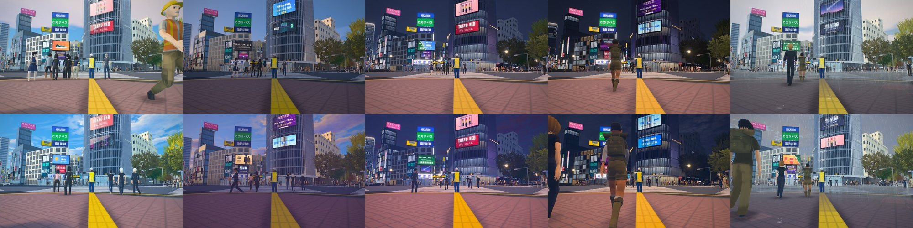
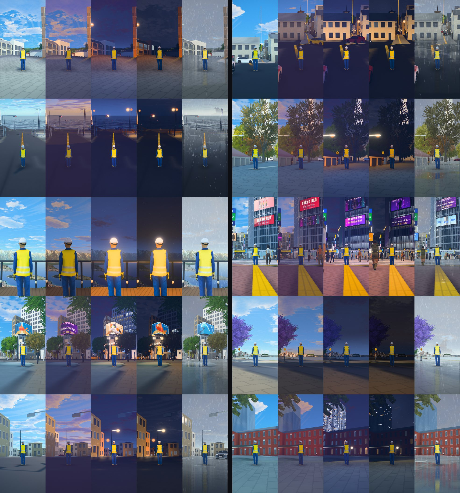

# The look of a place: grade, neon, wet streets, crowd and sound

> **Scope, November 2026.** The project is now one story on one map: Blue Hour, at the Shibuya Scramble
> ([STORY.md](STORY.md)). This page was written while the project built many maps, a globe and a model viewer.
> Where it names another city, the title screen, the viewer or the reef sites, it describes work kept at the tag
> `archive/world-2026-11`; the shared code it explains is the code Shibuya runs.

Shibuya's scramble is the reference: a hero shot by day, at dusk, at night and at night in the
rain, extending the title screen's lens (`web/lens.js`) rather than restyling it. What is built
here is general: every city's game takes the grade, every city with big LED screens
(`pipeline/screens.py`: Shibuya, Shinjuku, Osaka, Akihabara, Hong Kong) has their light, and any
city can key its own look in `game.look` in `cities/<id>/city.json`.

## What a browser can do now: the survey

Before building, we looked at what renders in a browser on ordinary hardware in 2026.

| Work | What it does | Licence | Here |
|---|---|---|---|
| three.js [SSRNode](https://threejs.org/docs/pages/SSRNode.html) and [SSGINode](https://app.unpkg.com/three@0.184.0/files/examples/jsm/tsl/display/SSGINode.js) (`examples/jsm/tsl/display`) | screen-space reflections and global illumination as TSL nodes, with MRT normals and temporal filtering | MIT | Not adopted: they are WebGPU node-material passes. The game renders through `WebGLRenderer` with an `EffectComposer` stack (bloom, the title's lens) and a reversed float depth buffer; moving it to `WebGPURenderer` is a separate project. SSR also misses everything off screen, and at a crossing the screens behind the camera are half of what a wet street reflects. |
| [pmndrs/postprocessing](https://github.com/pmndrs/postprocessing) | merged effect passes (SMAA, SSAO, depth of field, tone mapping) for WebGL | zlib | Not adopted: a second post stack beside three.js's own would double the passes the low tier pays for. Its ideas (merge effects into one pass, keep the HDR chain half-float) are already how `lens.js` works. |
| [realism-effects](https://www.npmjs.com/package/realism-effects) (0beqz) | SSGI, SSR, TRAA and motion blur for WebGL | MIT | Not adopted: built on pmndrs/postprocessing, and its last public release predates three.js r160; the v2 rewrite is unfinished. |
| [N8AO](https://github.com/N8python/n8ao) | fast screen-space ambient occlusion for three.js from the depth buffer alone: normals rebuilt from depth, half-resolution option, depth-aware denoise and upsample | CC0 1.0 | **Adopted** in its approach (`web/game/ao.js`, issue 138), written here rather than imported: N8AO reads ordinary and logarithmic depth but not three.js r186's reversed float depth, which the game draws with. The composer's target now resolves its depth for it on the medium and high tiers. |
| three.js [GTAOPass](https://threejs.org/docs/#examples/en/postprocessing/GTAOPass) (r186, `examples/jsm/postprocessing`) and GTAONode (TSL) | ground-truth AO (Jimenez et al. 2016) with Poisson denoise | MIT | Not adopted: the pass draws the scene again for its own depth and normals (a second pass over the whole city), and the node is WebGPU-only. Its horizon search is a better integral than a sample disc; worth a second look if the game moves to `WebGPURenderer`. |
| three.js [SAOPass](https://threejs.org/docs/#examples/en/postprocessing/SAOPass) (Scalable Ambient Obscurance, McGuire, Mara and Luebke, HPG 2012) | AO from a depth and a normal pass | MIT | Not adopted as a pass (it also draws the scene again for depth and normals); its falloff and estimator are the ones `ao.js` uses. |
| [pmndrs/postprocessing](https://github.com/pmndrs/postprocessing) SSAOEffect | SSAO with a normal pass, in its own effect stack | zlib | Not adopted, for the reason above: a second post stack, and a normal pass. |
| [three-gpu-pathtracer](https://github.com/gkjohnson/three-gpu-pathtracer) | a progressive path tracer for three.js scenes | MIT | Not in the game: a reference renderer for checking a grade against ground truth, too slow for play. |
| three.js `RectAreaLight` with [linearly transformed cosines](https://eheitz.github.io/research_ltc/) (Heitz, Dupuy, Hill and Neubelt, SIGGRAPH 2016) | analytic area lights: the right spread, falloff and specular shape for a rectangle of light | MIT (three.js and its LTC tables) | **Adopted** (`web/neon.js`): each big screen near the camera is an area light in the colour it is playing. |
| three.js `Reflector` (planar reflection with an oblique clip plane, Lengyel) | a mirror drawn from a mirrored camera | MIT | **Adopted** in its mechanism (`web/mirror.js`): the mirrored camera and its texture matrix, sampled by the ground's own materials in the puddles, with a clipping plane in place of the oblique near plane. |
| Screen-space planar reflections (Far Cry 5's, Unity URP SSPR) | a planar reflection by scattering the frame along the mirror | various | Not adopted: it needs compute or atomics that WebGL 2 lacks. |
| Light probes (three.js `LightProbe`, irradiance volumes) | baked indirect light | MIT | Not needed yet: the scramble's indirect light at night is mostly the screens' and the shopfronts', which the area lights and the light card carry directly. |
| [Poly Haven](https://polyhaven.com) scanned PBR textures (asphalt, worn concrete) | photographed surfaces: colour, normal and roughness of real asphalt and paving | CC0 1.0 | **Adopted** (`pipeline/surfaces.py`, `web/surface.js`): packed into one image each (luminance over the mean, roughness, normal) and sampled in metres on the ground at eye level, so a street up close has real aggregate, tar cracks and wheel polish instead of a procedural grain. |
| Texture bombing / anti-tiling (Inigo Quilez, [*texture repetition*](https://iquilezles.org/articles/texturerepetition/), technique 3) | two offset lookups of a tile blended by a noise, so a repeated texture shows no grid | MIT (the article's shader code) | **Adopted** (`web/surface.js`): the scanned surface is sampled twice at offsets a noise picks across the street and blended, so the 3 m tile does not read as a repeating blotch; value noise stands in for its noise texture. |

### The sky, the grade and an animated film's look: the second survey (issue 353)

Before the clouds, the per-region look and the light shafts were built, we looked at what draws a sky and
grades a picture in a browser, and at what is written about how animated films and games reach the look of
a painted background. Nothing below was copied as code or as art; where a source could not be opened, or its
licence could not be read, it says so.

| Work | What it does | Licence | Here |
|---|---|---|---|
| three.js `Sky` cloud layer (`examples/jsm/objects/Sky.js`, r186) | one layer of 2D gradient noise in the sky's shader: a four-octave fbm and a coverage sample (five noise calls, about twenty lattice hashes a pixel), Beer-powder shade, a Henyey-Greenstein silver lining | MIT | **Replaced** (`web/clouds.js`): its place in the dome's shader, its coverage and density uniforms and its forward lobe are kept; the shapes and the light are new. |
| Schneider and Vos, [*The Real-time Volumetric Cloudscapes of Horizon Zero Dawn*](https://www.advances.realtimerendering.com/s2015/The%20Real-time%20Volumetric%20Cloudscapes%20of%20Horizon%20-%20Zero%20Dawn%20-%20ARTR.pdf) (SIGGRAPH 2015) | Perlin-Worley noise for cumulus shapes, the Beer-powder term, a ray march of up to 64 samples | slides, no code | **Adopted in its noise only**: the texture's billow channel is a Perlin field with Worley heads on it. No march: a phone cannot pay for one in the sky. |
| [takram three-geospatial](https://github.com/takram-design-engineering/three-geospatial) (three-clouds, three-atmosphere) | volumetric clouds and Bruneton's precomputed scattering for three.js | MIT | Not adopted: a ray march and several targets of its own. |
| Shadertoy's cloud shaders (ray-marched volumes) | volumetric noise marched per pixel | CC BY-NC-SA 3.0 unless a shader says otherwise (from the headers of copies; Shadertoy's own terms could not be opened) | Not read for code and not adopted: the licence is non-commercial, and a march is too dear. |
| Hosek and Wilkie, [*An Analytic Model for Full Spectral Sky-Dome Radiance*](https://cgg.mff.cuni.cz/projects/SkylightModelling/) (2012) | a better fit than Preetham at sunset and in haze | the reference code is BSD 3-clause (as carried in Blender; not read here) | Not adopted now: the dome keeps Preetham with the hour's hue laid over it (golden hour, the blue hour, the night), which is where a painted sky departs from a measured one anyway. |
| Bruneton, [precomputed atmospheric scattering](https://github.com/ebruneton/precomputed_atmospheric_scattering); Hillaire, [*A Scalable and Production Ready Sky and Atmosphere*](https://github.com/sebh/UnrealEngineSkyAtmosphere) (EGSR 2020) | look-up tables for the whole atmosphere | BSD 3-clause; MIT | Not adopted: the tables are a render of their own at set-up and on a change of weather; no WebGL 2 port of Hillaire's was found. |
| Mitchell, [*Volumetric Light Scattering as a Post-Process*](https://developer.nvidia.com/gpugems/gpugems3/part-ii-light-and-shadows/chapter-13-volumetric-light-scattering-post-process) (GPU Gems 3, ch. 13) | light shafts: samples summed along the screen ray from a pixel to the light | book text | **Adopted** in the lens pass (`web/lens.js` `OE_SHAFTS`), without its occlusion pass: the bright sky is the light, 6 taps (4 on the medium tier, none on the low), jittered per pixel. |
| three.js `GodRaysShader`, [pmndrs `GodRaysEffect`](https://github.com/pmndrs/postprocessing), [three-good-godrays](https://github.com/Ameobea/three-good-godrays) | shafts as three blur passes, as a render of the light into its own target (60 samples), or as a march of the shadow map | MIT; zlib; zlib-style | Not adopted: each is one or more passes or renders. |
| Jimenez, [*Next Generation Post Processing in Call of Duty: Advanced Warfare*](https://www.iryoku.com/next-generation-post-processing-in-call-of-duty-advanced-warfare/) (SIGGRAPH 2014) | interleaved gradient noise | slides | **Adopted** (already the motion blur's): the shafts' taps are offset by it, so six read as haze. |
| [Khronos PBR Neutral](https://github.com/KhronosGroup/ToneMapping) | the tone curve the title's lens is built on | Apache-2.0 | Kept. The look is laid on it as a split tone, a lift and a vibrance, not as another curve. |
| AgX (Sobotka; three.js `AgXToneMapping`), [Narkowicz's ACES fit](https://knarkowicz.wordpress.com/2016/01/06/aces-filmic-tone-mapping-curve/), Uchimura's Gran Turismo curve ([glsl-tone-map](https://github.com/dmnsgn/glsl-tone-map)) | other LUT-free curves | MIT (three.js); CC0 or MIT; MIT | Not adopted: a second curve would part the game from the title screen and the films, which share this one. |
| [Tony McMapface](https://github.com/h3r2tic/tony-mc-mapface) | a display transform shipped as a LUT | MIT or Apache-2.0 | Not adopted: a LUT is a texture and a fetch more a pixel. |
| [HYG star database](https://codeberg.org/astronexus/hyg) | 119,614 stars | CC BY-SA 4.0 | Not adopted: the bright stars here are a hand list of 41 and the rest are scattered towards the galactic plane; the Milky Way is drawn from the clouds' own noise. |

What is written about the look of Makoto Shinkai's backgrounds, and what was taken from it. No frame, painting
or asset of any film or game was used, and none is imitated shot for shot:

- Shade takes the colour of what surrounds it (Shinkai, as quoted in
  [*The World of Makoto Shinkai*](https://tulip651989.wordpress.com/2014/11/20/the-world-of-makoto-shinkai/): under
  a blue sky the shadow is adjusted towards blue), and lens flares are tinted the same way. Here: the light in the
  shade is the sky's colour, the lens lifts the deepest shade towards blue or violet, and the flare takes the sun's
  colour for the hour.
- The clouds and the light carry the feeling of a scene
  ([Hikawa Ryusuke, nippon.com, 2016](https://www.nippon.com/en/views/b06802/the-independent-vision-of-anime-filmmaker-shinkai-makoto.html)).
  Here: the sky is where the work went first.
- Twilight is gradients of violet, magenta and deep gold that reach into the shadows; shadows are rich but open,
  never crushed; the highlights have a soft shoulder; colour is dense in the mid-tones
  ([a colourist's reading of *Your Name*](https://colorculture.org/your-name-cinematography-analysis/): one
  person's analysis, not a statement by the studio). Here: the clouds' palette at dusk, the shade lift, the
  existing highlight roll-off, and vibrance rather than plain saturation.
- Rain is an event: puddles that mirror the street's lights, drops and rings drawn as shapes
  ([Shinkai, JAXA's, no. 80](https://global.jaxa.jp/activity/pr/jaxas/no080/01.html)). Here: already the weather's
  and the wet street's work; the sky under rain is now a sheet with form in it rather than white.
- Nothing was found from the makers on how Genshin Impact, Breath of the Wild or Sky draw their clouds, nor on
  Persona 5's colour design; what circulates is fans' reconstruction. Persona 5 is a reference for design in
  [GAME.md](GAME.md)'s work, never for this picture.

## What was built

### The grade through the day (`web/game/atmosphere.js`)

The title's lens takes an exposure, a white balance, a saturation and a contrast keyed on the
sun's height: by day a little warmth and contrast; in the golden hour (sun at 3°) warmer; in the
blue hour (−4°) a lift and a cool balance, so the dusk sky and the first lights read together
rather than the street going grey; at night (−12°) the deepest contrast, with `uNightTone`
taking the shadows to blue and the lights to amber as before. Bloom keeps its high threshold
(6 by day, 1.6 at night), so lit walls do not bloom; only lamps, signs and screens do. All of
it is uniforms of the one pass that ends the frame (`web/lens.js`): a look costs no pass. A city
keys its own: `game.look.grade: {night, blue, golden, day}`, each `{ev, tint, sat, contrast}`.

**Dawn in the shade (Shibuya, Tokyo).** With the sun a degree or two up, a street among towers is all shade,
and the golden key's blue shade over a low exposure gave the whole frame a purple-grey veil. The two maps key
their own `golden` and `blue`: a third of a stop more exposure, a shade that is nearly neutral and warm
highlights. No fill light was added: a light with no source flattens the forms the sky's light gives and has
to be taken out again at every other hour; what the frame lacked was exposure, as a camera would give it.

### The sky and its clouds (`web/clouds.js`, issue 353)

The Sky's own cloud layer was one sheet of soft noise. In its place, in the same shader of the same dome (no
pass, no target, no draw), four layers are composed far to near:

- **cirrus** at 9 km: streaks bent by a slow field (a domain warp) so that they sweep and hook, broken along their
  length into strokes, and read from a coarse mip so that they are wisps rather than fine lines;
- **towers**: cumulus congestus standing on the horizon all round, shaped in azimuth and elevation like a painted
  backdrop's layer (they are tens of kilometres off, so they do not shift as you walk): a skyline of masses with
  heads on them, lit on the side the sun is on, wholly lit when the sun is behind you, rim-lit when it is behind
  them, their feet in the horizon's air;
- **altocumulus** at 5 km, a dappled sheet here and there;
- **the cumulus deck** at 1.5 km, on a sphere's shell, so it closes on the horizon 140 km off instead of running
  to infinity: banks and clear gaps, a lit side found by a second lookup of the density towards the sun, a shaded
  base in the sky's colour, a silver lining towards the sun, and the sun's glow through thin cloud.

All of it reads one tileable 256 x 256 texture made once on the CPU (billows, cells, streaks, regions; each
channel spread evenly by rank, so a cover of 0.3 hides three tenths of the sky): 10 bilinear lookups a sky pixel
against the 20 lattice hashes of the layer it replaces. The layers drift with the weather's wind (`OEWeather.S.wind`, [WEATHER.md](WEATHER.md)); under a thunderstorm the
sheet darkens and lightning lights it from within. They change shape slowly; the cover and density are the weather's
(`cloudCoverage`, `cloudDensity`, as before). Where the layers start is a hash of the map's latitude and longitude and the day, so two maps
at the same hour, or one map on two days, do not show the same sky. After dark the fair-weather cumulus thins out and softens.

The clouds' colours are not worked out per pixel. For each hour `OEClouds.light` sets a lit colour, a shade
colour and a rim colour from the sky's own zenith and horizon (worked out on the CPU, as the haze is), by a
palette keyed on the sun's height: cream and a clear blue shade by day, peach and violet in the golden hour,
rose over indigo after sunset, a pale slate over the city's glow at night, a luminous grey sheet with form in it
under an overcast, darker in rain. A cloud keyed to its sky holds its look through the tone curve at any exposure
and is never grey. The light from the sky (PMREM) is taken from the same dome, so the city is lit by the sky it
stands under; the haze at the model's edge is still the clear sky's horizon.

At night the stars go out behind cloud (each star looks up the cover in its vertex), the **Milky Way** lies where
it is that night (the galactic plane, brightest towards Sagittarius, with its rift), and on a clear night a
**shooting star** crosses now and then; both are a few lines of the dome's shader behind a uniform test.

### A look per region (`game.look.preset`, `web/game/atmosphere.js` `LOOKS`)

Two presets: `shinkai` on every Japanese map (any city whose `country_code` is `JP`, so a new one has it without
a line of configuration) and `film` everywhere else; `game.look.preset` in `cities/<id>/city.json` names another,
and `game.look.grade`, `game.look.light` and `game.sky` still override single numbers. A preset is only numbers
for what is already drawn:

| | `film` | `shinkai` |
|---|---|---|
| Sky | saturation 1.7, low towers, soft edges | saturation 1.95, towers at full height, drawn edges, a stronger rim and glow |
| Clouds' palette | natural: cream, a grey-blue shade | cream to rose lit sides, blue to violet shade |
| Night sky | a faint Milky Way, 6 shooting stars an hour | the Milky Way at full strength, 24 an hour |
| Grade (`lens.js`) | the hour's keys with a little vibrance | more vibrance, a cooler shade and warmer light (the split tone), the deepest shade lifted towards blue by day and violet at dusk |
| Light in the shade (`world.js` `shadeLight`) | the sky's colour, a little | the sky's colour, more; sunlit ground throws warm light back up onto walls (the hemisphere light's ground colour) |
| The sun in the lens | flare 0.55, shafts 0.5 | flare 0.9, shafts 1.0 |

A thunderstorm by day has its own key on top of the preset: the exposure down by nearly half (about a stop), a
harder curve and a cold slate cast (`OEWeather.S.storm`), and the cloud deck's underside darker (`clouds.js` `light`, `look.storm`; issue 381), since the weather lifts the exposure under cloud so that an overcast is never grey,
which left a storm's sky pale. At night it changes nothing.

The lens pass (`web/lens.js`) gained uniforms, not passes: `uShade` and `uHiTint` (the split tone, formerly two
constants), `uShadeLift`, `uVibrance`, `uSunSeen` and `uShafts`. The flare, which the game never drove, now
follows the sun; how much of the sun's disc the frame really shows is read at five points in the lens's *vertex*
shader (twenty lookups a frame, none a pixel), so a building or a cloud in front of the sun puts the flare and the
shafts out. The shafts run only while the sun is in or near the frame and above the horizon, and are compiled
out on the low tier. The Kuwahara lens stays the overture's.

Frame cost against main (`tools/frame_cost.js`, Shibuya on foot, high tier, 1440 x 900): 420 draws, 7.60M
triangles and 70 full-screen passes writing 80.0 MB a frame, before and after: the same passes, targets and
bytes. What changed is the work inside two shaders that already ran: the sky's (fewer operations: lookups for
hashes) and the lens's (the same by night and with the sun out of frame; six more lookups a pixel on the high
tier while the sun is in it). A software renderer's frame times do not tell these apart; a real GPU was not
available.

#### Stills: before and after, every live map

Each sheet is one map from where its game starts, on foot, at 1440 x 900 on the high tier: 13:00, 35 minutes before
sunset, 18 minutes after it, 21:30, and 15:00 in rain. The upper row is main before this work (60ff3b75), the
lower row the same views after it. The eight Japanese maps have the `shinkai` preset, Sydney and Queenstown
`film`.

**Shibuya**

**Tokyo (Marunouchi and Ginza)**

**Shinjuku**

**Kyoto**

**Higashiyama**

**Fushimi Inari**

**Tetsugaku-no-michi**

**Kamakura**

**Sydney**

**Queenstown**

The same views at a phone's size (390 x 844, the look only; five hours across, a map to each block: Fushimi
Inari, Higashiyama, Kamakura, Kyoto, Queenstown, Shibuya, Shinjuku, Sydney, Tetsugaku-no-michi, Tokyo). These were
drawn on the high tier at a phone's frame, not on a phone: a phone picks its own tier, and on the low one the
light shafts are compiled out.

A day in 24 seconds, from before sunrise to night, over Shibuya and over Higashiyama (960 x 540, 12 frames a
second, the clouds at twelve seconds a frame): [images/look/shibuya-day.mp4](images/look/shibuya-day.mp4) and
images/look/higashiyama-day.mp4, made with
`xvfb-run -a node tools/day_film.js shibuya out.mp4 960x540 24 12` (see the tool's header for the view). (Made before the clouds were seeded by place and day, so both start from the same sky.)

### Follow-ups (issue 372)

- **Glints on the rails.** The rails are their own material (`web/world.js` `railGlint`): each vertex carries its
  rail's direction (`aRail`), written by `web/game/rail.js` `trackMesh` and, for the landmark rails swept by
  `cities/<id>/rail.py` (material `rail_steel`: Tokyo, Sydney), worked out on load from each long thin triangle's
  longest edge (`railDirections`), and the rail's head takes the hair highlight of Kajiya and Kay
  (1989), sin(T, H) to the 90th, on the sun's light as its diffuse term has it (shadow, colour, angle). A track
  that runs towards a low sun shows a bright thread where the sun's reflection meets it, which moves with the eye.
  The rails had been wound face down and culled from above (only the sleepers showed, on every map with a railway,
  tram or funicular); they now have a head and two sides 0.14 m deep. The contact wire stays without a glint: at
  1.2 cm it is under a pixel from the street, and its rods are merged with the poles'.
- **A bounce that knows its ground.** A wall reads the sky visibility (`skyvis.webp`) of the ground 4 m in front
  of it, takes from it the height of the horizon there (the texture holds its mean cos^2), and asks whether the sun
  clears it; the ground term of the hemisphere light on that wall is scaled from 0.3 (a canyon's foot in shade) to
  1.25 (an open square in sun) (`web/world.js` `groundBounce`, on the city's walls and every material that takes
  the sky visibility). One texture read; nothing at night; `?bounce=off` leaves it out. It is directionless: a
  street that runs along the sun's bearing counts as shaded when it is deep, which the far sun's height field
  (`?farsun=on`) would settle where it is on.
- **Golden-hour violet.** The `shinkai` preset's golden key took shaded paving far towards violet. Its shade went
  from 0.92 / 0.90 / 1.14 to 0.95 / 0.94 / 1.06 and its lift from 0.012 / 0.006 / 0.030 to 0.008 / 0.006 / 0.016:
  still a cool shade, no longer a purple one. The owner's to judge (before/after stills of Kyoto, Shibuya and
  Kamakura were put in front of them); the old numbers are one line back.
- **Shafts at half size.** The light shafts read the bloom's bright pass, which is drawn at half size anyway: its
  alpha, which the bloom's blur never read, now holds each half-size pixel's brightness before the threshold
  (`web/lens.js` `bright`, `tBright`). Six taps of a half-size target in place of six of the full-size scene; the
  plain lens after a camera effect still reads the scene.
- **Cirrus and a sky per place and day** were done in #390.

### The screens light the street (`web/neon.js`)

Each LED screen's programme is followed on the CPU: the mean colour of every keyframe in its
sheet, the clip it is on, its hours and brightness, and the synchronised slot when all the
crossing's screens play together. The nearest screens, weighted by their size, drive a fixed
set of area lights (high tier 8, medium 4, low none), which fade from one screen to the next as
the camera moves. A screen lights the crowd, the cars, the asphalt and the facades across from
it, never what is behind it, and by day very little. The street's static pools of the screens'
light (`night.js`) stay for the far city and the low tier.

A square with no street lamp in it (the scramble) gets a light card after dark
(`game.look.fill`): a large area light over its middle, standing for the shopfronts,
floodlights and signs round it. A card may be aimed (`aim`) to light one thing from its
side: a small warm one lights Hachiko's bronze, which lamps drawn as points leave black.

The scramble's card was set (k 1.2, a peach #ffe4c8) before the hero level baked the shopfronts' and signs' own light
into the crossing (`hero.bake`) and took a share of the street lights and the screens' area lights; on top of them it lit
the whole crossing like an overcast afternoon, and its zebra stripes went to a pink white. From the story's first camera
over the crossing at 17:38 (sun 6 degrees down), 13 % of the ground was at white; the Stop's own grade (its blue veil
and half saturation) hid it, so the street seemed to flare up as time ran again. Measured with every other light as it
is (`tools/light_split.js`, a film's camera with the world held): with the card at 1.2 the ground's mean was 0.46 and
13 % of it clipped; at 0.7, 0.39 and none; at 0.5, 0.35 and none; without it, 0.25. It is 0.5 now, in a neutral warm
white (#fff0e2), the light of LED shopfronts rather than of sodium.

A card stood 3.6 m over the paving under the Ginza Line station's slab (508, -1064; k 1.1), for the light the city's
2.8 m underside left out. Frame 5's hero level (`miyamasu`, issue 33) raised the underside to 7 m and bakes its own
linear lights onto that paving, and with the card still on the new paving went cream and 12 % of frame 5's view
clipped at 17:39 (7 % at 20:00). Without it: 0.15 %, all of it lamps, and the paving's mean 0.50 at dusk and 0.45 at
night in its own tones and joints (`tools/light_split.js` `CARDI=3 CARD=0,0.2`). It was taken out.

### Faces and lights: what may burn

A photograph of Shibuya at night has one thing at white: the lights themselves (a lamp's head, a neon tube, the bulbs
round a sign), each with its glow. A lit sign's face, a shop's light box and a lit window are bright, but their images
stay in them: the letters stand off the face. The game set every glowing surface's light in absolute numbers
(`glow` on a landmark material, `glow` on a hero level), and the exposure rises through the evening; so at the blue
hour a white sign's face went past what the screen shows, the lens's roll-off (`lens.js`) took the face and its
lettering to one white and the bloom spread over them (SHIBU HACHI BOX on Hachiko Square, the koban's sign, the
shopfronts' light boxes: 0.2 to 0.6 % of a frame each at white, `WHO=1`).

The root of it is which of the two a surface is, not its number. A **face** (an image that glows, `emissive_map` on a
landmark material; a hero level's `glow*` light boxes and `win*` windows) is held under a ceiling set where the picture
is, not in the scene: `uFaceCap` is `FACE_MAX` (0.9) over the exposure the lens is using (`atmosphere.js`), so that at
any hour the brightest part of a face lands under the tone curve's last stretch (about 0.75) and what is darker on it
keeps its place; it eases in over the top 40 % and scales the colour as a whole, as the lens's roll-off does
(`world.js` `faceCap`). A **light** (`lamp`, `neon_*`, `aviation`, a hero level's `tube*`, `chase*`, `paper*`, the
lamps' points) is not held: it is what the camera exposes against. This is HDRP's split between an emissive surface's
"exposure weight" and a light, and how games author emissive signage (a face's luminance chosen against the camera,
the light's own bloom saying how bright it is); the lens's highlight roll-off stays the net for everything else.

`WHO=1 FAIL=0.3 tools/light_split.js` holds the rule: any surface that is not a light putting more than 0.3 % of a
frame at white fails it, from the views given, at the hours given.

### The camera (`web/game/atmosphere.js` camFx)

Depth of field and motion blur only where a camera would show them: photo mode gets an
Aperture slider (f/1.4 to f/16, focused on the focus point, the circle of confusion of a
full-frame lens at the chosen focal length), and the opening shot of a city has a shallow focus
and the camera's motion blur as it cranes in. In play there is neither. Both read a distance
pass drawn only while they are on.

The motion blur takes 12 taps along each pixel's motion, offset per pixel by interleaved gradient
noise (Jimenez, *Next Generation Post Processing in Call of Duty: Advanced Warfare*, SIGGRAPH 2014),
so its steps dissolve into a fine grain instead of standing as copies. Its streak is held to 1.2% of
the frame. A sample further off than the pixel itself is weighted down, so a far surface doesn't
smear over a near one (the background-over-foreground rule of McGuire et al., *A Reconstruction
Filter for Plausible Motion Blur*, I3D 2012, in its simplest form). A camera that jumps more than
5% of the frame in a frame (a cut, or the first frame after a stall) draws no blur. Before issue
265 it took 8 even taps up to 3% of the frame: the arrival onto Queenstown's Skyline deck drew
each edge of the rock and the deck as a row of jagged copies.

### A conversation's camera (`web/game/talkcam.js`, issue 15)

While one of the story's people speaks, the view is a conversation's, not the chase camera's: an
over-the-shoulder two-shot on the speaker as the talk opens (40 mm, the speaker's eyes on a third, a little
headroom), a cut to the speaker's single on the next line (50 mm, from the player's side, 25 degrees off the
line between them), a closer single (75 mm) on the line after an answer is judged, and the reverse over the
speaker's shoulder for the player's own question or the roll. A screen held upright takes the vertical angle
instead and puts the eyes nearer the middle. Each change is a cut; the chase view comes back eased over half a
second. The speaker's face is in focus where the tier draws depth of field (f/2.8).

The 180 degree rule is kept for the whole talk: the side of the line is chosen as the talk opens for the one on
which the two-shot, the single and the reverse are all clear, and kept. A shot is clear when no wall (the
camera's own probe, from the face to the lens), tree trunk, crown (from its lowest leaves up, `trees.json`
`clear_m`, `crown_r`), lamp post or body stands within reach of the line from the lens to the eyes. A shot that
is not clear comes in along the same line; only when nothing on that side is clear is the line crossed. The
crowd in a Stop is held and cannot be seen to step aside, so whoever of it still stands in the way is left
undrawn while the shot lasts.

A clear line is not a clear frame (issue 45): a held walker a shoulder's width off the line filled the middle of
the summation's close shot, the old woman pushed to its edge and half hidden, and a stranger with an umbrella
stood at her shoulder in the two-shot as though one of the talk. At each cut the shot is cleared of the crowd it
would show in front of the face (everyone nearer the lens than a pace beyond the face whose body, or an open
umbrella's canopy, comes into the frame) and of anyone within 1.6 m of the face (an umbrella held over a stranger at her back stood over her head): a walker among them is sent on
elsewhere, as one the crowd is done with, and someone waiting at a scramble's kerb is left undrawn until the
next cut. A cut hides the change, in a Stop as in the running street. The street behind the face keeps its
people: they are the life behind a talk.

The words are part of the frame (issue 76). At their largest the dialogue's panel covers the lower 28% of a
desktop's frame and more of a phone's, and a shot composed on the whole frame put Yuna's body under it, her head
at its edge. The shot is told the panel's top every frame (`#gd`, as a share of the canvas's height) and puts the
eyes on the upper third of what the words leave above them, never nearer the top than a fifth of the frame. It
does that with a lens shift (`camera.setViewOffset`): the lens looks level at the eyes and the picture is moved up,
so the shot's perspective and its verticals are the same at every size of the words, as a view camera's rising
front keeps them. The shift is set at a cut, eased as the words grow (a question's answers coming in under
them) and eased off with the blend back to the chase view; the reflection of a wet street (`web/mirror.js`) takes
the frame as shifted. A shot whose face the frame would not show is refused as a wall is, and the next distance
or the other side is tried: the eye outside the frame as composed, or the face behind the head of the one whose
shoulder the shot is over (a head 0.16 m round, hair and all, and a face 0.1 m, as the lens sees them).

The one spoken to is there before the talk opens: a map's person the story asks for (`ctx.person`) is loaded
ahead of the rest, and the talk waits until they have come. Taken up at frame 4, the player was put at SKY GATE
before Yuna's character had loaded, and the shot was of the empty place where she was to stand. A character that
comes is posed before it is put in the world, as the next frame would pose it: one that came in its bind pose
while the Stop held time had its head turned 0.055 rad by the first held frame, and the Stop's check failed on it
(`tools/head_spin.js` holds both).

`tools/talk_check.js` plays the episode and fails a shot whose face is off the screen or occluded, whose lens is
in a wall, or which shows any of the crowd it should have cleared, judged by what the crowd's renderer draws
(not by what the camera meant to clear); a face behind the shoulder's head; and a face under the words or below
the middle of what they leave above them (the log's `panel`). `WORDS=2` plays with the words at their largest from
the start, for a late start (`FROM=3 UPTO=4`).

Learnt from, not copied: film grammar's coverage of a dialogue (master, singles, reverse; the line of action);
the dialogue cameras of *Mass Effect* (2007) and *The Witcher 3* (2015), which cut between a small set of
framings chosen per line and keep the axis; *Kentucky Route Zero* and *Disco Elysium* for when not to move the
camera at all (a voice on the telephone keeps the street).

### A lit sign's level (first principles)

A light box after dark is tens of times the luminance of a facade lit by the street, more than any camera
holds: in a photograph it is the exposure that decides how it reads, and a well exposed night photograph of a
street puts its lit signs two to three stops over the fronts, the white near the top of the scale and the
printed colour still deep. A sign drawn brighter than that adds nothing a photograph would keep: its white
clips, the bloom spreads its area over everything near it, and the tone curve's roll-off pales its colours. The
cost grows with the lit area, so the largest boxes need the lowest level: Center Gai's bookshop's box sign, the
largest round the crossing and behind a conversation's speaker, has its own level (0.68 against the signs'
common 1.3) and a diffuser's warm white (238) rather than paper's (`cities/shibuya/scramble.py` `x_bk_sign`).
The rule of a film's lighting holds too: a lit practical behind a face may be brighter than the face, but
never so large and blown that the eye goes to it first.

### Steep ground (`web/world.js` STEEP_ROCK, every city)

The aerial photograph is taken from straight above, so on a face steeper than about 45 degrees
each of its pixels is drawn over 1.4 to 4 metres of slope, smeared down the fall line. There the
photograph gives way to rock, blended in between 44 and 60 degrees of slope: the photograph's own
tone, blurred to some 30 m, kept to a weathered schist's albedo, with a detail projected along the
face's three axes (triplanar mapping, so nothing stretches) and a foliation's bands. The game's
ground keeps its pavers off those faces (`oeSteep`). Near the camera, where a photo pixel is
magnified past about four screen pixels, its detail is taken towards the mean over a few of its
pixels and the sky's blue is taken out of its baked shadows: the drawn grain and pavers carry the
detail there instead of a smear of the photo's roof shadows and kerb lines.

### Wet streets (`web/mirror.js`, with the weather of #95)

When the ground is wet (`OEWeather.uniforms.uWet`, the weather's), the high tier draws the city a
second time, at half size, from the camera mirrored in the ground under it, and the ground tiles,
paving and road markings take that picture by Fresnel's law for water: clear in the puddles,
blurred and smeared down the frame on the wet film between them, wavering with the asphalt's
grain and, in the rain, with rings in the puddles. Screens, signs, lamps and headlights then
reflect as long images, as they do in a photograph of Shibuya in the rain. Below the high tier
the wet street (darker, smoother: the weather's own patch) reflects the sky and, through its
lower roughness, the screens' area lights.

### Contact shadows (`web/game/ao.js`, issue 138)

By day the facades and street corners read flat because nothing darkened where they meet. On
the medium and high tiers ambient occlusion is gathered from the depth buffer alone (the city is
not drawn a second time): at half the screen's size each pixel's position comes from depth and its
normal from its neighbours, a spiral of 16 samples (8 on the medium tier) in a disc of up to 1.8 m
near the camera and a little more further off gathers the occlusion with SAO's falloff, and two
depth-aware blurs take the noise out. The frame's one full-resolution pass, the lens, darkens each
pixel by it as it reads the scene, upsampled by depth (issue 352: before, a pass of its own drew
the whole frame again for this). It fades out between 160 and 420 m, so the far city keeps the
photograph's light, and is a third weaker at night, when the light is the street's own. The low
tier is untouched.

The frame-time governor (`web/quality.js`, [PERFORMANCE.md](PERFORMANCE.md)) sets its ceiling on a
device that cannot keep up: the lite level, then off, and back when the frame time allows. `?ao=0`
turns it off, `?ao=1` keeps it whatever the governor says, `?ao=show` shows the occlusion alone;
stills take `"ao"` in their views (`tools/game_shot.js`) and `tools/ao_cost.js` measures what each
level costs.

### The crowd (`web/game/game.js`, `game.crowd`)

On the medium and high tiers a city has room for its peak crowd (`pedestrians_peak`: Shibuya
1,600 walkers, drawn skinned near the camera and as instanced low-detail copies beyond); the low
tier keeps its usual number (640), so a phone draws no more people than before. How many are out
follows the hour (`hours`: the morning commute, lunch, the evening peak, the last trains),
Friday and Saturday nights (`weekend_night`) and the weekend (`weekend`; the Shibuya
Redevelopment Association counted 260,000 people a day on weekdays and 390,000 on holidays in
2014). The crowd's looks are the `tokyo` style of `web/game/people.js`; the NPCs are cast
Rocketbox avatars.

**Real people up close (`web/game/people.js` `crowdRenderer`, `game.crowd.real_from`).** At eye
level the far crowd's own low-detail character read as a doll. The nearest walkers (14 on the
high and medium tiers; 10 on a phone, from a cast of eight there, fewer on its lighter sets, which the
map built round the player left room for: docs/PERFORMANCE.md) are now drawn
as the textured Rocketbox NPCs cast for the city (`game.npcs`) and the casts `real_from` names
(Shibuya takes Tokyo's too), in their everyday clothes — the uniforms (police, delivery, pilot)
are left out. Each near walker keeps its far figure's sex and takes a scanned face, hair and
clothed body; its height is set to the Japanese adult mean (MHLW National Health and Nutrition
Survey 2019: women 1.58 m, men 1.71 m, or `game.crowd.height`) with the figure's own spread. A
city turns it off with `game.crowd.real: false` or the URL `?realcrowd=off`. A near walker whose
cast member is still streaming stands in as a loaded cast member of the same sex rather than the far
crowd's doll, so a dense crossing reads as real at once and swaps to its own character when it comes.

**Arms kept out of the body (`web/game/people.js` `armsClear`).** One clip file per sex drives every avatar of that
sex, so a pose made on one body plays on broader ones: the texting clip that three in ten of the crowd take when they stop
put the right forearm into a suit jacket's chest at the crossing (the owner's report), and the drink, the book, the
clipboard and the camera put hands and what they hold into blouses and jackets: 47 of 166 avatar-clips had a limb or a
held thing more than 2 cm inside the torso, up to 7 cm. Each body's own torso, as it was bound, is cut into 3 cm slices
up the spine, each a ring of 24 radii carried by a blend of the spine bones (as the skin is). Each frame a few points of
each forearm and hand (spread over them by farthest-point sampling) and the corners of what the hand holds are looked
for inside the rings; every point inside, or nearer than 2 cm, asks for the turn that takes it out along its ring's
radius, the elbow's half of the forearm of the shoulder (the forearm then aimed back at the wrist, so the hand keeps its
place), the wrist's half, the hand and what it holds of the elbow. The asks are weighed by the square of how far in each
point is, so the correction grows and fades with the pose, and the turn reaches the arm through a critically damped
spring (stiff to push, soft to let go; Lowe's closed form, *Game Programming Gems 4*, 2004), so a hand that meets the
body at speed is not stopped within a frame. It is laid over the clip and taken off before the next frame. About
0.08 ms a person a frame on a session's machine. Learned from the design of contact-aware retargeting, which treats the
skinned body's self-penetration as the thing to remove (Villegas et al., ICCV 2021) and from engines' run-time limb
correction after retargeting (Unreal Engine's IK Rig and Control Rig); nothing was copied. `tools/hold_check.js`
measures every cast avatar through every held clip (docs/CHECKS.md, `hold`).

**The far crowd is the same cast (`pipeline/crowd_cast.py`, `web/assets/people/crowd_cast.glb`, issue 475).**
Past the nearest walkers the crowd was still the instanced dolls recoloured from a palette, and across a street
they read as another kind of person from the scanned ones beside them. Each walker is now drawn far off as the
very cast member it becomes up close (the same hash picks both), at the same height: a copy of the Rocketbox
avatar stood in the first frame of its sex's Idle_Neutral, simplified to about 1,000 to 1,800 triangles with its
texture seams and swung parts kept (meshoptimizer's simplifier, MIT, `pipeline/vendor/meshoptimizer/`), and
its own colour maps in one 128 x 192 picture (the body at 128, the head and the hair cards at 64; the cards cut
out, lit as one head of hair and toned to the hair under them as `people.js` `matchHair` does). It walks on the
far crowd's shader swing as the dolls did, one instanced draw a cast member, so the cast is held to twelve on
the desktop tiers (six women, six men; Shibuya's sixteen came to more draws than the dolls' thirteen) and to
eight on a phone, where the copies' pictures go up at half size. The step from far to near changes
the detail and the gait (the swing to the clip), not the clothes, the face or the height. The dolls stay for a
walker whose cast member has no copy, and for a city with no cast; `?farcast=off` brings them back to compare.
Considered and not taken: octahedral impostors (a picture per view angle: 8 to 16 MB a cast at a readable size,
and a flat card where the crowd's shadows and night lights need a body), and the near walkers' skinned clips on
every walker (a skeleton a person: the cost the instancing exists to avoid).

**Where they are** (`game.crowd.places`, issue 494). One number for a whole map (the pool over `radius_m`, about
0.0008 walkers a square metre) left the busiest square of a city as empty as its back streets: at 12:30 nobody
stood within 32 m of the player at Tokyo's or Sydney's start. Three causes, three changes:

- *The opening.* The crowd's first placing was meant to put people anywhere, the player's side too, but it asked
  for the game's first second, and the title card holds the crowd while the game's clock runs under it. Everyone
  was put as a latecomer is: out of sight and 270 m off, or 45 m off where the crowd gathers. Now the crowd's
  first step, and the step after the hour is *set* (a still, the menu's clock, a story's cut), put people anywhere
  (`actors.js` `opened`, `crowd.fresh`); a clock that runs on still brings people in on foot from out of sight.
- *A density by place.* A map lists where its people are: `places: [{id, at, r, share, pull, hours, paths}]`.
  `share` is the part of the walkers put on the street who are put within `r` of the place (by its share among
  the places near the player), `pull` how often a walker near it takes the way towards it at a footway's end,
  `hours` `[hour, weight]` on the share (a station's forecourt at the commute, a quay from mid-morning). They are
  the same walkers, so the pool, and the frame, cost what they did. Tokyo: the Marunouchi side of the station.
  Sydney: Circular Quay's west promenade and the concourse between the station and the wharves. Shibuya's
  scrambles were places already (`crowd.hot`, set from the junctions).
- *Ways across open paving* (`places[].paths`). Footways are mapped as lines, and a quay thirty metres wide has
  two: the crowd walked those in file and left the paving bare. A place adds the ways people take across it (the
  water's edge, the plaza between its lawns), for the crowd only; `game.js` lays them on the ground and
  joins each end to a mapped footway's end within 6 m, and drops what is not ground to walk on.

Tokyo and Sydney have `hours` now (an office district's day; a commuter quay and foreshore's), with
`pedestrians_peak` for the desktop's pool, so the lunch hour is fuller than 3 a.m. Measured with
`tools/crowd_around.js` (`TIER`, `SIM`), `tools/frame_cost.js` and `tools/mem_check.js`; the numbers are in
issue 494. `pipeline/game_sync.py` copies these settings into `game.json` without a rebuild.

**Who is on the street** (`game.crowd.cast`, `web/game/game.js` `realCast`). The walkers drawn as people were the
story's NPCs in the order of their names, which put the office suits first, and three faults made copies of
them: the pick of a character was the walker's number modulo the cast's size, so a group that set out together
was one man eight times; a walker whose character had not streamed stood in as the first one loaded, and stayed
so; and only four of the cast were fetched ahead. A map now names its cast from every character built, in order
(six women and six men on a desktop, four and four on a phone): Shibuya's young crowd in everyday clothes with
every fourth a visitor from abroad, Marunouchi's office workers and shoppers, central Sydney with about a third
of Asian background (the shares are estimates). The pick is a mixed hash, the whole cast is fetched at the start,
and a stand-in gives way as soon as the walker's own character has come. Hair is part of a character's head:
another style is another head built in Blender (`blender/build_people.py` tags), not a change at run time.

**Heads and hair** (issue 505). Two walkers on one body should differ above the collar, so a cast also names the
same body under another head or hair colour: `R_Female_Adult_08_f016`, `R_Female_Adult_15_f011_brown`,
`R_Male_Adult_11_m017`, `R_Male_Adult_13_m008_grey` (a Rocketbox head is its face, its hair's cut and its cards;
`brown` and `grey` recolour it). A cast's names are built whether or not a story's NPC wears them
(`pipeline/fetch_rocketbox.py` `npc_cast` reads `game.crowd.cast`). A cap or a hat is not built: the far copies
could not show it, and it would be one more picture a head.

**The shares, checked** (issue 505). Central Sydney: the 2021 Census counts 211,632 people in the City of Sydney
(ABS QuickStats, LGA17200), by ancestry English 25.1%, Australian 16.8%, Chinese 16.8%, Irish 10.7%, Scottish
7.5% (up to two each), 44.6% born in Australia, 7.8% in China, 3.0% in Thailand, 2.7% in Indonesia; Mandarin is
spoken at home by 8.6%, Cantonese 2.8%, Thai 2.8%, Indonesian 2.1%. So about a fifth to a quarter of residents
are of east or south-east Asian background; the cast's three in eight (and the visitors a quay has) stays an
estimate on the high side of that, not a count. Shibuya: the Tokyo Metropolitan Government's survey of foreign
visitors' behaviour (2023) has 67.1% of them visiting Shibuya, the most of any district (Shinjuku and Okubo
57.4%); that is the share of visitors who come, not of the people on the crossing, for which no count was found:
every fourth walker a visitor stays an estimate.

**The same person in other clothes** (`web/game/people.js` `DRESS`). A cast of a dozen fills a crossing, so two of
one character meet, and side by side in the one red shirt, or three in the one taupe suit, they read as copies.
Each walker wears one of eight: a coloured cloth turned round the wheel and quietened (a dark one nearly to
charcoal: the first pass put a crossing in green and purple suits), a neutral one lighter or darker with a little
dye (navy, sand, brown, grey), as Tokyo dresses. The same far and near; the skin is left as scanned, and the head has its own material. No new pictures and no new programs
beyond one.

**A Tokyo street's colours** (issue 64). The owner, from the opening's still of the north-west kerb at dusk: some
clothes were too bright, and one look told the models were the same. The still had one man in a black-and-white
argyle sweater vest ten times or more, and women in aqua, mint, lime and sky blue. Three causes:

- *The cast.* Of the six men a desktop draws, two were the one body, Male_Adult_13's argyle vest, under two heads
  (`_13`, `_13_m008_grey`), and two more were Male_Adult_11's shirt under two heads; the women were three bodies
  twice. A turn of the hue does nothing to a black-and-white print, so a third of the men at a kerb were that vest.
  `game.crowd.cast` now names six bodies of each sex, no two alike (`R_Female_Adult_14_f016` the beige trench,
  `R_Business_Female_04_f013` the dark pinstripe suit, `R_Female_Adult_08_f016` grey T-shirt and jeans,
  `R_Female_Adult_11` the brown dress, `R_Female_Adult_15_f011_brown` the shirt, `R_Female_Adult_17_f011` the
  T-shirt; `R_Male_Adult_20_m008` brown jacket, `R_Male_Adult_11_m017` dark shirt and jeans,
  `R_Business_Male_06_m017` white shirt, `R_Male_Adult_06` jacket, `R_Male_Adult_05_m008` camel jacket and olive
  trousers, `R_Business_Male_03` black suit), every one built with its skin mask, with no new build. The argyle
  vest is out of the crowd. A phone's four and four are the first of each list.
- *The colours.* The change of clothes turned a cloth round the hue wheel and quietened it, so a green T-shirt
  became aqua or lime and a blue blouse a sky blue. Now every change, the first too, draws the turned hue to the
  nearest of four street hues (navy, brown to camel and beige, olive, a dark wine; their directions measured from
  sRGB navy 35,45,75, brown 120,80,50, olive 95,95,60, wine 95,35,45, made linear) and holds its colour to what
  that hue has at its lightness (chroma over luminance: dark navy 0.8 down to 0.12 for a light one, brown 0.75 to
  0.22, olive 0.35 to 0.12, wine 0.6 to 0.12), so a light colour is a greyish blue or a beige, never a pastel. Twelve
  changes instead of eight, three of them near grey or black (each keeping a third of the colour and a dye of navy or
  sand, so that different people in the grey change are not one grey top), and a walker's colours lighter or darker as a whole.
  Still one program, the same far and near, no new pictures or attributes (the colour kept rides in the length of
  the turn's vector).
- *Who wears what.* A walker's change of clothes was drawn at random, so the same man in the same clothes stood
  three times at one kerb. Now each cast member's walkers are dealt the twelve in turn from a start of its own,
  and the list goes dark and light by turns (near black, then a light grey or sand), so one person's walkers one
  after another are not two shades of one colour, and two in one change are as rare as a cast of twelve allows.

**Eight more in the cast** (issue 77). With twelve, a view of two hundred people at the Scramble still saw one body
twenty times, told apart only by its change of clothes. Eight bodies no one had worn were built for the crowd
(`python blender/build_people.py --npcs --no-clips --only ...`, each with its skin mask): `R_Business_Female_01_f011`
black suit and white blouse, `R_Female_Adult_02_f013` light knit and denim skirt, `R_Female_Adult_13_f016` grey vest
and jeans, `R_Female_Adult_05_f011` short jacket and jeans (its pink drawn to a dusty brown by the change of clothes),
`R_Male_Adult_02_m017` beige knit and brown trousers, `R_Male_Adult_18_m008` grey hoodie, `R_Male_Adult_04_m017` dark
jacket, `R_Male_Adult_12` denim jacket. Passed over: the robes and the headscarves (Female_Adult_06, 10 and 16,
Male_Adult_19 and 21), the track jacket in royal blue and white (Male_Adult_17), and the bodies the story's people
wear. A desktop or a tablet draws ten of each sex (`game.js` `HIGH_CAST` 20); a phone keeps its four and four. The far
copies of twenty are 0.70 MB (`crowd_cast.glb`, from 0.42).

The palette's sources (facts only, nothing copied): no count of what a Tokyo street wears was found. Web Japan,
"Goodbye Black, Hello Gray" (2007: black, grey, navy, brown and beige the basic colours), Highsnobiety's Tokyo
street style report (December 2019: black, brown and grey), Oggi's ranking of the colours working women in their
thirties wear in autumn (2022: beige second, black and navy third) and FASHIONSNAP on Japanese brands' colour ranges
(2024: the cheaper ones black and three or four colours) agree with photographs of the Scramble at a weekday
evening: black, charcoal, navy, grey and white most, beige, camel and brown next, some olive, few saturated colours
and almost no loud prints. Measured in one view with `tools/crowd_count.js` (COUNT=80 on `tools/game_shot.js`
and `tools/story_play.js`): the numbers are in issue 64.

**A mask for the skin** (issue 505). The change found skin by its colour, so a tan waistcoat or a beige coat was
taken for skin and stayed as scanned, and a dark hand could be read as cloth. `blender/build_people.py`
`skin_mask` now marks each cast member's bare skin in its body picture's alpha (204; cloth 255): the hue of that
character's own hands, on faces where a body can be bare, reached over the mesh from a hand, the neck or a leg.
The material stays opaque; only the crowd's shader reads the alpha (`OE_SKIN_MASK`), and a far copy's cell carries
it with its head and hair marked too (`pipeline/crowd_cast.py`), so hair keeps its built colour. A character built
before has no `mask` in `people.json` and is read by colour as it was.

### Hair: strands, not a shell (`web/game/people.js`, issue 74)

Every conversation is shot over Kagami's shoulder, so the back of Kagami's head is the asset the player sees most.
A Rocketbox head of hair is two things: hair cards (the `*_opacity` material: strips cut from a 1024 px picture of
strands) and, under them, hair painted on the head's own mesh; a long head of hair falls down the back as part of
the head. Both were drawn as any other surface, the cards cut at one alpha and everything lit as a matte skin: one
near-black shell, its hem cut in teeth, with no sheen from the street. They are drawn now as real-time hair is
drawn on cards, on the hero characters and every NPC alike (`strandHair`, `hairMaterial`), with no new picture: a
phone's memory is unchanged.

- **The strands.** Each vertex of the cards and of the head's hair carries the strand's way (from the crown down
  over the skull, laid along the hair's surface), how far it is off the skull, and its way round the head
  (`hairTR`, `hairSK`, worked out once a character from its rig: the pelvis, the head and the eyes). The way round
  the head, in clumps of about 4 mm at the skull, gives each clump its own shade and a finer grain over it; both
  fade where a pixel spans several clumps, so a head far off does not shimmer. On the head's mesh, a vertex is hair
  where its picture is dark or without the warmth of skin, above the brows or behind the ears; the face is left as
  it was.
- **The light.** Kajiya-Kay's strand highlight, in Scheuermann's two-lobe form: a narrow white lobe shifted toward
  the root and a broader one tinted by the hair shifted toward the tip, both jittered by the clumps. It is taken from
  every light three.js has (the moon or sun, the street lights' fill, a car's lamps; `RE_Direct` wrapped, so their
  shadows hold), and from the street round the head: the hemisphere's sky and the street lights' and screens' own
  light where the head is (world.js `streetLight`), coming from above and behind the lens as the lit fronts round a
  crossing light it. The same light comes through the thin strands and the outline in the warm brown of hair's
  pigment, as a backlit head of hair glows at its rim. A wrap of the diffuse lets light into the hair.
- **The tone.** The root is darker (0.55 at the scalp), the ends a little lighter.
- **The edge.** With MSAA (a desktop's composer) the cards use alpha to coverage: each strand cut at its own alpha
  (a third of the old cut to one and a quarter of it, by its clump's shade), so where the picture's strands thin out
  they end one by one at their own lengths, and the cut sharpened across a pixel (Golus) so that coverage is whole
  or none except at the cut: a GPU's dither pattern is never seen. Between strands a card lets the hair under it
  through, and a card takes the normal of the head's hair under it, so its straight top edge is not a ledge. The
  card's alpha is kept up in its smaller mips. The head's painted hair opens between its strands toward its
  outline, the same way. Without MSAA (a phone, the low tier) the cards are cut at the old alpha and the head stays
  whole: the same pixels, with the new light and tone. An afterimage (`exposure`) is cut as without MSAA.
- **Cost.** One more program for the head and one for the cards (they had their own already); two vertex
  attributes a hair vertex; a few dozen instructions in the hair's fragments. No texture.

`tools/hair_shot.js` sets a character's head before a lit shop front over the shoulder of another, with and
without MSAA, and from the front (the lashes and brows are cards too), with the game's own people.

**What was surveyed** (November 2026). Hair cards in three.js are drawn opaque with an alpha test or alpha hash, and
alpha to coverage where MSAA is on (three.js forum threads on hair cards and `alphaToCoverage`; three.js's own
`ALPHA_TO_COVERAGE` path does `smoothstep(alphaTest, alphaTest + fwidth(a), a)`, MIT). Ben Golus, "Anti-aliased
Alpha Test: The Esoteric Alpha To Coverage" (2017): the sharpened coverage and keeping alpha in the mips; adopted,
written here from the article. Kajiya and Kay, "Rendering fur with three dimensional textures" (SIGGRAPH 1989) and
Thorsten Scheuermann, "Practical Real-Time Hair Rendering and Shading" (ATI, SIGGRAPH 2004 sketch): the strand
highlight and its two shifted lobes; adopted, written from the papers. Marschner et al., "Light Scattering from Human
Hair Fibers" (2003), and Karis's UE4 approximation of it, model the R, TT and TRT lobes physically: here R and TRT
are Scheuermann's two lobes and TT the rim's warm transmission, a fraction of the cost. three.js's
`MeshPhysicalMaterial.anisotropy` (KHR_materials_anisotropy) stretches a GGX lobe along a tangent; it costs the
physical material's whole program on every person and has no second lobe or transmission, so it was not used. No
code was copied from any of them.

### People in the street's light (`web/game/people.js` `castPatch`, issue 123)

Issue 74's hair took its highlight from the game's lights, and the launch review still found Kagami's hair one black
shape in every over-the-shoulder shot, her cardigan flat, and the cast's skin and cloth flat. `tools/cast_probe.js`
gave the reason in numbers: at 17:14, the first frame's hour, the scene has no sun or moon to speak of, one point light
at 0.25 and the hemisphere; everything else that lights a person is the street's own light where they stand (world.js
`streetLight`: the lamps, the shop fronts, the screens) and that was laid on them evenly, as on paving, with no
direction. A strand highlight from a light that is not there is nothing, and an even light gives a fold or a cheek no
form. So a person is lit as a film lights one in a street at night, from the light that is there, with no new picture,
no new pass and no new program (the patch goes into the one every person's material already had):

- **A key.** The street's light comes from the lens's side, above and to one side, wrapped: 0.3 round cloth (a knit
  lets light round), and on skin further in the red than in the blue (0.8, 0.42, 0.28), so the terminator on a cheek
  is warm, as light scattered under skin leaves it. The far side keeps four tenths. From dusk, before the street's
  lamps are up, the lit fronts round a street are already most of a person's light and the game's lights say nothing
  of them but the sky's: the sky's light stands in for them, warmed, and fades out as the day brightens (above a mean
  sky of 0.25 to 0.6), so the day is as it was.
- **A rim.** The screens and the sky behind, on the outline that faces up and to the other side, in their own colour.
- **Cloth's sheen.** The fibres standing off a knit or a wool catch light at grazing angles all round: a fourth-power
  Fresnel-like term in the cloth's colour, half desaturated.
- **Skin's highlight** (not on a phone: `quality.js` `lean`). A broad lobe toward the key: a cheekbone, the bridge of a nose.
- **Hair.** The light round the head (the same sky and street) now gives three broad bands across the strands: from
  above and behind the lens, from the key's side and from the screens behind on the other. A broad source makes both
  of Scheuermann's lobes wider and the second (through the strand, in the pigment's dark warm brown, which black hair
  has too) as strong as the first. A little of that light is scattered among the strands, wrapped round the strand's
  own normal toward the lens. A card's colour is matched to the head's hair under it by channel, within a quarter of
  their tone's ratio (a card of brown strands over black hair read as a patch at the nape).
- **Skin from cloth.** By the character's mask where its body's picture has one (`OE_SKIN_MASK`), by the head's own
  material (everything on it that `strandHair` did not mark as hair), otherwise by colour.
- **Cost.** A phone: about thirty instructions more in a person's fragments, no texture, no uniform, no program more
  (`tools/mem_check.js` unchanged). Nothing moves in time.

`tools/hair_shot.js` is lit at the game's own levels for dusk (from the probe) with the street's light as the game
gives it; `NOLIGHT=1` leaves that out.

**What was surveyed** (November 2026; written here from the papers and talks, no code copied).
| What | Source | Licence of its code | Taken |
| --- | --- | --- | --- |
| Skin's warm terminator as a wrap per channel | Penner, "Pre-Integrated Skin Shading" (SIGGRAPH 2011 course); a LUT-free fit described on Simon's Tech Blog (2015) | none used | the three-term wrap; no curvature term |
| Light scattered among strands, a fake normal round the strand | Karis, "Physically Based Hair Shading in Unreal" (SIGGRAPH 2016 course) | slides only (Unreal's source is under Epic's EULA and was not read) | the wrap round the strand's normal, in the pigment's colour; not his three Gaussian lobes |
| Rim from the light that is there | Mitchell, Francke, Eng, "Illustrative Rendering in Team Fortress 2" (NPAR 2007) | paper only | a Fresnel rim on the outline facing up and away, coloured by the street and sky |
| Cloth's sheen | Estevez and Kulla, "Production Friendly Microfacet Sheen BRDF" (2017); three.js `MeshPhysicalMaterial.sheen` | three.js MIT (not used: the physical material's program on every person) | its shape at grazing angles as one term |
| Translucency without a thickness map | Barré-Brisebois and Bouchard (GDC 2011); three.js `SubsurfaceScatteringShader` | three.js MIT | not taken: ears and nostrils are too small in these shots to pay for it |
| Hair in a browser | Scthe `frostbitten-hair-webgpu` and `WebFX` (TressFX strands) | MIT | not taken: strands and WebGPU; a phone's memory is full (issue 105) |
| Shells | Babylon.js `FurMaterial` | Apache-2.0 | not taken: shells suit fur and cropped hair, not an avatar's cards |
| Two passes for cards (opaque core, blended fringe) | common practice | - | not taken yet: twice the hair's draws; the next step for the hem (below) |

**What is left** (issue 123's comment has the stills). The hem of a long head of hair is still the avatar's own
cut: cards over the head's painted hair, ending in a few broad points; a soft hem wants new cards built in
`blender/build_people.py` or the two passes above. Cloth has the avatars' own normal maps and no weave of its own.
The crowd takes the same light (it is one patch) but none of this was tuned on it.

### The crossing's sound (`web/game/audio.js`, `game.look.sound`)

The constant beds are off in play: the crowd's murmur and the screens' music were too loud and
always there, so the game keeps them silent; `?noise=1` on the game's URL brings them back. The
station's announcements and the walk signals' calls still play.

All synthesised, no recordings: the crowd's murmur (noise through two voice bands pulsing at a
syllable's rate) as loud as there are people round you; the screens' music, muffled across the
street, while they play (9:00 to midnight); and now and then the station's two-note chime
and an announcement too far off to make out. All of it is heard from the camera, so a film hears
what it sees. The walk signals' bird calls are no longer part of it: they play at every
signalled crossing, from the signal heads (`web/game/walkcalls.js`, [GAME.md](GAME.md), "Walk
signals' calls"), and `sound.signal` is ignored.

### The far skyline (`web/farcity.js`)

The owner's ask (November 2026): the far Tokyo, Tokyo Tower and the Skytree, as pictures if need be, for the depth the
views from SHIBUYA SKY and the flight lack. The map's buildings end at its frame; past it the far land (`farland.js`) is
flat, its built-up land a glow: from 229 m the eye looked over it to Shinjuku, Roppongi and the bay and found nothing
standing.

What the games do (looked at, no code taken): a far landmark is an impostor, the model drawn once into a picture with its
own coverage and turned to the camera (Epic's octahedral impostors, Ryan Brucks 2018, for objects seen from every side; a
card turned about its own axis for one seen from a narrow range of directions, as these are from Shibuya, 4 to 11 km
off); a far city is its massing from data, low prisms whose facades are what a facade is at that distance (bands of
storeys, a share of lit windows), under the air's haze. A photograph as a backdrop was not used: it cannot follow the
hour, the weather or the season, and its own haze and light would sit under the scene's.

What was built:

- `pipeline/far_city.py`: every roof face of Project PLATEAU's LOD2 models of the 23 wards (MLIT, CC BY 4.0; the
  vector-tile mirror the map's own heights come from, indigo-lab, MIT) within 14 km of the frame's middle and outside the
  frame, at least 45 m tall 2 km out and 5.5 m more a kilometre beyond, simplified to a few corners, stood on the far
  land's ground: 4,300 faces, 123 kB (`farcity.bin`). The tiles are PLATEAU's 2020 models; the towers finished since
  (Azabudai Hills' Mori JP Tower, Japan's tallest, between the Scramble and Tokyo Tower; Toranomon Hills' Station and
  Residential towers; Tokyu Kabukicho Tower; Tokiwabashi Tower; Takanawa Gateway's Linkpillar) are added from
  OpenStreetMap's footprints and heights (ODbL) wherever no PLATEAU face as tall stands.
- `web/farcity.js` draws them in sixteen sectors round the frame's middle (what is behind the camera is not drawn),
  under the far land's own air (`OE_FAR`, world.js edgeHaze). A face is glass in most towers, stone or tile in some,
  each its own tone; its storeys a band of glass over a spandrel, settled to their mean once a storey is under a pixel.
  After dark its offices light as the map's own do (buildings.js occupancy: most at dusk, a few by midnight), by the
  9 m run along a floor, at the map's own lit rooms' level, under cool white, a building in five warmer. Two things
  first drew every far tower as a pale grey block against a darker sky, and were corrected: a storey there is about a
  pixel, so whole floors lit at twice the map's level summed to a half-lit facade (now runs, and the map's level; a
  lit storey's line dims as it spreads under a pixel); and the edge haze's colour, lit for the plain under it, is
  taken darker over the towers by night (`nightHaze`), so a far tower stays a dark mass with its lights in it. A light on each tower's top over 60 m (one a tower, night.js
  `D.farTops`) flashes with the map's own, forty times a minute.
- `blender/build_far_towers.py`: Tokyo Tower (the lattice Open Earth 3D modelled, from its published outline: 333 m, a
  base 80 m a side, the decks at 150 m and 250 m, seven bands of International Orange and white) and TOKYO SKYTREE (634 m,
  a triangle 68 m a side turning round by 320 m, the Tembo Deck at 350 m and the Tembo Galleria at 450 m, the gain tower
  over 497 m, white tubes round the concrete core) modelled and drawn square on and orthographic: their colour and
  coverage by day under an even sky and a sun from the upper left, and the masks of what lights them after dark
  (`web/assets/far/`, 0.4 MB). The page stands each at its real place, turned about its axis to the camera, under the
  same air, and tints the masks by the date: Tokyo Tower's Landmark Light orange from October to early July and white in
  summer, the decks' windows warm; the Skytree's Iki (a pale indigo blue) one night and Miyabi (Edo purple) the next.
- What it costs. The geometry carries no normals (flat shading takes each face's from its slope) and its facade
  attributes as 16-bit whole numbers: 20 bytes a vertex. On the low tier (phones) only the faces over 100 m, the cards at
  a quarter of their size (a tower is a hundred pixels on a phone's screen at most) and packed to ASTC where the GPU
  takes it; and, since the far skyline is seen from SHIBUYA SKY and the flight and hardly at all from the street, it is
  built only once the camera is over 90 m and let go five seconds after it is back under 60 m. A phone's GPU peak
  (tools/mem_check.js) stays at the 268 MB it had without it; with it built at once it was 275, over the 270 budget.
  `?farcity=off` leaves the far skyline out, to compare.

## Frame time by tier

Measured with `tools/scramble_shot.js` (the median of a run of frames at each view). In this
repository's checks that is Mesa's llvmpipe, a software renderer, which is only good for
comparing one build with another; a real GPU was not available to measure.

Shibuya, from the middle of the scramble at 21:00, 1440×900, median frame (ms), November 2026:

| Tier | main before | this change |
|---|---|---|
| low | 750, 750 | 700, 733 |
| medium | | 1,750 |
| high | 1,467 | 2,217 |

The low tier is unchanged or a little faster (no area lights, no mirror, the crowd thinned by the
hour). On the high tier the software renderer pays for every area light in every lit fragment
and for the larger crowd; on a GPU those are cheap, but this was not measured on one. A device
that runs slowly can drop a tier in About.

## Stills

`tools/scramble_shot.js` takes stills from free cameras with the world running, at the hours
and weather a views file names (`tools/views/shibuya-scramble.json`: from Hachiko, from the
middle of the scramble and from the Starbucks window over it, by day, at dusk, at night and at
night in the rain).

## The sky's light after the weather changes

The light from the sky (`web/world.js` `setSun`) is made with the clouds as lit for the cover of that moment. The
weather set its cover afterwards (`web/game/weather.js` `light`), so a storm that cleared between two hours left the
day lit by its clouds, about an eighth darker in a street between towers (luma 54.6 against 62.2), until the sun
had moved on or a lost context made the sky again. `light` now has the sky's light made again, once, where the
cover is no longer the one it was made under (`skyStale`). Found from the game check's lost-context step, which
held or failed by the hour the run had reached: at night the two skies are alike.
