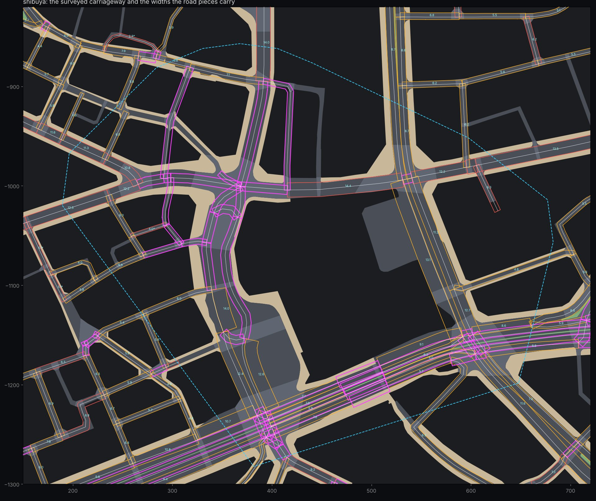

# The road network as a designed thing

Issue 167. The owner's report (21 November 2026): on the walk at 17:57, driving the errand "Drive to 109, at the foot
of Dogenzaka" with 400 m to go, the street ended at a low building standing across it; three buses and two cars were
packed into that end, one bus through another, the nearest car on a mound at the kerb, and traffic kept coming out of
the closed end. "Plan the whole city's routes, so that a drive never ends without reason in a dead end with a pile of
cars coming out of it; set the design against the survey."

The whole map: [images/roads/whole.jpg](images/roads/whole.jpg). Both are drawn by `python tools/road_map.py shibuya
docs/images/roads` from the data the game loads.

## What was wrong

Measured in the game's own road graph (`tools/road_net_dump.js`) and seen in stills, in order of cause:

1. **The roads and what is built did not agree, and the thing in the way was the railway.** The place in the report
   is the street that runs west from Meiji-dori at Miyashita Park and passes under the Yamanote Line (tertiary, at
   about 445, -713; 340 m from 109 in a straight line). The railway's builder drew its embankment wall across every
   street, and the game ends a road where it meets a solid: two dead ends facing each other across 9 m. The same at
   the next street north and at three towards Ebisu. Elsewhere: Meiji-dori's southbound carriageway ended under a
   deck that stood 1.7 m over it; Route 246 ended either side of the JR viaduct, 40 m apart, because the data maps
   it there as a tunnel and the builder drops tunnels; 41 stretches of road in a wall map-wide, 240 m.
2. **Traffic was made on streets that lead nowhere.** A vehicle was put on any street in a ring round the player,
   and only a one-way street with no way on was refused. Of the graph's 596 loose ends, 218 were at the map's edge,
   24 at a wall and 354 inside the map (residential culs-de-sac, and the trunk road's eight ends at the viaduct).
3. **Buses took any street they fitted.** Nothing said where a bus goes.
4. **Nine back streets of Dogenzaka were two-way in the data and are one-way as surveyed.** Overture's segments lose
   a one-way that OpenStreetMap gives with a condition beside it.
5. **Wide junctions ran without their lights.** A junction took a mapped signal only within 22 m of where its roads'
   lines meet; a wide junction's signals are mapped at its stop lines, further back. Miyamasuzaka's crossing of
   Meiji-dori gave way instead of cycling. This did not show while Meiji-dori was cut 70 m south of it. Once the
   roads were joined its cross street starved and the queue stood back through the Scramble to 109.
6. **A driver waited for good on someone standing on the pavement** beside its way: the walk's people stand at the
   corners its drives turn round.
7. **Nothing checked any of it.**

## The survey, and what was taken from it

| Source | What it gives | Licence | Used for |
|---|---|---|---|
| OpenStreetMap, through Overture Maps' segments (`pipeline/game_data.py`, `road_rules.py`, `road_lanes.py`) | the roads' lines, class, one-way, banned turns, lanes, signals | ODbL | the graph itself, as before |
| OpenStreetMap, the API's map call over the map's box, fetched 21 November 2026 (`pipeline/road_osm.py` → `cities/shibuya/roads_osm.json`) | 6,283 highway ways with `oneway`, `lanes`, `access`, `service`, `tunnel`, `covered`; the ways of 113 `route=bus` relations (735 ways: Toei, Tokyu, Keio, Odakyu and the Hachiko community bus); 7 `amenity=taxi`; 86 barrier nodes on roads | ODbL | the audit of class and one-way; one-ways the data lost; the bus streets |
| Toei Bus GTFS (Bureau of Transportation, Tokyo Metropolitan Government; the Public Transportation Open Data Center, `api-public.odpt.org`, no key needed), feed version 20261122 | `shapes.txt`: 34 route shapes inside the map | CC BY 4.0 | the bus streets, beside OSM's relations |
| PLATEAU (the city model already built: `buildings.json`) and the game's collision | what stands where | CC BY 4.0 | whether a carriageway is clear: measured in the game, and held statically against the footprints |

Tokyu's own GTFS is published through the same centre behind a developer key, which this build does not have; its
routes come from OpenStreetMap's relations instead. PLATEAU's road surfaces (`tran`) were not used then: the carriageway's width was the class's. They are now
("From the base", below).

How others do it, and what was adopted:

- **OpenStreetMap's tagging** (the wiki's `Key:oneway`, `Key:access`, `Key:service`, `Relation:restriction`,
  `Relation:route`): a road's direction and who may use it are the way's tags; a bus route is a relation whose
  members are the ways it runs along, in order. Adopted as the authority for one-way, and for where a bus goes.
- **Traffic simulators** (SUMO's "fringe" edges and its `netconvert --remove-edges.isolated`, MATSim's network
  cleaner): demand enters and leaves at the edges cut by the network's boundary, and parts of the network that are
  not strongly connected to it are removed before any vehicle is routed. Adopted: every loose end is classed, the
  ends at the edge are the gates, and a piece is open to traffic only if a way along it leads from a gate to a gate.
- **Open-world games.** The Grand Theft Auto games' path nodes carry flags (a node can be switched off, marked a
  dead end, or closed to ambient traffic), ambient vehicles are created on nodes out of the camera's sight in a band
  ahead of the player and removed behind, and roads are closed with what a city closes them with: barriers, works,
  a police line. Cities: Skylines feeds its traffic through "outside connections" at the map's edge, and its
  well-known jams come from dead ends and missing links, which its traffic tools flag. Adopted: vehicles made only
  on open streets in the ring out of sight; a closed street is named in the data with its reason so that it can be
  dressed and read from the junction before it; quiet streets take no ambient traffic. Nothing of any game's look or
  data is used.
- **Signals.** OpenStreetMap's guidance for a wide junction is to tag `highway=traffic_signals` on each approach at
  its stop line, not on one node in the middle. Adopted in how a junction finds its signals.

## The plan

`pipeline/road_plan.py` writes the decision on the road pieces of `game.json` (`paths.road`):

| Key | Meaning |
|---|---|
| `x: 1` | Closed to cars: the built model stands across it or no car fits along it (the game's own measure, `cities/shibuya/road_measured.json`), or the city closes it by decision (`city.json` `game.road_plan.closed`). Out of the traffic's graph and the routes'. Still painted, still walked. |
| `e: [a, b]` | What each end is where no other open piece joins it: 1 a **gate** (the street leaves the map there: within 60 m of the edge of the roads' extent, or named in `game.road_plan.gates`), 2 a **dead end** (it ends there in the city too), 3 a **closure** (the street goes on and the level closes it: a closed piece lies beyond, or the city names the place). |
| `q: 1` | **Quiet**: no way along it leads from a gate to a gate without turning round: a cul-de-sac and the streets only it serves, a stub before a closure. No traffic is made on it and none turns into it; a route takes it only to a place on it. |
| `b: 1` | A **bus street**: 70 % of it lies within 9 m of a bus route's line. |
| `o`, `ow: 1` | One-way from OpenStreetMap where the data had none. |
| `j: 1` | A piece joined under cover (`game.road_plan.under`): the survey's road goes on, the data left it out. |

Shibuya, as planned (`cities/shibuya/road_plan.json` has the report and every end):

- 4,905 pieces, 360 km. Against OpenStreetMap as fetched: class agrees on all 4,895 pieces matched to a way, one-way
  on 4,894.
- 9 pieces closed (0.8 km): lanes through a block near Hikarie and at Sakuragaoka, streets at Ebisu Garden Place's
  south edge that the model builds over, two residential lanes a house's footprint stands in.
- 363 quiet (23.6 km).
- 1,206 bus streets (97.9 km).
- Ends: 230 gates, 329 dead ends, 2 closures. Nodes by degree: 561 of one, 145 of two, 2,130 of three, 586 of four,
  40 of five or more.
- On a phone the plan is made again on the roads its district cuts (`pipeline/district.py`): 1,131 pieces, 100
  gates, 59 dead ends, 2 closures, 64 quiet, 351 bus streets.

## What was built to make the roads true

- **The Yamanote's bridges over streets** (`cities/shibuya/rail.py` `underbridges()`): where a street of the graph
  crosses the line with 3 m or more under the bed, the embankment's wall is not drawn across it; the bed is carried
  on a plate girder between two abutments, over the carriageway and a footway either side. Six bridges: Miyashita
  Park's street, the next north, three towards Ebisu, and Route 246.
- **Route 246 under the JR viaduct** (`game.road_plan.under`): the four one-way lines that ended either side are
  joined, and the viaduct's solids raised to stand 4.7 m over the road. Closing it there was tried first: all of the
  trunk road's traffic then turned at the junction before, which jammed, and the autopilot's drive to 109 was handed
  back there three times out of three.
- **Footprints stood back, posts out of the carriageway** (`pipeline/road_passages.py`, as before; its loop never made
  the packs between passes, so nothing it carved had reached the page: `tools/road_passages.sh` now does).
- **Lights**: a signal mapped up to 50 m back on a junction's own arm is that junction's; a primary or trunk road
  crossed by a road of tertiary class or above has lights whether the map has them or not; a scramble's turns run
  their length (they gapped out after 4 or 5 s, because a car is seen coming only on the last piece of an arm, and
  109's fork passed one car in 80 s from Bunkamura-dori) (`web/game/junctions.js`).

`tools/road_plan.sh shibuya` makes all of it again in order (join, landmarks, passages with packs between, measure,
plan, measure again, check, map), about five minutes.

## In the game

- **Where traffic is made** (`web/game/actors.js` `respawn`): only on a street that is not quiet and not cut at a
  wall, in the ring 330 to 550 m from the player, a main road four times in five; a bus only on a bus street. The
  gates of a simulated ring are its rim on the open streets; the map's gates are what make a street open.
- **Where it goes** (`web/game/junctions.js`): a junction offers no quiet street while another way goes on; a bus
  takes a bus street where one goes on from the junction.
- **Routes** (`web/game/cars.js` `router`, unchanged): the route line, the autopilot, the rides and the car brought to
  the kerb are all computed on the same graph, which no longer holds a closed piece; a quiet street is taken only
  to a place on it, since nothing shorter passes through one.
- A banned turn is now looked up by the piece's place in `game.json` (it was looked up by its place after the cuts
  at walls, which shifted every index after the first cut).

## The checks

Static, with `tools/check.sh`'s static checks, 3 s (`python pipeline/road_plan.py --city shibuya --check`):

- the plan in `game.json` is the one the roads, the measure and the bus data give now;
- no open piece's line runs more than 3 m through a building's solid that stands on the ground;
- every loose end is a gate, a dead end or a closure;
- no bus street is quiet or closed;
- every place a drive is asked to (`game.road_plan.drives`, the walk's drive errands, where your car starts) is on
  an open road, and each can be driven to from every other.

In the browser, the `roads` target (`tools/check.sh roads`; routed when the traffic, the drivers, the junctions or
the plan change):

- `tools/road_traffic_watch.js`: from two kerbs for three minutes each, no vehicle made on a quiet street, at a wall
  or within 120 m; no bus made off the bus streets, and under 15 % of the buses' time off them; no two vehicles one
  inside the other for over 3 s; no more than three held 150 s; traffic coming in and going out.
- `tools/road_drive.js` with `TO` and `FROM`: the walk's drive to 109 on the autopilot from three starts (the
  Scramble's kerb, the street in the report, Meiji-dori by SKY GATE), each arriving within the errand's 35 m without
  leaving the carriageway or standing in a wall.

By hand: `xvfb-run -a node tools/road_drive.js shibuya 320` drives every piece within 320 m of the start once, a leg
at a time, and fails where no route is found, the car stands 150 s, leaves the carriageway or meets a wall.

## Measured

Five minutes at each of two kerbs at 17:57 (`tools/road_traffic_watch.js shibuya 5`), main before this work against
the branch:

| | Before | After |
|---|---|---|
| Buses' time off the bus streets | 100 % (no bus streets) | 0 to 5 % |
| Vehicles made on a quiet street or at a wall | not known to the game; 1 at a wall | 0 |
| Round Miyashita Park's junction: in, out | 116, 106 | 150, 145 |
| Held 150 s near 109 | 1 | 0 on a desktop's page, 3 on a phone's (12 to 15 before the lights were mended) |

The drive to 109 on the autopilot at 17:57, on a desktop's page and a phone's: from the Scramble's kerb 595 m, 112
and 280 s; from the street in the report 493 m, under the railway, 165 and 106 s (before: no road under the
railway); from Meiji-dori by SKY GATE 364 m, 401 and 155 s.

## From the base: the carriageway as surveyed, the bus on its line, the drive inside the area

Issue 196. The owner's ask (23 November 2026): design the road pipeline again from first principles, so that a player
can drive Shibuya and believe it: every road on the protagonist's routes open, the buses on their real routes, widths
and one-ways as the real network has them.

Drawn by `python tools/road_width_map.py shibuya docs/images/roads/widths.jpg`: the survey's carriageways, junctions,
footways and islands, and each piece's band at the width it now carries (magenta: a piece that keeps its class's).

### What a road is made of, and what the plan had of each

| What a driver believes | Where it comes from | Before | Now |
|---|---|---|---|
| The street goes where it goes | OpenStreetMap's line, through Overture | had | had |
| Its direction | OpenStreetMap's `oneway`, audited (4,894 of 4,895) | had | had |
| **How wide it is, kerb to kerb** | a survey of the road itself | its class's width, in five tables | measured |
| How many lanes | OpenStreetMap's `lanes`, where tagged | by class, taken down by a tag | by class, taken down by a tag or by the width |
| **Where each bus goes** | each route as an ordered thing | any street any route takes | its own line, piece by piece |
| **That the drive asked of you can be made** | the routes, inside the area the player is kept to | reachable somewhere on the map | reachable inside the planned area |

### The survey

| Source | What it gives | Licence | Used for |
|---|---|---|---|
| Project PLATEAU (MLIT Japan), Shibuya-ku road model 2025, `13113_tran_lod2`, as vector tiles from the catalogue at `api.plateauview.mlit.go.jp/datacatalog/plateau-datasets` (`pipeline/road_survey.py` → `cities/shibuya/road_surface.json`) | every public road cut into carriageway (車道部), junction (車道交差部), footway (歩道部) and island (島), from the 1:2,500 public survey (数値地形図, 公共測量成果): 29.3 ha of carriageway, 8.6 ha of junctions, 10.2 ha of footway over the phone's district | CC BY 4.0 | each piece's width |
| OpenStreetMap, the API's map call over the planned area and the traffic's ring, fetched 23 November 2026 (`pipeline/bus_lines.py --fetch` → `cities/shibuya/bus_lines.json`) | 85 `route=bus` relations, each one's ways in the order it runs them (the public transport schema, version 2), with its number, operator and destination | ODbL | the bus lines |

How others do it, and what was adopted:

- **Survey-first road models** (PLATEAU's own LOD2 road specification; CityGML's `TrafficArea` and
  `AuxiliaryTrafficArea`; OpenDRIVE and Lanelet2, which driving simulators such as CARLA and SUMO read): a road is
  its surface cut by function, and the centre line with a width is only a reference to it. Adopted as far as the
  width: the piece keeps the map's line, and takes its width from the surface. Not adopted: lanes as surveyed
  geometry (the survey has no lane lines at LOD2; LOD3 has, issue 90).
- **Width from tags** (OpenStreetMap's `width`, `lanes`; osm2streets, A/B Street): lanes times a nominal lane.
  Not adopted: 925 of 6,283 ways here carry `lanes` and almost none `width`, and a nominal lane is the class table
  again.
- **Transit in open-world and simulation games** (Cities: Skylines' lines, which are ordered stops with a path
  between; GTFS `shapes.txt`; the Grand Theft Auto games' buses, which run fixed node routes): a bus belongs to a
  line and the line is an ordered path. Adopted. Nothing of any game's data or look is used.

### The width (`pipeline/road_width.py`)

Each piece is measured every 4 m: the chord square to its line across the surveyed carriageway, outside the
junctions' own areas (a mouth is wider than the street that comes to it). Where two pieces run in one carriageway
(the two ways of Meiji-dori, a slip beside its road) each takes its side, to half way between the lines. Written on
the piece:

| Key | Meaning |
|---|---|
| `cw: w` | The carriageway's width, kerb to kerb, in metres. Never more than puts the band's edge 1.5 m past the nearer kerb (the line is the map's, the kerbs the survey's, and the two agree within a metre over 83 % of the length); a forecourt or a terminal's apron is a lane across it (14 m one-way, 26 m two-way at most). |
| `st: 1` | A single track: two ways, under 5.2 m, so two cars do not pass. Driven down its middle; no traffic is made on it and none turns in. |

Shibuya, as measured (`cities/shibuya/road_width.json`): 555 pieces, 40.6 km.

| Class | Drawn before | Surveyed: 10th percentile, median, 90th | Length |
|---|---|---|---|
| trunk | 12 m | 4.3, 8.8, 13.2 m (each line of Route 246 its share) | 4.2 km |
| primary | 12 m | 7.8, 9.0, 14.0 m | 2.8 km |
| secondary | 10 m | 7.0, 9.4, 10.5 m | 1.0 km |
| tertiary | 9 m | 7.0, 9.1, 13.5 m | 9.7 km |
| unclassified | 6 m | 4.2, 6.1, 7.8 m | 13.6 km |
| residential | 7 m | 3.6, 4.6, 6.5 m | 9.3 km |

Dogenzaka above 109 is 11 to 12 m (was 9), Miyamasuzaka 12 to 14 m (was 9), the back streets of Dogenzaka and
Udagawacho 4 to 6 m (were 6 and 7). 66 pieces are single track.

In the game one function gives a piece's width (`OEStreets.widthOf`, `web/streets.js`: `cw`, else the class's), and
the five tables read it: the asphalt, the kerb line and the paint (`game.js`), where things stand back from a
carriageway (`streets.js`), a junction's reach, its stop lines and its signal posts (`junctions.js`), where a car
pulls in (`cars.js` `kerbOf`: its side at the surveyed kerb), and whether a ride is on the road (`rides.js`). The
lanes follow (`junctions.js`): a carriageway under 11.2 m two-way or 6.4 m one-way has one lane each way whatever
its class; on a two-way street under 6.8 m each lane's middle is a quarter of the way across; a single track is
driven down the middle.

### The bus lines (`pipeline/bus_lines.py`)

A relation's ways are joined end to end into a line. From where the line first meets a road piece it is walked
through the road graph: at each node the piece that lies along the line ahead (within 7 m on average, the way the
piece may be driven) is the next. Written as `game.bus_lines` (`[{ref, to, by}]`) and on each piece `bl: [line,
step, way, ...]`. The steps are places in an order, not indices, so a piece dropped later (the game's cut at a wall,
a phone's district) leaves the order whole.

Shibuya: 51 lines on 308 pieces, 28.3 km (Toei, Tokyu, Keio, Odakyu, the Hachiko community bus, two long-distance
coaches on the expressway), each matched over its whole run in the area but for a few metres at the ends
(`cities/shibuya/bus_lines_report.json`).

In the game a bus is made where a line runs its way and is that line's (`actors.js` `respawn`); at a junction it
takes the piece with its line's next step (`junctions.js` `choose`); where its line ends (a terminal, the edge of
what the lines were read over) it takes up a line that goes on from there, and failing that keeps to the bus streets
as before. The look-ahead that chooses a car's exit two junctions on was not told the car was a bus: it is now.

### The drives (`pipeline/road_routes.py`, `pipeline/bounds.py`)

The plan's check held that every place a drive is asked to can be reached from every other, anywhere on the map.
The player is kept to the planned area (docs/BOUNDS.md), and the router knows nothing of its edge. Measured: SKY
GATE's kerb is on Meiji-dori's northbound side, which is entered only from the south; the way there from the
Scramble is round the station's west side, along Route 246 under the railway and up Meiji-dori, and it left the hull
of the story's places by 57 m. A player sent there was stopped at the road works with the route line going on.

The planned area is now the hull of its places **and of the roads the drives between them take**, each with 40 m of
room (the easing at the edge, a carriageway, a car): its south edge moves from y -1223 to -1282. `road_routes.py`
finds, for every pair of the places a drive is asked to, the shortest way by road on all the roads and on the roads
inside the area alone, and fails where there is none inside or where the shortest leaves it.

| From | To | Inside the area | Narrowest |
|---|---|---|---|
| 109 | SKY GATE's kerb | 473 m | 9.0 m |
| 109 | where your car starts | 110 m | 9.0 m |
| SKY GATE's kerb | 109 | 241 m | 9.0 m |
| SKY GATE's kerb | where your car starts | 195 m | 9.0 m |
| where your car starts | 109 | 221 m | 6.0 m |
| where your car starts | SKY GATE's kerb | 300 m | 6.2 m |

### Every vehicle has somewhere to go (`web/game/trips.js`)

Asked whether every vehicle now drives by a logic and a path of its own, the answer on reading the code was no. The
game has always asked for `OETrips` (`game.js`: `if (window.OETrips) junctions.setTrips(...)`), docs/GAME.md
describes it, and the file was not in this repository: it was lost when the story was split from the world, the
guard passed in silence, and every car and taxi picked an exit by chance at every junction. A random walk turns back
on itself and circles a block, and the flow on a street is what chance left there.

What each kind of vehicle drives by now:

| Vehicle | Where it is going | How it gets there |
|---|---|---|
| A car, a van, a taxi of the traffic | a place: one of eight gates on the main roads at the map's edge (out of town), or a street by one of the places the map names (into town); seven in ten are bound, by the hour (three quarters into town in the morning, a quarter in the evening) | a field per place, worked out once: at a junction the exit that brings it nearest by road, one 64 m dearer a third as likely |
| A bus | its line's end | the piece with its line's next step |
| Your car on the autopilot, a ride, the car sent for you | the place asked | a route searched on the same graph (`cars.js` `router`) and driven |

The field is a search back from the place over the road graph as it may be driven (one-ways, banned turns, the roads
to keep off, no turning round at a junction). A metre of back street costs 2.5 of a main road's, a surveyed
carriageway under 5.5 m 1.6 times that again, a quiet street or a single track three times: through traffic keeps to
the roads that carry it. A trip into town is over 110 m by road from its place (the car park is round there, not on
the place), and its place is a street of 6 m or more. The first version sent each trip to the nearest back street
and ended it only on that street: thirteen cars at a time made for one lane, and the block behind 109 locked in a
ring, each junction waiting for room in the next (19 vehicles stood 150 s; none after).

`tools/trips_probe.js shibuya 120` (a desktop's page, 17:57, two minutes): 140 of 192 cars bound for one of 18
places; a car coming onto a new piece is nearer its place by road 22 times of 22; none went back onto the piece it
had just left. `tools/road_traffic_watch.js` with the trips on: 0 and 3 vehicles stood 150 s at the two kerbs (three
is the limit; the three wait at 109's lights, issue 175).

### The checks, and what was measured

Static, with `tools/check.sh`'s static checks:

- `python pipeline/road_width.py --city shibuya --check`: the widths in `game.json` are what the survey gives now,
  and no open piece is narrower than a car;
- `python pipeline/bus_lines.py --city shibuya --check`: the lines are what the relations give now, none on a
  closed piece or against a one-way;
- `python pipeline/road_routes.py shibuya --check`: every drive between the places inside the planned area.

In the browser (software WebGL on a session's machine, a desktop's page, 17:57):

- `tools/road_traffic_watch.js shibuya 3`, three minutes at each of two kerbs: each bus on a line of its own, the way
  the line runs, for 94.0 % and 99.0 % of the buses' time (a new line of the check: under 20 % off); the buses' time
  off the bus streets 4.9 % and 0 %; no vehicle made on a quiet street, at a wall or in sight; none inside another;
  none stood 150 s.
- `TO=535,-1078 FROM="372,-1041" node tools/road_drive.js shibuya`: your car on the autopilot from the Scramble's
  kerb to SKY GATE's: 492 m by road with two turns, 210 s, arrived.

Not checked: a real GPU, a phone in hand, Safari.

### Not done here

- **The Scramble's hero level draws its carriageways at their class's width** and keeps it: its floor, kerbs,
  crosswalks, guard pipes and tactile paving are built from that plan (`cities/shibuya/scramble.py`), so a change is
  a rebuild of the level and every still of the story taken again. The survey has Dogenzaka-shita at 16.6 m where
  the level draws 9 m, the station's west side at 14 m against 9 m, Koen-dori's foot at 14.7 m against 9 m
  (`road_width.json` `hero`). Issue 196, with issue 90.
- **The survey is Shibuya-ku's.** 34 km of streets in the phone's district lie in Minato, Meguro and Setagaya and
  keep their class's width; each ward has a road model of its own in the same catalogue.
- **The ground is painted as a band along each piece.** The survey's junction mouths, corner radii and islands are
  polygons, and are not yet painted as such.
- **A bus shows no number or destination**; `game.bus_lines` carries both.

## Not done, and why

- **The mounds beside the streets at the embankment** are the survey's ground, left as it is by `street_ground.py`
  where a street would move it more than 4 m. The carriageway under each bridge is level; the paved slopes either
  side of it are issue 163's (the conditioned ground).
- **Dressing a closure** (barriers, works) so that it reads from the junction before: the two closures left are at
  Ebisu Garden Place's south edge, 2 km from the level. The data names each closure and its reason for issue 143 to
  dress where the walk's bounds put one.
- **Taxi ranks**: OpenStreetMap maps seven in the map; taxis do not yet stand at them.
- **Expressway pieces clipped by a tower's corner** on their decks are left to the game's own cut (three, at Ohashi
  and Ikejiri): closing 400 m of expressway for 2 m of footprint would be the larger fault.
- **The Scramble and 109 still pass too few cars** (issue 175): a drive across the Scramble from SKY GATE's kerb
  took 401 s for 364 m on a desktop's page. The taxis' ranks, a dressed closure, the clipped expressway pieces and
  Tokyu's GTFS are issue 176.
