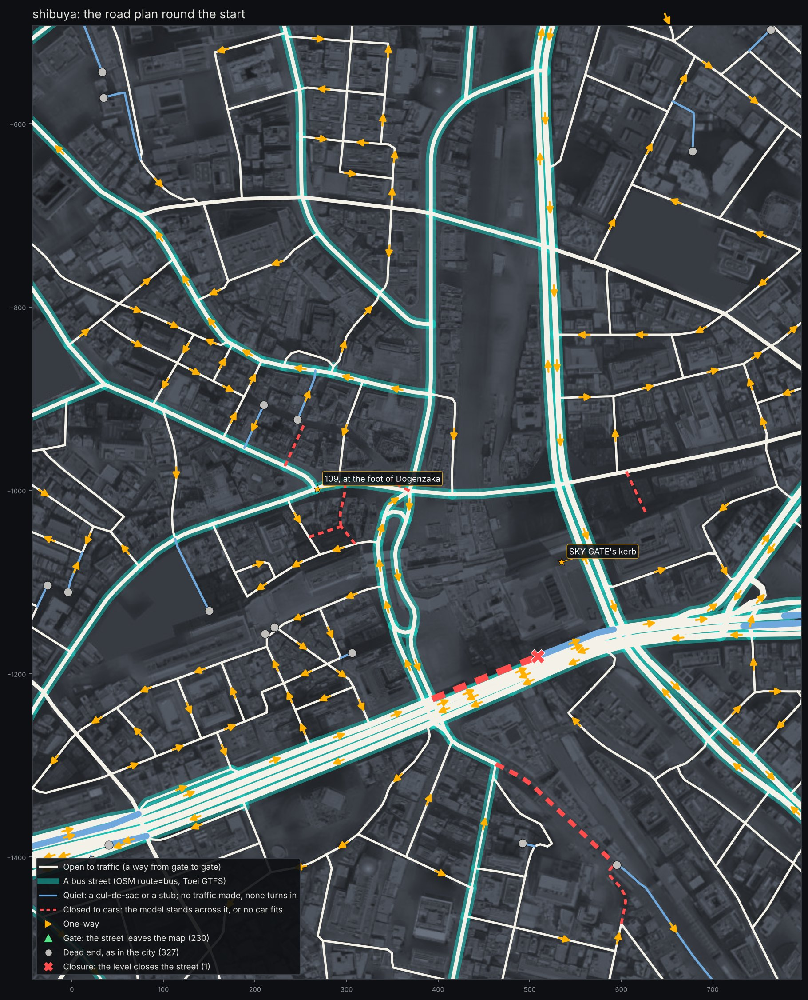
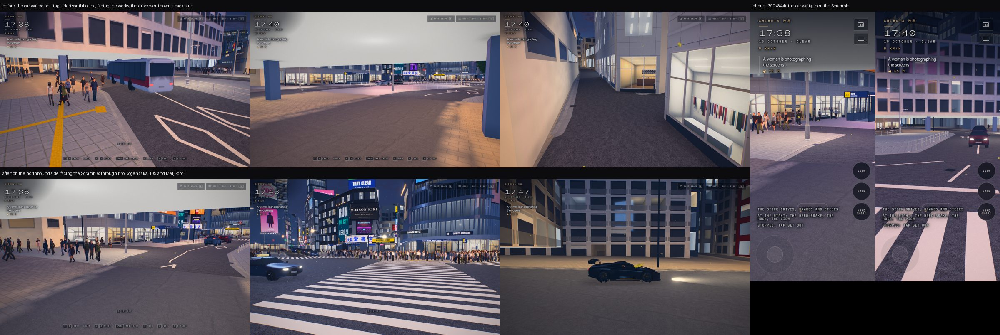

# The road network as a designed thing

Issue 167. The owner's report (21 November 2026): on the walk at 17:57, driving the errand "Drive to 109, at the foot
of Dogenzaka" with 400 m to go, the street ended at a low building standing across it; three buses and two cars were
packed into that end, one bus through another, the nearest car on a mound at the kerb, and traffic kept coming out of
the closed end. "Plan the whole city's routes, so that a drive never ends without reason in a dead end with a pile of
cars coming out of it; set the design against the survey."

The whole map: [images/roads/whole.jpg](images/roads/whole.jpg). Both are drawn by `python tools/road_map.py shibuya
docs/images/roads` from the data the game loads.

## What was wrong

Measured in the game's own road graph (`tools/road_net_dump.js`) and seen in stills, in order of cause:

1. **The roads and what is built did not agree, and the thing in the way was the railway.** The place in the report
   is the street that runs west from Meiji-dori at Miyashita Park and passes under the Yamanote Line (tertiary, at
   about 445, -713; 340 m from 109 in a straight line). The railway's builder drew its embankment wall across every
   street, and the game ends a road where it meets a solid: two dead ends facing each other across 9 m. The same at
   the next street north and at three towards Ebisu. Elsewhere: Meiji-dori's southbound carriageway ended under a
   deck that stood 1.7 m over it; Route 246 ended either side of the JR viaduct, 40 m apart, because the data maps
   it there as a tunnel and the builder drops tunnels; 41 stretches of road in a wall map-wide, 240 m.
2. **Traffic was made on streets that lead nowhere.** A vehicle was put on any street in a ring round the player,
   and only a one-way street with no way on was refused. Of the graph's 596 loose ends, 218 were at the map's edge,
   24 at a wall and 354 inside the map (residential culs-de-sac, and the trunk road's eight ends at the viaduct).
3. **Buses took any street they fitted.** Nothing said where a bus goes.
4. **Nine back streets of Dogenzaka were two-way in the data and are one-way as surveyed.** Overture's segments lose
   a one-way that OpenStreetMap gives with a condition beside it.
5. **Wide junctions ran without their lights.** A junction took a mapped signal only within 22 m of where its roads'
   lines meet; a wide junction's signals are mapped at its stop lines, further back. Miyamasuzaka's crossing of
   Meiji-dori gave way instead of cycling. This did not show while Meiji-dori was cut 70 m south of it. Once the
   roads were joined its cross street starved and the queue stood back through the Scramble to 109.
6. **A driver waited for good on someone standing on the pavement** beside its way: the walk's people stand at the
   corners its drives turn round.
7. **Nothing checked any of it.**

## The survey, and what was taken from it

| Source | What it gives | Licence | Used for |
|---|---|---|---|
| OpenStreetMap, through Overture Maps' segments (`pipeline/game_data.py`, `road_rules.py`, `road_lanes.py`) | the roads' lines, class, one-way, banned turns, lanes, signals | ODbL | the graph itself, as before |
| OpenStreetMap, the API's map call over the map's box, fetched 21 November 2026 (`pipeline/road_osm.py` → `cities/shibuya/roads_osm.json`) | 6,283 highway ways with `oneway`, `lanes`, `access`, `service`, `tunnel`, `covered`; the ways of 113 `route=bus` relations (735 ways: Toei, Tokyu, Keio, Odakyu and the Hachiko community bus); 7 `amenity=taxi`; 86 barrier nodes on roads | ODbL | the audit of class and one-way; one-ways the data lost; the bus streets |
| Toei Bus GTFS (Bureau of Transportation, Tokyo Metropolitan Government; the Public Transportation Open Data Center, `api-public.odpt.org`, no key needed), feed version 20261122 | `shapes.txt`: 34 route shapes inside the map | CC BY 4.0 | the bus streets, beside OSM's relations |
| PLATEAU (the city model already built: `buildings.json`) and the game's collision | what stands where | CC BY 4.0 | whether a carriageway is clear: measured in the game, and held statically against the footprints |

Tokyu's own GTFS is published through the same centre behind a developer key, which this build does not have; its
routes come from OpenStreetMap's relations instead. PLATEAU's road surfaces (`tran`) are not in the build's downloads
and were not used: the carriageway's width is the class's, as the game draws it.

How others do it, and what was adopted:

- **OpenStreetMap's tagging** (the wiki's `Key:oneway`, `Key:access`, `Key:service`, `Relation:restriction`,
  `Relation:route`): a road's direction and who may use it are the way's tags; a bus route is a relation whose
  members are the ways it runs along, in order. Adopted as the authority for one-way, and for where a bus goes.
- **Traffic simulators** (SUMO's "fringe" edges and its `netconvert --remove-edges.isolated`, MATSim's network
  cleaner): demand enters and leaves at the edges cut by the network's boundary, and parts of the network that are
  not strongly connected to it are removed before any vehicle is routed. Adopted: every loose end is classed, the
  ends at the edge are the gates, and a piece is open to traffic only if a way along it leads from a gate to a gate.
- **Open-world games.** The Grand Theft Auto games' path nodes carry flags (a node can be switched off, marked a
  dead end, or closed to ambient traffic), ambient vehicles are created on nodes out of the camera's sight in a band
  ahead of the player and removed behind, and roads are closed with what a city closes them with: barriers, works,
  a police line. Cities: Skylines feeds its traffic through "outside connections" at the map's edge, and its
  well-known jams come from dead ends and missing links, which its traffic tools flag. Adopted: vehicles made only
  on open streets in the ring out of sight; a closed street is named in the data with its reason so that it can be
  dressed and read from the junction before it; quiet streets take no ambient traffic. Nothing of any game's look or
  data is used.
- **Signals.** OpenStreetMap's guidance for a wide junction is to tag `highway=traffic_signals` on each approach at
  its stop line, not on one node in the middle. Adopted in how a junction finds its signals.

## The plan

`pipeline/road_plan.py` writes the decision on the road pieces of `game.json` (`paths.road`):

| Key | Meaning |
|---|---|
| `x: 1` | Closed to cars: the built model stands across it or no car fits along it (the game's own measure, `cities/shibuya/road_measured.json`), or the city closes it by decision (`city.json` `game.road_plan.closed`). Out of the traffic's graph and the routes'. Still painted, still walked. |
| `e: [a, b]` | What each end is where no other open piece joins it: 1 a **gate** (the street leaves the map there: within 60 m of the edge of the roads' extent, or named in `game.road_plan.gates`), 2 a **dead end** (it ends there in the city too), 3 a **closure** (the street goes on and the level closes it: a closed piece lies beyond, or the city names the place). |
| `q: 1` | **Quiet**: no way along it leads from a gate to a gate without turning round: a cul-de-sac and the streets only it serves, a stub before a closure. No traffic is made on it and none turns into it; a route takes it only to a place on it. |
| `b: 1` | A **bus street**: 70 % of it lies within 9 m of a bus route's line. |
| `o`, `ow: 1` | One-way from OpenStreetMap where the data had none. |
| `j: 1` | A piece joined under cover (`game.road_plan.under`): the survey's road goes on, the data left it out. |

Shibuya, as planned (`cities/shibuya/road_plan.json` has the report and every end):

- 4,905 pieces, 360 km. Against OpenStreetMap as fetched: class agrees on all 4,895 pieces matched to a way, one-way
  on 4,894.
- 9 pieces closed (0.8 km): lanes through a block near Hikarie and at Sakuragaoka, streets at Ebisu Garden Place's
  south edge that the model builds over, two residential lanes a house's footprint stands in.
- 363 quiet (23.6 km).
- 1,206 bus streets (97.9 km).
- Ends: 230 gates, 329 dead ends, 2 closures. Nodes by degree: 561 of one, 145 of two, 2,130 of three, 586 of four,
  40 of five or more.
- On a phone the plan is made again on the roads its district cuts (`pipeline/district.py`): 1,131 pieces, 100
  gates, 59 dead ends, 2 closures, 64 quiet, 351 bus streets.

## What was built to make the roads true

- **The Yamanote's bridges over streets** (`cities/shibuya/rail.py` `underbridges()`): where a street of the graph
  crosses the line with 3 m or more under the bed, the embankment's wall is not drawn across it; the bed is carried
  on a plate girder between two abutments, over the carriageway and a footway either side. Six bridges: Miyashita
  Park's street, the next north, three towards Ebisu, and Route 246.
- **Route 246 under the JR viaduct** (`game.road_plan.under`): the four one-way lines that ended either side are
  joined, and the viaduct's solids raised to stand 4.7 m over the road. Closing it there was tried first: all of the
  trunk road's traffic then turned at the junction before, which jammed, and the autopilot's drive to 109 was handed
  back there three times out of three.
- **Footprints stood back, posts out of the carriageway** (`pipeline/road_passages.py`, as before; its loop never made
  the packs between passes, so nothing it carved had reached the page: `tools/road_passages.sh` now does).
- **Lights**: a signal mapped up to 50 m back on a junction's own arm is that junction's; a primary or trunk road
  crossed by a road of tertiary class or above has lights whether the map has them or not; a scramble's turns run
  their length (they gapped out after 4 or 5 s, because a car is seen coming only on the last piece of an arm, and
  109's fork passed one car in 80 s from Bunkamura-dori) (`web/game/junctions.js`).

`tools/road_plan.sh shibuya` makes all of it again in order (join, landmarks, passages with packs between, measure,
plan, measure again, check, map), about five minutes.

## In the game

- **Where traffic is made** (`web/game/actors.js` `respawn`): only on a street that is not quiet and not cut at a
  wall, in the ring 330 to 550 m from the player, a main road four times in five; a bus only on a bus street. The
  gates of a simulated ring are its rim on the open streets; the map's gates are what make a street open.
- **Where it goes** (`web/game/junctions.js`): a junction offers no quiet street while another way goes on; a bus
  takes a bus street where one goes on from the junction.
- **Routes** (`web/game/cars.js` `router`, unchanged): the route line, the autopilot, the rides and the car brought to
  the kerb are all computed on the same graph, which no longer holds a closed piece; a quiet street is taken only
  to a place on it, since nothing shorter passes through one.
- A banned turn is now looked up by the piece's place in `game.json` (it was looked up by its place after the cuts
  at walls, which shifted every index after the first cut).

## The checks

Static, with `tools/check.sh`'s static checks, 3 s (`python pipeline/road_plan.py --city shibuya --check`):

- the plan in `game.json` is the one the roads, the measure and the bus data give now;
- no open piece's line runs more than 3 m through a building's solid that stands on the ground;
- every loose end is a gate, a dead end or a closure;
- no bus street is quiet or closed;
- every place a drive is asked to (`game.road_plan.drives`, the walk's drive errands, where your car starts) is on
  an open road, and each can be driven to from every other.

In the browser, the `roads` target (`tools/check.sh roads`; routed when the traffic, the drivers, the junctions or
the plan change):

- `tools/road_traffic_watch.js`: from two kerbs for three minutes each, no vehicle made on a quiet street, at a wall
  or within 120 m; no bus made off the bus streets, and under 15 % of the buses' time off them; no two vehicles one
  inside the other for over 3 s; no more than three held 150 s; traffic coming in and going out.
- `tools/road_drive.js` with `TO` and `FROM`: the walk's drive to 109 on the autopilot from three starts (the
  Scramble's kerb, the street in the report, Meiji-dori by SKY GATE), each arriving within the errand's 35 m without
  leaving the carriageway or standing in a wall.

By hand: `xvfb-run -a node tools/road_drive.js shibuya 320` drives every piece within 320 m of the start once, a leg
at a time, and fails where no route is found, the car stands 150 s, leaves the carriageway or meets a wall.

## Measured

Five minutes at each of two kerbs at 17:57 (`tools/road_traffic_watch.js shibuya 5`), main before this work against
the branch:

| | Before | After |
|---|---|---|
| Buses' time off the bus streets | 100 % (no bus streets) | 0 to 5 % |
| Vehicles made on a quiet street or at a wall | not known to the game; 1 at a wall | 0 |
| Round Miyashita Park's junction: in, out | 116, 106 | 150, 145 |
| Held 150 s near 109 | 1 | 0 on a desktop's page, 3 on a phone's (12 to 15 before the lights were mended) |

The drive to 109 on the autopilot at 17:57, on a desktop's page and a phone's: from the Scramble's kerb 595 m, 112
and 280 s; from the street in the report 493 m, under the railway, 165 and 106 s (before: no road under the
railway); from Meiji-dori by SKY GATE 364 m, 401 and 155 s.

## The first drive, and the streets inside the playable area

The owner's report (22 November 2026), on the walk at 17:39, just set out: the road ahead ended in buildings with a
lane between them that no car could take, and the car was put on it. "Either move where your car waits so that the
drive from it goes on, or build the place as it is. Change what is on the blade's edge."

What the player meets first is the car: "YOUR CAR [C]" is on the screen from the first second. Measured in the game
(`tools/first_drive.js`) and in the graph (`tools/first_drive.py`), the first drive went wrong in three ways:

1. **The car faced the edge.** It waited on Jingu-dori's southbound carriageway by the west exit (piece 1693, the
   survey's real three-lane road). 105 m south of it the street crosses the playable area's edge, where the road works
   stand (docs/BOUNDS.md), and the only way off it before them, the link round the bus terminal's island (piece 1700),
   is shut to cars from 06:00 to 22:00 (Overture's timed access, `road_rules.py`). So at every hour of the story the
   first drive could only end at the barriers on a one-way street, where no car may turn round.
2. **Lanes no car fits were open to it.** Inside the area, Dogenzaka's back lanes (pieces 1668 and 1686, OpenStreetMap
   `unclassified` and two-way) have 4.4 to 4.6 m between the shopfronts in the built model; the autopilot's drive to 109
   went through one (the alley in the report), and the piece joining them to the Mark City street (1687) led only there.
3. **One-way streets into a dead end.** Center Gai's mouth is 25 m of one-way carriageway from the Scramble into a
   street the data maps as a footway beyond; a lane at the area's north-west corner and a service stub on Route 246's
   north side were the same. A car that took one could not leave it.

What was done, the least change for each:

- **The car waits on the other carriageway** (`city.json` `game.start.car`, its note says why): Jingu-dori's
  northbound side by the west exit, facing the Scramble, 77 m from the junction where Dogenzaka (and 109, and
  Bunkamura-dori past it), Jingu-dori north and the old Oyama road to Meiji-dori all go on. It is 80 m' walk from the
  start, and its ring in the area's hull is inside the edge as it was, so the edge does not move.
- **A parked car inside the drawn asphalt** (`game.js` `kerbPose`): your car, parked or brought to the kerb (C), stood
  with its centre 4.4 m off a tertiary street's line (`cars.js` `kerbOf`), and the street is drawn 4.5 m out
  (`street_ground.py`): half of it on the kerb wherever no hero level draws the ground. Its outer side now stays 0.25 m
  inside the class's drawn edge, and inside a hero level it pulls in only as far as the kerb the level draws, as the
  rides do (#54).
- **The routes never cross the area's edge** (`bounds.js` `closeRoads` marks the pieces `edge`, `cars.js` router):
  when no legal way was left, the router's search along any street let a shut street through at a cost. That is right
  for a street shut at an hour, but wrong for one the works stand across. The autopilot, held in the Scramble's queue,
  turned round and drove out past the works along the Mark City street, 30 m out of the area.
- **The playable area's own pass in the plan** (`pipeline/road_plan.py` `playable()`): inside `game.bounds.ground`,
  a street with less clear width between its walls along most of its length than a car needs (5.5 m two-way, 3.5 m
  one-way; walls raised 3 m or more over the road, and a footprint the road runs inside, are left to the game's own
  measure) is closed, as is a one-way street into a dead end and a stub left leading only into a closed lane, until
  none is left. Closed means the plan's `x: 1`: out of the traffic's graph and every route, still painted and walked.
  Six pieces, 0.2 km (`road_plan.json` `report.playable_closed` names each with its reason). Outside the area
  nothing changes.

**The check** (`python tools/first_drive.py shibuya`, 4 s, in `tools/check.sh`'s static checks): the graph inside the
area as the game drives it at each hour of the story's day (closed pieces out, one-ways, the turns banned at all
times, the streets shut at that hour, the streets that cross the edge ending at the works; a two-way street may be
turned round in where it ends, a one-way never). It fails where the car's drive does not reach the area's main
group, or the main group begins more than 200 m ahead, or an errand's place is not reached from the car, or a street
open to cars inside the area is a one-way into a dead end, narrower than a car needs, or not a carriageway in the
survey (OpenStreetMap: pedestrian, footway, path, steps, a service road with no access). Put back where it was, the
car fails it at 16 hours, 06:30 to 21:30. It prints every drivable dead end inside the area: two culs-de-sac (a
residential lane at the north-west corner, a service road beside Route 246) and the one-way streets that lead only to
the works at the edge (Meiji-dori's carriageways, Route 246, and, from 06:30 to 21:30, Jingu-dori south of the
Scramble): the area's designed edge, said by the works and their line, not a fault of the roads.

`xvfb-run -a node tools/first_drive.js out_dir [WxH] [hour]` opens the walk as a player does, takes the car where it
waits, and drives it on the autopilot to 109's foot and to SKY GATE's kerb, a still every few seconds.

## Not done, and why

- **The mounds beside the streets at the embankment** are the survey's ground, left as it is by `street_ground.py`
  where a street would move it more than 4 m. The carriageway under each bridge is level; the paved slopes either
  side of it are issue 163's (the conditioned ground).
- **Dressing a closure** (barriers, works) so that it reads from the junction before: the two closures left are at
  Ebisu Garden Place's south edge, 2 km from the level. The data names each closure and its reason for issue 143 to
  dress where the walk's bounds put one.
- **Taxi ranks**: OpenStreetMap maps seven in the map; taxis do not yet stand at them.
- **Expressway pieces clipped by a tower's corner** on their decks are left to the game's own cut (three, at Ohashi
  and Ikejiri): closing 400 m of expressway for 2 m of footprint would be the larger fault.
- **A pinch on Jingu-dori south of the bus terminal**: for about 20 m the southbound carriageway has 2.6 m between the
  terminal island's solid and the building east of it in the model, which the plan's width test reads as a pinch, not
  a lane (its median width is the street's). The traffic and your car pass it; the island's footprint wants standing
  back (issue 195).
- **The Scramble and 109 still pass too few cars** (issue 175): a drive across the Scramble from SKY GATE's kerb
  took 401 s for 364 m on a desktop's page. The taxis' ranks, a dressed closure, the clipped expressway pieces and
  Tokyu's GTFS are issue 176.
