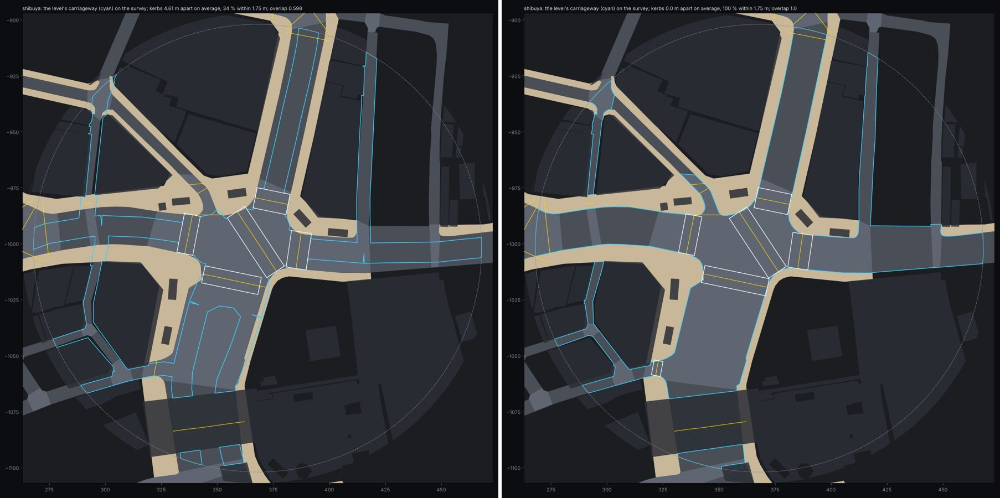
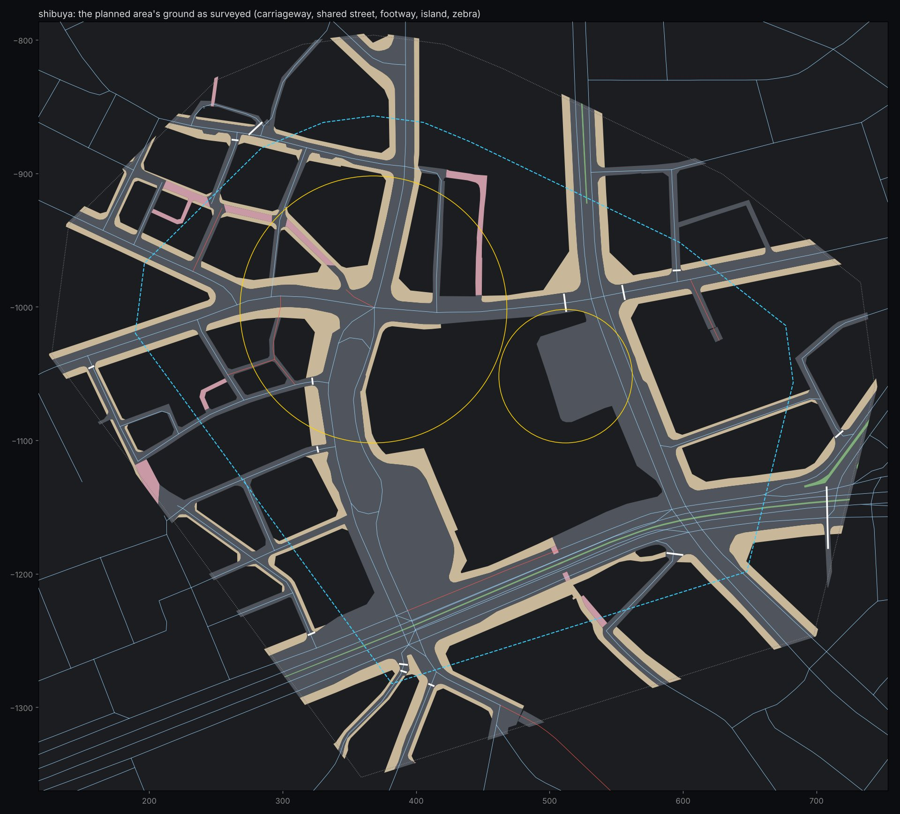
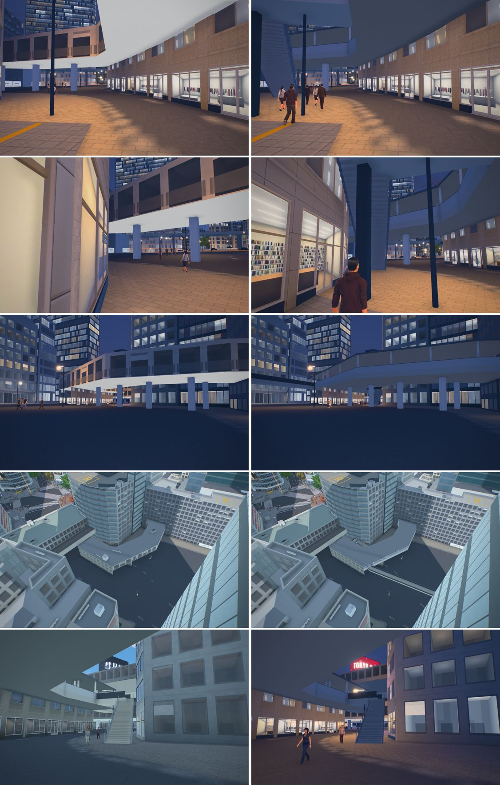
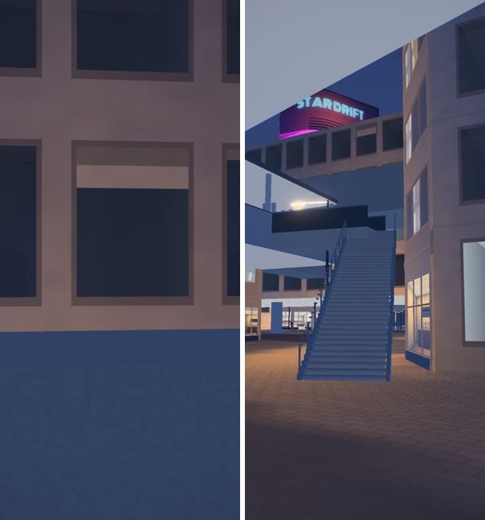
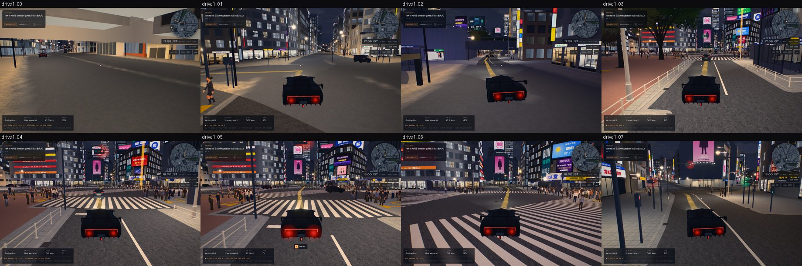
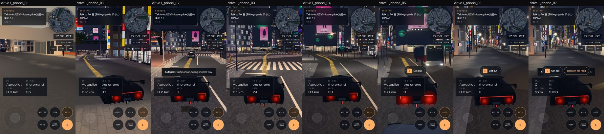

# The road network as a designed thing

Issue 167. The owner's report (21 November 2026): on the walk at 17:57, driving the errand "Drive to 109, at the foot
of Dogenzaka" with 400 m to go, the street ended at a low building standing across it; three buses and two cars were
packed into that end, one bus through another, the nearest car on a mound at the kerb, and traffic kept coming out of
the closed end. "Plan the whole city's routes, so that a drive never ends without reason in a dead end with a pile of
cars coming out of it; set the design against the survey."

The whole map: [images/roads/whole.jpg](images/roads/whole.jpg). Both are drawn by `python tools/road_map.py shibuya
docs/images/roads` from the data the game loads.

## What was wrong

Measured in the game's own road graph (`tools/road_net_dump.js`) and seen in stills, in order of cause:

1. **The roads and what is built did not agree, and the thing in the way was the railway.** The place in the report
   is the street that runs west from Meiji-dori at Miyashita Park and passes under the Yamanote Line (tertiary, at
   about 445, -713; 340 m from 109 in a straight line). The railway's builder drew its embankment wall across every
   street, and the game ends a road where it meets a solid: two dead ends facing each other across 9 m. The same at
   the next street north and at three towards Ebisu. Elsewhere: Meiji-dori's southbound carriageway ended under a
   deck that stood 1.7 m over it; Route 246 ended either side of the JR viaduct, 40 m apart, because the data maps
   it there as a tunnel and the builder drops tunnels; 41 stretches of road in a wall map-wide, 240 m.
2. **Traffic was made on streets that lead nowhere.** A vehicle was put on any street in a ring round the player,
   and only a one-way street with no way on was refused. Of the graph's 596 loose ends, 218 were at the map's edge,
   24 at a wall and 354 inside the map (residential culs-de-sac, and the trunk road's eight ends at the viaduct).
3. **Buses took any street they fitted.** Nothing said where a bus goes.
4. **Nine back streets of Dogenzaka were two-way in the data and are one-way as surveyed.** Overture's segments lose
   a one-way that OpenStreetMap gives with a condition beside it.
5. **Wide junctions ran without their lights.** A junction took a mapped signal only within 22 m of where its roads'
   lines meet; a wide junction's signals are mapped at its stop lines, further back. Miyamasuzaka's crossing of
   Meiji-dori gave way instead of cycling. This did not show while Meiji-dori was cut 70 m south of it. Once the
   roads were joined its cross street starved and the queue stood back through the Scramble to 109.
6. **A driver waited for good on someone standing on the pavement** beside its way: the walk's people stand at the
   corners its drives turn round.
7. **Nothing checked any of it.**

## The survey, and what was taken from it

| Source | What it gives | Licence | Used for |
|---|---|---|---|
| OpenStreetMap, through Overture Maps' segments (`pipeline/game_data.py`, `road_rules.py`, `road_lanes.py`) | the roads' lines, class, one-way, banned turns, lanes, signals | ODbL | the graph itself, as before |
| OpenStreetMap, the API's map call over the map's box, fetched 21 November 2026 (`pipeline/road_osm.py` → `cities/shibuya/roads_osm.json`) | 6,283 highway ways with `oneway`, `lanes`, `access`, `service`, `tunnel`, `covered`; the ways of 113 `route=bus` relations (735 ways: Toei, Tokyu, Keio, Odakyu and the Hachiko community bus); 7 `amenity=taxi`; 86 barrier nodes on roads | ODbL | the audit of class and one-way; one-ways the data lost; the bus streets |
| Toei Bus GTFS (Bureau of Transportation, Tokyo Metropolitan Government; the Public Transportation Open Data Center, `api-public.odpt.org`, no key needed), feed version 20261122 | `shapes.txt`: 34 route shapes inside the map | CC BY 4.0 | the bus streets, beside OSM's relations |
| PLATEAU (the city model already built: `buildings.json`) and the game's collision | what stands where | CC BY 4.0 | whether a carriageway is clear: measured in the game, and held statically against the footprints |

Tokyu's own GTFS is published through the same centre behind a developer key, which this build does not have; its
routes come from OpenStreetMap's relations instead. PLATEAU's road surfaces (`tran`) were not used then: the carriageway's width was the class's. They are now
("From the base", below).

How others do it, and what was adopted:

- **OpenStreetMap's tagging** (the wiki's `Key:oneway`, `Key:access`, `Key:service`, `Relation:restriction`,
  `Relation:route`): a road's direction and who may use it are the way's tags; a bus route is a relation whose
  members are the ways it runs along, in order. Adopted as the authority for one-way, and for where a bus goes.
- **Traffic simulators** (SUMO's "fringe" edges and its `netconvert --remove-edges.isolated`, MATSim's network
  cleaner): demand enters and leaves at the edges cut by the network's boundary, and parts of the network that are
  not strongly connected to it are removed before any vehicle is routed. Adopted: every loose end is classed, the
  ends at the edge are the gates, and a piece is open to traffic only if a way along it leads from a gate to a gate.
- **Open-world games.** The Grand Theft Auto games' path nodes carry flags (a node can be switched off, marked a
  dead end, or closed to ambient traffic), ambient vehicles are created on nodes out of the camera's sight in a band
  ahead of the player and removed behind, and roads are closed with what a city closes them with: barriers, works,
  a police line. Cities: Skylines feeds its traffic through "outside connections" at the map's edge, and its
  well-known jams come from dead ends and missing links, which its traffic tools flag. Adopted: vehicles made only
  on open streets in the ring out of sight; a closed street is named in the data with its reason so that it can be
  dressed and read from the junction before it; quiet streets take no ambient traffic. Nothing of any game's look or
  data is used.
- **Signals.** OpenStreetMap's guidance for a wide junction is to tag `highway=traffic_signals` on each approach at
  its stop line, not on one node in the middle. Adopted in how a junction finds its signals.

## The plan

`pipeline/road_plan.py` writes the decision on the road pieces of `game.json` (`paths.road`):

| Key | Meaning |
|---|---|
| `x: 1` | Closed to cars: the built model stands across it or no car fits along it (the game's own measure, `cities/shibuya/road_measured.json`), or the city closes it by decision (`city.json` `game.road_plan.closed`). Out of the traffic's graph and the routes'. Still painted, still walked. |
| `e: [a, b]` | What each end is where no other open piece joins it: 1 a **gate** (the street leaves the map there: within 60 m of the edge of the roads' extent, or named in `game.road_plan.gates`), 2 a **dead end** (it ends there in the city too), 3 a **closure** (the street goes on and the level closes it: a closed piece lies beyond, or the city names the place). |
| `q: 1` | **Quiet**: no way along it leads from a gate to a gate without turning round: a cul-de-sac and the streets only it serves, a stub before a closure. No traffic is made on it and none turns into it; a route takes it only to a place on it. |
| `b: 1` | A **bus street**: 70 % of it lies within 9 m of a bus route's line. |
| `o`, `ow: 1` | One-way from OpenStreetMap where the data had none. |
| `j: 1` | A piece joined under cover (`game.road_plan.under`): the survey's road goes on, the data left it out. |

Shibuya, as planned (`cities/shibuya/road_plan.json` has the report and every end):

- 4,905 pieces, 360 km. Against OpenStreetMap as fetched: class agrees on all 4,895 pieces matched to a way, one-way
  on 4,894.
- 9 pieces closed (0.8 km): lanes through a block near Hikarie and at Sakuragaoka, streets at Ebisu Garden Place's
  south edge that the model builds over, two residential lanes a house's footprint stands in.
- 363 quiet (23.6 km).
- 1,206 bus streets (97.9 km).
- Ends: 230 gates, 329 dead ends, 2 closures. Nodes by degree: 561 of one, 145 of two, 2,130 of three, 586 of four,
  40 of five or more.
- On a phone the plan is made again on the roads its district cuts (`pipeline/district.py`): 1,131 pieces, 100
  gates, 59 dead ends, 2 closures, 64 quiet, 351 bus streets.

## What was built to make the roads true

- **The Yamanote's bridges over streets** (`cities/shibuya/rail.py` `underbridges()`): where a street of the graph
  crosses the line with 3 m or more under the bed, the embankment's wall is not drawn across it; the bed is carried
  on a plate girder between two abutments, over the carriageway and a footway either side. Six bridges: Miyashita
  Park's street, the next north, three towards Ebisu, and Route 246.
- **Route 246 under the JR viaduct** (`game.road_plan.under`): the four one-way lines that ended either side are
  joined, and the viaduct's solids raised to stand 4.7 m over the road. Closing it there was tried first: all of the
  trunk road's traffic then turned at the junction before, which jammed, and the autopilot's drive to 109 was handed
  back there three times out of three.
- **Footprints stood back, posts out of the carriageway** (`pipeline/road_passages.py`, as before; its loop never made
  the packs between passes, so nothing it carved had reached the page: `tools/road_passages.sh` now does).
- **Lights**: a signal mapped up to 50 m back on a junction's own arm is that junction's; a primary or trunk road
  crossed by a road of tertiary class or above has lights whether the map has them or not; a scramble's turns run
  their length (they gapped out after 4 or 5 s, because a car is seen coming only on the last piece of an arm, and
  109's fork passed one car in 80 s from Bunkamura-dori) (`web/game/junctions.js`).

`tools/road_plan.sh shibuya` makes all of it again in order (join, landmarks, passages with packs between, measure,
plan, measure again, check, map), about five minutes.

## In the game

- **Where traffic is made** (`web/game/actors.js` `respawn`): only on a street that is not quiet and not cut at a
  wall, in the ring 330 to 550 m from the player, a main road four times in five; a bus only on a bus street. The
  gates of a simulated ring are its rim on the open streets; the map's gates are what make a street open.
- **Where it goes** (`web/game/junctions.js`): a junction offers no quiet street while another way goes on; a bus
  takes a bus street where one goes on from the junction.
- **Routes** (`web/game/cars.js` `router`, unchanged): the route line, the autopilot, the rides and the car brought to
  the kerb are all computed on the same graph, which no longer holds a closed piece; a quiet street is taken only
  to a place on it, since nothing shorter passes through one.
- A banned turn is now looked up by the piece's place in `game.json` (it was looked up by its place after the cuts
  at walls, which shifted every index after the first cut).

## The checks

Static, with `tools/check.sh`'s static checks, 3 s (`python pipeline/road_plan.py --city shibuya --check`):

- the plan in `game.json` is the one the roads, the measure and the bus data give now;
- no open piece's line runs more than 3 m through a building's solid that stands on the ground;
- every loose end is a gate, a dead end or a closure;
- no bus street is quiet or closed;
- every place a drive is asked to (`game.road_plan.drives`, the walk's drive errands, where your car starts) is on
  an open road, and each can be driven to from every other.

In the browser, the `roads` target (`tools/check.sh roads`; routed when the traffic, the drivers, the junctions or
the plan change):

- `tools/road_traffic_watch.js`: from two kerbs for three minutes each, no vehicle made on a quiet street, at a wall
  or within 120 m; no bus made off the bus streets, and under 15 % of the buses' time off them; no two vehicles one
  inside the other for over 3 s; no more than three held 150 s; traffic coming in and going out.
- `tools/road_drive.js` with `TO` and `FROM`: the walk's drive to 109 on the autopilot from three starts (the
  Scramble's kerb, the street in the report, Meiji-dori by SKY GATE) and one back across the Scramble, each arriving
  within the errand's 35 m without leaving the carriageway or standing in a wall, and within its time (issue 175).
- `tools/junction_flow.js`: the Scramble's cycle and what each arm passes of its queue ("The junctions' capacity").

By hand: `xvfb-run -a node tools/road_drive.js shibuya 320` drives every piece within 320 m of the start once, a leg
at a time, and fails where no route is found, the car stands 150 s, leaves the carriageway or meets a wall.

## Measured

Five minutes at each of two kerbs at 17:57 (`tools/road_traffic_watch.js shibuya 5`), main before this work against
the branch:

| | Before | After |
|---|---|---|
| Buses' time off the bus streets | 100 % (no bus streets) | 0 to 5 % |
| Vehicles made on a quiet street or at a wall | not known to the game; 1 at a wall | 0 |
| Round Miyashita Park's junction: in, out | 116, 106 | 150, 145 |
| Held 150 s near 109 | 1 | 0 on a desktop's page, 3 on a phone's (12 to 15 before the lights were mended) |

The drive to 109 on the autopilot at 17:57, on a desktop's page and a phone's: from the Scramble's kerb 595 m, 112
and 280 s; from the street in the report 493 m, under the railway, 165 and 106 s (before: no road under the
railway); from Meiji-dori by SKY GATE 364 m, 401 and 155 s.

## From the base: the carriageway as surveyed, the bus on its line, the drive inside the area

Issue 196. The owner's ask (23 November 2026): design the road pipeline again from first principles, so that a player
can drive Shibuya and believe it: every road on the protagonist's routes open, the buses on their real routes, widths
and one-ways as the real network has them.

Drawn by `python tools/road_width_map.py shibuya docs/images/roads/widths.jpg`: the survey's carriageways, junctions,
footways and islands, and each piece's band at the width it now carries (magenta: a piece that keeps its class's).

### What a road is made of, and what the plan had of each

| What a driver believes | Where it comes from | Before | Now |
|---|---|---|---|
| The street goes where it goes | OpenStreetMap's line, through Overture | had | had |
| Its direction | OpenStreetMap's `oneway`, audited (4,894 of 4,895) | had | had |
| **How wide it is, kerb to kerb** | a survey of the road itself | its class's width, in five tables | measured |
| How many lanes | OpenStreetMap's `lanes`, where tagged | by class, taken down by a tag | by class, taken down by a tag or by the width |
| **Where each bus goes** | each route as an ordered thing | any street any route takes | its own line, piece by piece |
| **That the drive asked of you can be made** | the routes, inside the area the player is kept to | reachable somewhere on the map | reachable inside the planned area |

### The survey

| Source | What it gives | Licence | Used for |
|---|---|---|---|
| Project PLATEAU (MLIT Japan), Shibuya-ku road model 2025, `13113_tran_lod2`, as vector tiles from the catalogue at `api.plateauview.mlit.go.jp/datacatalog/plateau-datasets` (`pipeline/road_survey.py` → `cities/shibuya/road_surface.json`) | every public road cut into carriageway (車道部), junction (車道交差部), footway (歩道部) and island (島), from the 1:2,500 public survey (数値地形図, 公共測量成果): 29.3 ha of carriageway, 8.6 ha of junctions, 10.2 ha of footway over the phone's district | CC BY 4.0 | each piece's width |
| OpenStreetMap, the API's map call over the planned area and the traffic's ring, fetched 23 November 2026 (`pipeline/bus_lines.py --fetch` → `cities/shibuya/bus_lines.json`) | 85 `route=bus` relations, each one's ways in the order it runs them (the public transport schema, version 2), with its number, operator and destination | ODbL | the bus lines |
| Tokyo Metropolitan Government, Digital Twin project, 2023 ortho photographs at 0.20 m (sheets 09LD2659, 2669, 2750, 2760; `pipeline/fetch_tokyo_ortho.py`, laid under the ground by `tools/ortho_overlay.py`) | what is painted on the survey's carriageway, and whether an island is raised: the bus stand in front of Hachiko has none, it is one plain laid out in paint (`cities/shibuya/terminal_paint.json`, traced to within half a metre) | CC BY 4.0 (credited on the Credits screen) | the markings a hero level paints that neither PLATEAU's LOD2 nor OpenStreetMap carries |

How others do it, and what was adopted:

- **Survey-first road models** (PLATEAU's own LOD2 road specification; CityGML's `TrafficArea` and
  `AuxiliaryTrafficArea`; OpenDRIVE and Lanelet2, which driving simulators such as CARLA and SUMO read): a road is
  its surface cut by function, and the centre line with a width is only a reference to it. Adopted as far as the
  width: the piece keeps the map's line, and takes its width from the surface. Not adopted: lanes as surveyed
  geometry (the survey has no lane lines at LOD2; LOD3 has, issue 90).
- **Width from tags** (OpenStreetMap's `width`, `lanes`; osm2streets, A/B Street): lanes times a nominal lane.
  Not adopted: 925 of 6,283 ways here carry `lanes` and almost none `width`, and a nominal lane is the class table
  again.
- **Transit in open-world and simulation games** (Cities: Skylines' lines, which are ordered stops with a path
  between; GTFS `shapes.txt`; the Grand Theft Auto games' buses, which run fixed node routes): a bus belongs to a
  line and the line is an ordered path. Adopted. Nothing of any game's data or look is used.

### The width (`pipeline/road_width.py`)

Each piece is measured every 4 m: the chord square to its line across the surveyed carriageway, outside the
junctions' own areas (a mouth is wider than the street that comes to it). Where two pieces run in one carriageway
(the two ways of Meiji-dori, a slip beside its road) each takes its side, to half way between the lines. Written on
the piece:

| Key | Meaning |
|---|---|
| `cw: w` | The carriageway's width, kerb to kerb, in metres. Never more than puts the band's edge 1.5 m past the nearer kerb (the line is the map's, the kerbs the survey's, and the two agree within a metre over 83 % of the length); a forecourt or a terminal's apron is a lane across it (14 m one-way, 26 m two-way at most). |
| `st: 1` | A single track: two ways, under 5.2 m, so two cars do not pass. Driven down its middle; no traffic is made on it and none turns in. |

Shibuya, as measured (`cities/shibuya/road_width.json`): 555 pieces, 40.6 km.

| Class | Drawn before | Surveyed: 10th percentile, median, 90th | Length |
|---|---|---|---|
| trunk | 12 m | 4.3, 8.8, 13.2 m (each line of Route 246 its share) | 4.2 km |
| primary | 12 m | 7.8, 9.0, 14.0 m | 2.8 km |
| secondary | 10 m | 7.0, 9.4, 10.5 m | 1.0 km |
| tertiary | 9 m | 7.0, 9.1, 13.5 m | 9.7 km |
| unclassified | 6 m | 4.2, 6.1, 7.8 m | 13.6 km |
| residential | 7 m | 3.6, 4.6, 6.5 m | 9.3 km |

Dogenzaka above 109 is 11 to 12 m (was 9), Miyamasuzaka 12 to 14 m (was 9), the back streets of Dogenzaka and
Udagawacho 4 to 6 m (were 6 and 7). 66 pieces are single track.

In the game one function gives a piece's width (`OEStreets.widthOf`, `web/streets.js`: `cw`, else the class's), and
the five tables read it: the asphalt, the kerb line and the paint (`game.js`), where things stand back from a
carriageway (`streets.js`), a junction's reach, its stop lines and its signal posts (`junctions.js`), where a car
pulls in (`cars.js` `kerbOf`: its side at the surveyed kerb), and whether a ride is on the road (`rides.js`). The
lanes follow (`junctions.js`): a carriageway under 11.2 m two-way or 6.4 m one-way has one lane each way whatever
its class; on a two-way street under 6.8 m each lane's middle is a quarter of the way across; a single track is
driven down the middle.

### The bus lines (`pipeline/bus_lines.py`)

A relation's ways are joined end to end into a line. From where the line first meets a road piece it is walked
through the road graph: at each node the piece that lies along the line ahead (within 7 m on average, the way the
piece may be driven) is the next. Written as `game.bus_lines` (`[{ref, to, by}]`) and on each piece `bl: [line,
step, way, ...]`. The steps are places in an order, not indices, so a piece dropped later (the game's cut at a wall,
a phone's district) leaves the order whole.

Shibuya: 51 lines on 308 pieces, 28.3 km (Toei, Tokyu, Keio, Odakyu, the Hachiko community bus, two long-distance
coaches on the expressway), each matched over its whole run in the area but for a few metres at the ends
(`cities/shibuya/bus_lines_report.json`).

In the game a bus is made where a line runs its way and is that line's (`actors.js` `respawn`); at a junction it
takes the piece with its line's next step (`junctions.js` `choose`); where its line ends (a terminal, the edge of
what the lines were read over) it takes up a line that goes on from there, and failing that keeps to the bus streets
as before. The look-ahead that chooses a car's exit two junctions on was not told the car was a bus: it is now.

### The drives (`pipeline/road_routes.py`, `pipeline/bounds.py`)

The plan's check held that every place a drive is asked to can be reached from every other, anywhere on the map.
The player is kept to the planned area (docs/BOUNDS.md), and the router knows nothing of its edge. Measured: SKY
GATE's kerb is on Meiji-dori's northbound side, which is entered only from the south; the way there from the
Scramble is round the station's west side, along Route 246 under the railway and up Meiji-dori, and it left the hull
of the story's places by 57 m. A player sent there was stopped at the road works with the route line going on.

The planned area is now the hull of its places **and of the roads the drives between them take**, each with 40 m of
room (the easing at the edge, a carriageway, a car): its south edge moves from y -1223 to -1282. `road_routes.py`
finds, for every pair of the places a drive is asked to, the shortest way by road on all the roads and on the roads
inside the area alone, and fails where there is none inside or where the shortest leaves it.

| From | To | Inside the area | Narrowest |
|---|---|---|---|
| 109 | SKY GATE's kerb | 473 m | 9.0 m |
| 109 | where your car starts | 110 m | 9.0 m |
| SKY GATE's kerb | 109 | 241 m | 9.0 m |
| SKY GATE's kerb | where your car starts | 195 m | 9.0 m |
| where your car starts | 109 | 221 m | 6.0 m |
| where your car starts | SKY GATE's kerb | 300 m | 6.2 m |

### Every vehicle has somewhere to go (`web/game/trips.js`)

Asked whether every vehicle now drives by a logic and a path of its own, the answer on reading the code was no. The
game has always asked for `OETrips` (`game.js`: `if (window.OETrips) junctions.setTrips(...)`), docs/GAME.md
describes it, and the file was not in this repository: it was lost when the story was split from the world, the
guard passed in silence, and every car and taxi picked an exit by chance at every junction. A random walk turns back
on itself and circles a block, and the flow on a street is what chance left there.

What each kind of vehicle drives by now:

| Vehicle | Where it is going | How it gets there |
|---|---|---|
| A car, a van, a taxi of the traffic | a place: one of eight gates on the main roads at the map's edge (out of town), or a street by one of the places the map names (into town); seven in ten are bound, by the hour (three quarters into town in the morning, a quarter in the evening) | a field per place, worked out once: at a junction the exit that brings it nearest by road, one 64 m dearer a third as likely |
| A bus | its line's end | the piece with its line's next step |
| Your car on the autopilot, a ride, the car sent for you | the place asked | a route searched on the same graph (`cars.js` `router`) and driven |

The field is a search back from the place over the road graph as it may be driven (one-ways, banned turns, the roads
to keep off, no turning round at a junction). A metre of back street costs 2.5 of a main road's, a surveyed
carriageway under 5.5 m 1.6 times that again, a quiet street or a single track three times: through traffic keeps to
the roads that carry it. A trip into town is over 110 m by road from its place (the car park is round there, not on
the place), and its place is a street of 6 m or more. The first version sent each trip to the nearest back street
and ended it only on that street: thirteen cars at a time made for one lane, and the block behind 109 locked in a
ring, each junction waiting for room in the next (19 vehicles stood 150 s; none after).

`tools/trips_probe.js shibuya 120` (a desktop's page, 17:57, two minutes): 140 of 192 cars bound for one of 18
places; a car coming onto a new piece is nearer its place by road 22 times of 22; none went back onto the piece it
had just left. `tools/road_traffic_watch.js` with the trips on: 0 and 3 vehicles stood 150 s at the two kerbs (three
is the limit; the three wait at 109's lights, issue 175).

### The checks, and what was measured

Static, with `tools/check.sh`'s static checks:

- `python pipeline/road_width.py --city shibuya --check`: the widths in `game.json` are what the survey gives now,
  and no open piece is narrower than a car;
- `python pipeline/bus_lines.py --city shibuya --check`: the lines are what the relations give now, none on a
  closed piece or against a one-way;
- `python pipeline/road_routes.py shibuya --check`: every drive between the places inside the planned area.

In the browser (software WebGL on a session's machine, a desktop's page, 17:57):

- `tools/road_traffic_watch.js shibuya 3`, three minutes at each of two kerbs: each bus on a line of its own, the way
  the line runs, for 94.0 % and 99.0 % of the buses' time (a new line of the check: under 20 % off); the buses' time
  off the bus streets 4.9 % and 0 %; no vehicle made on a quiet street, at a wall or in sight; none inside another;
  none stood 150 s.
- `TO=535,-1078 FROM="372,-1041" node tools/road_drive.js shibuya`: your car on the autopilot from the Scramble's
  kerb to SKY GATE's: 492 m by road with two turns, 210 s, arrived.

Not checked: a real GPU, a phone in hand, Safari.

### Not done here

- **The survey is Shibuya-ku's.** 34 km of streets in the phone's district lie in Minato, Meguro and Setagaya and
  keep their class's width; each ward has a road model of its own in the same catalogue.
- **A bus shows no number or destination**; `game.bus_lines` carries both.

## The ground as surveyed: the hero levels, and the planned area's streets

Issue 196, its second part. The owner's ask (23 November 2026): "Rebuild the road surface of the Scramble's core area
at the surveyed widths too. Follow the actual survey and the real road network; at the very least the protagonist's
radius of action must reproduce Shibuya completely."

A band along a centre line cannot be a road's ground: it has no junction mouth, no corner radius and no island, and
it lies off any carriageway whose middle is not the map's line. The survey's polygons are the ground itself. So
inside the planned area nothing is a band any more: `pipeline/road_ground.py` sorts the survey's polygons by what
the road pieces say of them, and the hero levels, the page's drawing of the streets and the checks all read it.

| What | Is |
|---|---|
| asphalt | the survey's carriageways (車道部) and junctions (車道交差部) that a road piece on the ground runs through |
| shared | those no piece runs through, or only one closed to cars with the crowd's own line down it: a pedestrian street the survey has as a road (Center Gai). Paved, with no kerb |
| walk | the footways (歩道部) |
| island | the islands (島): Route 246's and Meiji-dori's medians |
| a piece's own band | only where the survey has no ground (a private way) |

### Measured before anything was changed

`python tools/hero_survey_map.py shibuya out.jpg [cx cy r]` draws a level's carriageway (cyan) on the survey, its
crosswalks (white) and OpenStreetMap's crossings (yellow), and gives the figures:

| The Scramble's level (r 100 m) | Before | Now |
|---|---|---|
| Carriageway drawn | 6,200 m² | 8,194 m² |
| The survey's carriageway not drawn as one | 3,612 m² | 0 |
| Drawn as carriageway on a surveyed footway | 198 m² | 0 |
| Kerb within the survey's accuracy (1.75 m at map level 2500) | 34 % of 779 m | 100 % of 637 m |
| Mean distance between the two kerb lines | 4.6 m (worst 29.5 m) | 0 |

What that was on the street: Dogenzaka-shita 9 m wide where it is 16.7 m; the road south of the junction, past
Hachiko, drawn as two lanes round a paved island 15 m by 40 m that does not exist (the two one-way pieces' bands with
the gap between them paved); Koen-dori's foot two 9 m bands where one carriageway of 14.7 m is; the road under the
tracks 9 m against 14.4 m. Miyamasu (r 50 m): 2,607 m² drawn, the survey 4,097 m² (the east exit's bus apron).

**The sources against each other.** The five crosswalks were placed from OpenStreetMap's crossing ways and GSI's
aerial photograph. Taken to the surveyed kerbs (`scramble.fit_walk`), nine of their ten ends move 0.01 to 0.82 m:
two independent surveys agree to well inside either's accuracy. The tenth, the south crosswalk's end at Hachiko
Square, moves 2.82 m, more than the survey's 1.75 m, so it was checked against a third: on GSI's seamless photograph
(zoom 18, `tools/aerial_local.py shibuya 365 -1010 45`) the bars run to x 372.5; the survey's kerb is at 371.6 and
OpenStreetMap's way ends at 368.9. The survey is right, and the map's way is short. The crowd waits at the ends of
those ways, so its walkers stood 2.8 m out in the carriageway there: the game now takes the lines kerb to kerb
(`road_ground.x`).

| Crosswalk | Length kerb to kerb | As drawn before | Width (the photograph's) |
|---|---|---|---|
| The diagonal, QFRONT to Hachiko | 31.9 m | 32.0 m | 9.4 m |
| North, QFRONT to MAGNET | 15.2 m | 15.0 m | 9.2 m |
| East, MAGNET to Hachiko | 15.7 m | 16.5 m | 9.0 m |
| South, Hachiko to the Ekimae building | 29.3 m | 25.6 m | 7.8 m |
| West, across Dogenzaka-shita | 17.6 m | 17.7 m | 7.2 m |

Not done: PLATEAU's LOD3 road tiles for the same streets (`13113_tran_lod3`, 3D Tiles; issue 90) were not read. They
would add the lane lines as surveyed; the kerbs are settled by the three sources above.

### The hero levels (`cities/shibuya/scramble.py`, `hero.py`)

- `road_bands(D)` is the survey's asphalt; `junction_area` the same inside the crosswalks' hull. Everything that
  follows the kerb is generated from it as before, and so moved with it: the gutter, the granite kerb, the guard
  pipes, the bollards along QFRONT's forecourt, the lamp posts, the tactile lines' ends, the gully grates.
- The crosswalks end at the surveyed kerbs, and their bars are laid from kerb to kerb where the kerb runs askew.
  Crossings OpenStreetMap maps as marked that lie whole inside a level are painted too (`zebras`), 4 m wide.
- A stop line is read from the road pieces that cross it (`stop_line`): from the line dividing the two ways to the
  left kerb. The table it replaces had the road from the south as one-way and stopped its whole width.
- A piece inside a level carries its surveyed width like any other (`road_width.py` has no exception left), and two
  lanes each way are driven and painted where the survey has room for them (13.6 m two-way, 9.6 m one-way,
  `OEStreets.roomForTwo`): Dogenzaka-shita, Koen-dori's foot, Miyamasuzaka, the station's west side.
- Each level's plan is kept beside it (`cities/shibuya/hero_plan.json`) when it is built.

### The planned area's streets (`game.json` `road_ground`, `web/game/game.js` `streetTexture`)

`python pipeline/road_ground.py --city shibuya` writes the planned area's ground and 60 m round it (25 kB: 5
carriageways, 10 shared streets, 50 footways, 4 islands, the zebra crossings each from kerb to kerb). Inside that ring
the page fills the polygons: footways, shared streets and islands in the paving's tone, a kerb line round the asphalt,
the asphalt, an edge line half a metre in from the surveyed kerb; a piece's band is painted only outside the ring.
Centre and lane lines stay on the pieces' lines, which is where the traffic drives. It costs a phone nothing new:
the same drawing at the same size.

### A line inside its kerbs (`pipeline/road_fit.py`)

The surveyed ground showed what a centred band had hidden. A piece's line is the map's and the traffic drives at fixed
places off it; the road past Hachiko is 29 m wide and the map's line runs 2.5 m from its east kerb, so the lane 1.7 m
to the left of it had its wheels on the kerb, and the ride back to Hachiko set you down with two corners of the car
on the square (`tools/ride_people.js` found it: the first full run of the checks on this branch). `road_fit.py` moves
each vertex of a piece in the planned area square to its line until the lanes driven there have their room on both
sides (half a car, the gutter and a hand past the outer lane's middle), a node once for every piece that ends on it:
92 vertices of 37 pieces, 1.3 m or less but for one of 1.8 m (Meiji-dori by Scramble Square). A street with no room
for its lanes at all is left as it is. The widths, the bus lines and the levels are made again on the lines as moved.

### Nothing stands on the road (`pipeline/stations.py`, `tools/deck_check.py`)

The owner's report (24 November 2026, on the deployed page, frame 3): south of Hachiko the paving ended against a
wide stretch of asphalt that ran up to the face of a low building of shops, with no road in or out of it. The building
was Shibuya's west exit deck (しぶにしデッキ, OpenStreetMap w1333409445: `man_made=bridge`, `layer=1`, 10 m), which the
map's data gives a height and a footprint and no underside: the game built it from the ground up, across the bus
terminal's carriageway, with the road (piece 1693) running through it. While the ground was a band per piece the
paving round it hid that; on the surveyed ground the carriageway runs on to its walls.

From first principles: where the survey has a driven carriageway (pipeline/road_ground.py: its carriageway with a
piece of the map's roads through it), nothing stands on the ground. `tools/deck_check.py` lists every solid with
30 m2 or more, and two fifths of its footprint, on one: 6 in or near the planned area, 10 on the map. `stations.py`
`over_roads` raises each to stand over the road, its underside at 4.7 m (Japan's 4.5 m clearance, 道路構造令 第12条,
and a little more; the west exit deck at 6.0 m, its walkway at the second floor's level as the east side's decks
are), on piers kept off the carriageway where nothing of its building touches the ground. Raised: the west exit deck
(three solids), a structure over the lane at 617,-1003 that a piece runs 29 m through, and four parts of buildings over
back lanes. Two solids past the planned area are lower than a vehicle passes under (a shelter, a kiosk) and are listed,
not raised. Views: `tools/views/deck-196.json`.

Where the grading then reached the ground under the raised parts, it moved 445 nodes, none inside a hero level; at
617,-1003 the ground east of the lane, under what had been a building, now steps down 3.7 m to the lot beside it.

### A deck drawn as a deck (issue 212)

Raised over the road, the west exit deck was still its building's box: walls and rows of windows on piers, a pale
underside that glowed grey over the road at dusk, and nothing down to the footways. Now a solid raised over a road
(`stations.py` `over_roads`, buildings.json `over_roads`) of a building with no foot on the ground and no deeper than
6 m is a deck (`stations.py` `decks`, buildings.json `decks`), and `web/buildings-geo.js` `deck()` draws it as one, in the
cells' own batches (no draws added): its underside in the concrete's grey, lit by its downlights after dark; the
slab's edge, 0.9 m; the walkway; a glass parapet 1.1 m high with its steel rail; and where it is deep enough, a canopy
on slim posts every 7.2 m. Past the middle distance it is its box, as every building is.

Its stairs and the walkways that join it to them are landmarks (`cities/shibuya/city.py` `deck_stairs`), from what
OpenStreetMap maps by the decks: each `highway=steps` on a layer, as a straight flight on its mapped line from the
ground the game draws (`pipeline/levels.py`) to the deck's walkway, its head at the end OpenStreetMap joins to a
walkway up on a layer, 16 cm risers and 30 cm treads, granite on a cast flight with one sloped soffit, steel stringers
and handrails; each `bridge=yes` footway the deck's outline does not take in, as a 3 m slab at the walkway's level with
a glass parapet each side and round piers every 12 m kept off the surveyed carriageway (the deck's arm to its stair at
370,-1103, and the deck to Shibuya Fukuras).

Not done: the bus bays and their shelters under the deck (the map has no bus stop polygons there: a separate job);
the four parts of buildings raised over back lanes keep their walls (they are rooms over a lane, not decks), not
checked against photographs; the deck at 211,-1151 (a PLATEAU solid with no OpenStreetMap record) is drawn as a deck by
the rule and was not checked against a photograph.

### The checks

- `python tools/deck_check.py shibuya`: no solid stands on a driven surveyed carriageway in or near the planned area;
- `python pipeline/road_fit.py --city shibuya --check`: no lane driven in the planned area lies over a surveyed kerb;
- `python pipeline/road_ground.py --city shibuya --check`: `road_ground` is what the survey gives now;
- `python tools/hero_survey_map.py shibuya --check`: every level that draws ground, as built, against the survey:
  its carriageway's overlap, its kerb within 1.75 m, none of it on a surveyed footway, every crosswalk's end on a kerb;
- `python pipeline/road_width.py --city shibuya --check`, with no hero exception.

## The first drive, and the streets inside the playable area

The owner's report (22 November 2026), on the walk at 17:39, just set out: the road ahead ended in buildings with a
lane between them that no car could take, and the car was put on it. "Either move where your car waits so that the
drive from it goes on, or build the place as it is. Change what is on the blade's edge."

What the player meets first is the car: "YOUR CAR [C]" is on the screen from the first second. Measured in the game
(`tools/first_drive.js`) and in the graph (`tools/first_drive.py`), the first drive went wrong in three ways:

1. **The car faced the edge.** It waited on Jingu-dori's southbound carriageway by the west exit (piece 1693, the
   survey's real three-lane road). 105 m south of it the street crosses the playable area's edge, where the road works
   stand (docs/BOUNDS.md), and the only way off it before them, the link round the bus terminal's island (piece 1700),
   is shut to cars from 06:00 to 22:00 (Overture's timed access, `road_rules.py`). So at every hour of the story the
   first drive could only end at the barriers on a one-way street, where no car may turn round.
2. **Lanes no car fits were open to it.** Inside the area, Dogenzaka's back lanes (pieces 1668 and 1686, OpenStreetMap
   `unclassified` and two-way) have 4.4 to 4.6 m between the shopfronts in the built model; the autopilot's drive to 109
   went through one (the alley in the report), and the piece joining them to the Mark City street (1687) led only there.
3. **One-way streets into a dead end.** Center Gai's mouth is 25 m of one-way carriageway from the Scramble into a
   street the data maps as a footway beyond; a lane at the area's north-west corner and a service stub on Route 246's
   north side were the same. A car that took one could not leave it.

What was done, the least change for each:

- **The car waits on the other carriageway** (`city.json` `game.start.car`, its note says why): Jingu-dori's
  northbound side by the west exit, facing the Scramble, 77 m from the junction where Dogenzaka (and 109, and
  Bunkamura-dori past it), Jingu-dori north and the old Oyama road to Meiji-dori all go on. It is 80 m' walk from the
  start, and its ring in the area's hull is inside the edge as it was, so the edge does not move.
- **A parked car inside the drawn asphalt** (`game.js` `kerbPose`): your car, parked or brought to the kerb (C), stood
  with its centre 4.4 m off a tertiary street's line (`cars.js` `kerbOf`), and the street is drawn 4.5 m out
  (`street_ground.py`): half of it on the kerb wherever no hero level draws the ground. Its outer side now stays 0.25 m
  inside the class's drawn edge, and inside a hero level it pulls in only as far as the kerb the level draws, as the
  rides do (#54).
- **The routes never cross the area's edge** (`bounds.js` `closeRoads` marks the pieces `edge`, `cars.js` router):
  when no legal way was left, the router's search along any street let a shut street through at a cost. That is right
  for a street shut at an hour, but wrong for one the works stand across. The autopilot, held in the Scramble's queue,
  turned round and drove out past the works along the Mark City street, 30 m out of the area.
- **The playable area's own pass in the plan** (`pipeline/road_plan.py` `playable()`): inside `game.bounds.ground`,
  a street with less clear width between its walls along most of its length than a car needs (5.5 m two-way, 3.5 m
  one-way; walls raised 3 m or more over the road, and a footprint the road runs inside, are left to the game's own
  measure) is closed, as is a one-way street into a dead end and a stub left leading only into a closed lane, until
  none is left. Closed means the plan's `x: 1`: out of the traffic's graph and every route, still painted and walked.
  Six pieces, 0.2 km (`road_plan.json` `report.playable_closed` names each with its reason). Outside the area
  nothing changes.

**The check** (`python tools/first_drive.py shibuya`, 4 s, in `tools/check.sh`'s static checks): the graph inside the
area as the game drives it at each hour of the story's day (closed pieces out, one-ways, the turns banned at all
times, the streets shut at that hour, the streets that cross the edge ending at the works; a two-way street may be
turned round in where it ends, a one-way never). It fails where the car's drive does not reach the area's main
group, or the main group begins more than 200 m ahead, or an errand's place is not reached from the car, or a street
open to cars inside the area is a one-way into a dead end, narrower than a car needs, or not a carriageway in the
survey (OpenStreetMap: pedestrian, footway, path, steps, a service road with no access). Put back where it was, the
car fails it at 16 hours, 06:30 to 21:30. It prints every drivable dead end inside the area: two culs-de-sac (a
residential lane at the north-west corner, a service road beside Route 246) and the one-way streets that lead only to
the works at the edge (Meiji-dori's carriageways, Route 246, and, from 06:30 to 21:30, Jingu-dori south of the
Scramble): the area's designed edge, said by the works and their line, not a fault of the roads.

`xvfb-run -a node tools/first_drive.js out_dir [WxH] [hour]` opens the walk as a player does, takes the car where it
waits, and drives it on the autopilot to 109's foot and to SKY GATE's kerb, a still every few seconds.

## The junctions' capacity

Issue 175. With the roads joined, the Scramble and the fork at 109 were what limited a drive: the autopilot's 364 m from
Meiji-dori by SKY GATE to 109 took 401 s. Counted at the stop lines as a traffic engineer counts a junction
(`tools/junction_flow.js`: each phase's green, the vehicles into the box per green against the queue that waited, and
the seconds of green the vehicle at the line stood, by its reason), 17:57, eight minutes, the watcher out of the
scrambles' reach:

| | Before | After |
|---|---|---|
| The Scramble's cycle; walk, east-west, north-south | 73 s; 26, 17, 9 | 77 to 100 s as its queues ask (118 at most); 26, 20 to 22, 14 to 25 |
| East arm (from Miyamasuzaka): into the box an hour, of its queue a green, first away after | 77; 2.0 of 2.0 with 62 s of its greens lost to a car crossing the box; 10.8 s | 108 to 151; 3.0 to 3.3 of 5.3 to 5.7; 2.6 to 5.8 s |
| West arm (from 109): the same | 84; 1.6 of 3.6; 13.3 s | 175 to 192; its queue and those that come up behind it |
| The junction beside 109, westbound to 109 | 0 vehicles in 8 minutes: 173 s of its greens waiting on 109's light, 7 m on | 229 an hour |
| 109's fork: down Dogenzaka, from Bunkamura-dori | 104, 15 an hour | 135, 90 |
| Route 246 under the expressway at Dogenzaka-shita: its cycle; the trunk road's arms; the side street's | 17 s, 3.7 s of green a turn; 94 to 259 an hour, 0.4 to 1.3 cars of queues of 6 a green; 50 | 30 s, 13 and 7 s; 152 to 593, 1.5 to 4.9 a green; 152 |

The drive on the autopilot, a desktop's page, the traffic running, each figure one drive:

| | Before | After |
|---|---|---|
| SKY GATE to 109, 364 m | 72, 203, 401 (the issue's), 557 s; a phone's page 155 (the issue's) | 64, 70, 90 s as landed (49 to 127 over the twenty drives before, median 80) |
| The street under the railway to 109, 493 m | 165 s (the issue's) | 106 s (78 to 130 over six before) |
| The Scramble's kerb to 109 by the station's front, 594 m | 112 s (the issue's) | 168 to 253 s while it was built, 90 to 150 of them at Route 246's junction under the expressway before its lights were mended (8) |
| Back across the Scramble, Bunkamura-dori to Miyamasuzaka, 278 m | not driven; the cars of Bunkamura-dori stood | 47, 121 s |

The drive from SKY GATE to 109 at 17:57 after, a still every 8 s, on a desktop's page (69 s) and a phone's (57 s); the
kerbs' crowds wait off the carriageway through the traffic's turns:

### What held the queues, in the order the count found them

1. **A way across was held from the line to the far side.** A car let into a junction held every movement its way
   crosses until it had left the junction: 43 to 64 m of the Scramble's box, 8 to 10 s. A car turning across the
   oncoming road took that road's whole green, and one late out of the last turn the first seconds of the next (first
   away after 11 to 13 s of a 17 s green). Now a movement holds another only until its car, tail and 1.5 m more, has
   gone by the stretch where the two ways come within a car's width (`junctions.js` `zoneEnd`, `past`): the conflict
   area of SUMO's internal lanes and of an intersection manager's tiles, not the whole movement. In a scramble's wide
   box a bus sweeps its own way 4.4 m wide, not the whole junction. A car's place on its way is followed from step
   to step: the way of the turn from the station's front round into Dogenzaka doubles back past itself.
2. **The stages were set by the arms' bearings, not by what crosses.** The one-way street out of the station's front
   (the Scramble's south-west arm) lay 41 degrees off the east-west road and was put in its turn, though every way out
   of it cuts both of that road's directions. A scramble's two turns are now the split of its arms that crosses least,
   each crossing pair of ways weighed by how often it is driven (`stages`): east-west, and north-south with the
   station's front, which is how the real junction runs. 109's fork came out with Dogenzaka's downhill arm in a turn of
   its own, which crosses nothing.
3. **Two junctions 7 m apart ran on two cycles.** The junction between the Scramble and 109 (806: the side streets by
   Center-gai) has room for one car before 109's line, so a car crosses the two together and needed both green at
   once: 109's turn was 10 s in 60. A junction whose line is within 12 m of a scramble's now runs from that scramble's
   controller (`follow`): the road they share is green through both of the scramble's turns, the side roads and the
   walkers over the shared road have theirs with the scramble's walk. A car from the side road crosses its own
   junction alone and waits the scramble's turn on the short piece; a bus, which does not fit there, takes another
   way out.
4. **A game's cycle.** The turns were 10 and 8 s (17 and 9 as the queues stretched them). With 3 s of amber, 4 of all red and 4 to 6 before the first car was
   away, a turn passed one or two cars: 55 to 84 an hour a lane, against a saturation flow of 1,800 to 2,000. They are
   now the real cycle's (below), run as an actuated signal runs them: 7 s at least, on while the queue is there, ended
   4 s after the last of it has gone, a turn with nobody waiting passed over (never twice running); the traffic's time
   is split between the two turns by the queues that wait as each begins. With you on foot at a scramble's kerb the
   walk still comes next, and the turn that cannot be passed over for you runs 12 s at most. The all red
   between the two turns is 2 s, since what is late in the box now holds only what it crosses.
5. **The Scramble and 109's fork each ran their own cycle, with room for four cars between them.** Once each passed
   its queue, the 29 m of Dogenzaka between the Scramble's western line and the junction beside 109 was what held: the
   Scramble's east-west green filled it in its first seconds and stood full, 109's emptied it into a red, and a queue
   of fourteen on Miyamasuzaka moved three cars a cycle (306 s to 109 in one drive of the check). A scramble joined to
   a greater one by less than 45 m of road now runs on that one's cycle, in step (`coordinate`). All of 109's own
   traffic has the one turn, with the Scramble's east-west (Bunkamura-dori in a turn of its own, with the Scramble's
   north-south, found the road between full every time and stood 150 s); the junction's rule, the longest waiting
   first, shares it. 109's arm from the Scramble is green through both of the Scramble's turns, nothing of 109's own
   moving in the second, so the tail of the east-west green and what the north-south turn sends round from the
   station's front run on through (a bus let round stood in the middle of the Scramble through the walk when that road
   was full). A lag of a car's time between the two junctions was tried first: it cleared the road westbound and left
   the eastbound cars four a cycle. 109's cycle is then the Scramble's, not shorter as the issue put it: on a cycle of
   its own it could not pass its cars.
6. **The signals saw a queue only on the last piece of an arm.** The Scramble's east arm is 25 m from the junction
   before it and 109's downhill arm 9 m: the cars behind stood unseen, their green ended with three of eight through
   or their turn was passed over (a car stood 150 s at the junction before 109). A car is counted for the line whose
   queue it stands in, through the cars ahead and across a junction without lights (`actors.js` `queuedFor`).
7. **A walker and a driver each waited on the other.** One of the crowd sent to the nearest kerb of the Scramble in a
   straight line, 30 m off and across Dogenzaka, stood in the lane at the western stop line with a car before it for
   150 s. The scramble's crowd no longer steps off the pavement outside its walk; one standing in a driver's way off
   the walk is asked aside after 3 s, as the traffic's cars already asked.
8. **A trunk road's junction turned every 3.7 s.** Route 246's junction under the expressway at Dogenzaka-shita (nine
   arms, a box 50 m across) is where the drive from the Scramble's kerb goes round to come back up the station's
   front, and where it stood behind a car held 150 to 195 s (the comment on issue 175: "a bus that stays in the box
   with no reason given"). With a queue on every arm, the rule that nobody waits at a red longer than 10 s gave each
   turn 3.7 s of green in a cycle of 17 with 10 of it amber and all red. Where a trunk road is crossed the longest
   red is now 20 s (`j.red`).
9. **The autopilot read a long red as a jam.** A car stood 40 s was "longer than a red light lasts", and the drive went
   round by another way (213 s). The limit is now the red of the scramble the road leads to, and a wait in the queue
   for a red is not counted as a road that will not clear.

### The real junctions, and what was taken

| Source | What it gives | Standing | Used for |
|---|---|---|---|
| shingou-saikuru.com, "渋谷駅前" (signal 331-06), timed by stopwatch on 25 August 2020 at 18:00, two cycles alike | cycle 140 s: walk 37 s and 10 flashing, all red 4; east-west (Dogenzaka to Miyamasuzaka) 44, amber 3, all red 3; north-south 33, 3, 3. No arrow. Right turns banned on every approach by day | one observer's timing, not the police's | the order of the stages, the split 44 to 33, the walk's third of the cycle |
| ja.wikipedia, 渋谷スクランブル交差点 (citing the Asahi Shimbun, 2016) | up to 3,000 across in one green, every two minutes; a scramble since 1973 | secondary | the cycle's cap, 120 s |
| shingou-saikuru.com, "道玄坂下" (331-05), 26 August 2020 | by day Bunkamura-dori has a left arrow and no full green, its right turn banned; U-turns banned on Dogenzaka 8 to 20 h. Its cycle is in a picture only | one observer's | not adopted: the game's fork passes Bunkamura-dori in the east arm's turn, which crosses nothing of it |
| 交通工学研究会, 平面交差の計画と設計 (as quoted in Nihon University's proceedings, F-17) | saturation flow 2,000 pcu a green hour for a through lane, 1,800 for a turning one; measured values 10 to 20 % lower | the design manual, at second hand | the bar the count is read against |
| FHWA, Traffic Signal Timing Manual, chapter 3 | 1,900 pc/h/lane ideal, about 2 s lost at start-up, 4 s a phase in all | official | the same; the lost time in the drive's limit |
| Osaka Prefectural Police, signal timing | a walker's 1.0 m/s for the walk | official | not adopted: the game's crowd crosses at 1.45 m/s and its walk is the time that takes |

No official timing of either junction was found, nor traffic counts for these streets, nor whether 109's fork is a
separated-phase signal; the game keeps it a scramble as it was. No signal was found between the Scramble and 109: the
game's junction 806 there has mapped signals in the data and now runs as part of 109's.

How simulators do it, and what was adopted:

- **SUMO** (Eclipse, EPL-2.0; its documentation, no code): a turn waits inside the junction on an internal lane for a
  gap in its foes, and conflicts are held at the place two lanes cross; `keepClear` keeps a junction's box free;
  actuated lights run a phase between a minimum and a maximum and end it a gap after the last vehicle (5 to 50 s,
  `max-gap` 3 s). Adopted: the conflict held at the place the ways cross, and the minimum, extension and maximum.
- **A/B Street** (Apache-2.0; its documentation): a stage lists the turns that may run together, none of its protected
  turns crossing another; a stage's time is fixed or variable (a minimum, extended while there is demand); close
  junctions are crossed as one "uber-turn". Adopted: stages made of what does not cross, and the junction beside a
  scramble run as one with it.
- **traffic-simulation.de** (GPL-3.0; read, nothing taken): the IDM's time gap of 1.5 s, which the game's traffic
  already has near (a headway of 2.2 to 2.4 s from a standing queue where nothing crosses).
- **Closely spaced signals** are run on a common cycle with an offset of the travel time between them, so that a
  platoon released by one meets green at the next (FHWA's Traffic Signal Timing Manual, chapter 6; A/B Street's
  signal groups). Adopted: `coordinate`, and its 16 s.
- Not adopted: gap acceptance for a turn across the oncoming road (the turner still goes in its turn of arrival, and
  holds the oncoming road only while it is on the crossing place: 9 to 18 s of 8 minutes at the Scramble's arms).

### The checks

In the `roads` target: `tools/junction_flow.js` with `CHECK=1` counts the Scramble for four minutes and fails on a
cycle over 130 s, on more than a quarter of an arm's queued greens passing nobody, and on an arm that passes under a
third of its queue. `tools/road_drive.js` with `TIMED=1` fails a drive that takes longer than its road at 6 m/s and
one whole cycle of each scramble on its way (118 s at the Scramble; half as much again for 109's fork, which runs on
the Scramble's cycle: a car that comes to it out of the Scramble's other turn waits the walk and the rest), and
the longest red of each other signal on its way: 226 s for the 364 m from SKY GATE to 109. The three minutes the issue
asks were a limit of their own (`@180` on a start) until issue 204: timed on main after issue 196, six drives of seven
were inside them (46 to 161 s) and one took 193 s, with the Scramble's red and then the walk at 109 both met. The figure is the worst an
undisturbed drive can meet: a mean of 8 m/s between lines with a quarter in hand for queues to start, and a car that
comes up to each scramble as its turn ends waits the rest of that cycle. The fourth start drives back across the
Scramble, from Bunkamura-dori to Miyamasuzaka. `TRACE=1` prints
each stand of a drive: where, how long, behind what, at which light. `DUMP=1 node tools/junction_flow.js` prints a
junction as built: arms, stop lines, ways across, which cross and where, and where footways cross its arms.

## Not done, and why

- **The mounds beside the streets at the embankment** are the survey's ground, left as it is by `street_ground.py`
  where a street would move it more than 4 m. The carriageway under each bridge is level; the paved slopes either
  side of it are issue 163's (the conditioned ground).
- **Dressing a closure** (barriers, works) so that it reads from the junction before: the two closures left are at
  Ebisu Garden Place's south edge, 2 km from the level. The data names each closure and its reason for issue 143 to
  dress where the walk's bounds put one.
- **Taxi ranks**: OpenStreetMap maps seven in the map; taxis do not yet stand at them.
- **Expressway pieces clipped by a tower's corner** on their decks are left to the game's own cut (three, at Ohashi
  and Ikejiri): closing 400 m of expressway for 2 m of footprint would be the larger fault.
- **A pinch on Jingu-dori south of the bus terminal**: for about 20 m the southbound carriageway has 2.6 m between the
  terminal island's solid and the building east of it in the model, which the plan's width test reads as a pinch, not
  a lane (its median width is the street's). The traffic and your car pass it; the island's footprint wants standing
  back (issue 195).
- **The ways across a scramble all pass its node.** The road graph has one node at the Scramble's middle, so ways
  that are 10 m apart on the real junction come within 2 m of each other there, and are read as crossing (the cars
  from the north and from the station's front, both in the north-south turn, take turns at the middle). Shaping the
  ways by the box, not the graph, is the next gain there.
- **Every other junction keeps the game's 10 s red.** Their greens are 6 to 13 s against about 6 s lost at each
  change; what the count found at the scrambles and at Route 246 holds for them in a smaller measure, and
  `tools/junction_flow.js` at a place says how much. Issue 176 has the taxis' ranks, a dressed closure, the clipped
  expressway pieces and Tokyu's GTFS.
- **With you on foot at a scramble's kerb its traffic's turns are 12 s** (20 for the one 109 shares), so that the
  walk comes for you within half a minute: the traffic round you passes about half of what it does with you away.
